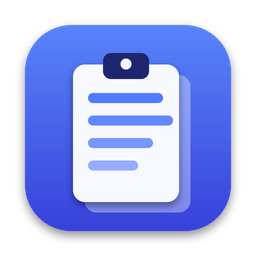
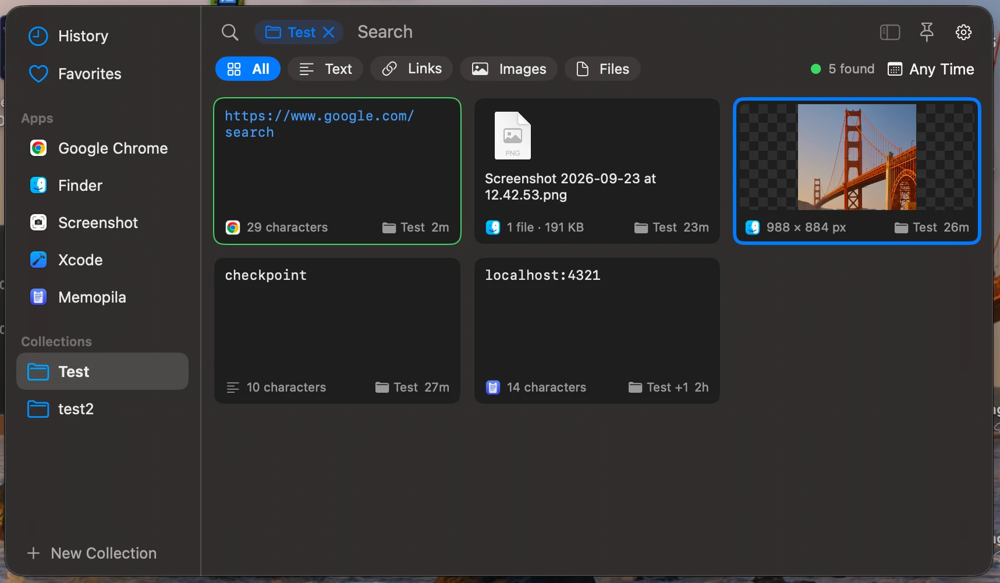

<div align="center">



# Memopila

**A native macOS clipboard manager: everything you copy, searchable and editable, and kept on your Mac.**

[](https://github.com/dan-leech/memopila/actions/workflows/ci.yml)
[](https://github.com/dan-leech/memopila/releases)


[**Download**](https://github.com/dan-leech/memopila/releases/latest) · [Website](https://dan-leech.github.io/memopila/) · [Design plan](docs/PLAN.md)

</div>

<p align="center">
  
</p>

Memopila lives in the menu bar and keeps a history of what you copy: text, rich text, links, images, PDFs, colours and files. Press **⌥⌘V**, find what you need, and press ↩. The record goes back on the clipboard and you are returned to the app you were in.

> [!NOTE]
> Memopila is young (0.x). Every v1 feature in the [plan](docs/PLAN.md) is implemented, but the per-macOS-version checks in PLAN §10 are still open, so expect rough edges.

## Features

### History and search
- **Menu bar app** with a floating history panel on **⌥⌘V** (you can change the shortcut). The panel does not take focus from your app, shows over full-screen apps, can be pinned open, and remembers its frame on each display.
- **Sidebar** with History, Favorites, source Apps and Collections. A **filter bar** filters by kind (text, links, images, files, colours) and by period.
- **Search** covers text, titles, text found in images, app names, source pages and file names, and highlights the matches on the cards.
- **Cards** in a grid you can resize (⌘+ / ⌘−). Drag a card into another app. A thin green line marks the card that is on the clipboard right now.
- **History on disk** (SwiftData). RAM holds only the visible cards and a small thumbnail cache.

### Capture you control
- **Duplicates are merged.** Copying the same thing again moves the existing record to the top.
- **Current — not saved** card: when a copy is too large, unsupported or failed, a red card says why and offers *Save Anyway* and per-app quick fixes.
- **Per-app settings:** *Don't save*, *Delete after*, size limit, text recognition, source page, and format rules (keep or skip types per app, e.g. for Photoshop). Each is two clicks away from any card. A clipboard inspector shows what an app actually puts on the clipboard.
- **Pause capture** (5 min, 15 min, 1 hour or until you resume) and **Skip next copy**, from the menu or optional hotkeys.
- **Sensible retention:** by default 500 items, 30 days and 512 MB of stored data. Favorites are never deleted automatically.

### Edit Record
- One window to view and edit any record:
  - formatted text, edited with its formatting kept;
  - syntax highlighting while you type, line numbers for code, and invisible characters;
  - files through Quick Look;
  - colours as HEX / RGB / HSL;
  - links with *Open*.
- *Changes…* compares your edits with the saved text, and the standard *Save / Don't Save / Cancel* sheet keeps you from losing them.
- **Text in images** is recognized on device (Vision) and is searchable. Copy part of it or all of it as a new card.
- **Copied from <page>** for copies from a browser.

### Organize and transform
- **Favorites**, **Collections** and custom **titles**.
- **⌘K actions panel** with every action for the selected card.
- **Duplicate As:** plain text, text from an image, or a text action (trim, change case, sort lines, remove duplicate lines, format or minify JSON, URL and Base64 encode or decode). The result becomes a new card.
- **Select several cards** to favorite or delete them together. *Undo* is available after a delete.

### Everyday comfort
- **Choose for Clipboard** (double-click, ↩ or ⌘1…⌘9) puts a record on the clipboard and takes you back to your app.
- Optional **auto-paste** after choosing (needs Accessibility).
- Launch at login, tooltips on every control, and a full keyboard map.
- English and Russian.

## Install

1. Download `Memopila-<version>.zip` (or the `.dmg`) from the [latest release](https://github.com/dan-leech/memopila/releases/latest). Pre-releases are listed on the [Releases](https://github.com/dan-leech/memopila/releases) page.
2. Unzip it and move **Memopila.app** to **/Applications**.
3. **First launch of an unsigned build.** Releases built without a Developer ID certificate are signed ad hoc, and Gatekeeper blocks them at first. Since macOS 15, right-click → **Open** no longer gets past it. Use either of these:
   - Open Memopila once and click **Done** when macOS says it was not opened. Then open **System Settings → Privacy & Security**, scroll to *Security* and click **Open Anyway** next to the Memopila message. Confirm with your password, then click **Open Anyway** again. The button stays for about an hour after the blocked attempt.
   - Or, before the first launch, clear the quarantine flag in Terminal:

     ```sh
     xattr -dr com.apple.quarantine /Applications/Memopila.app
     ```

4. **Allow clipboard access.** Choose **Enable Capture** in the panel banner or the menu bar menu. When macOS asks whether Memopila may read the clipboard, choose **Always Allow**. If capture stays paused, open **System Settings → Privacy & Security** and set Memopila to *Always Allow*.
5. **Optional: Accessibility.** This is needed only for *Settings → General → Auto-Paste After Choosing → Paste into the app you were in* and for ⌥↩. Memopila asks for it when you turn the option on. You can also add it in **System Settings → Privacy & Security → Accessibility**.

> [!IMPORTANT]
> macOS ties clipboard access and Accessibility to the app's signature, and an unsigned (ad-hoc signed) build gets a new one with every release. After an update you may need to choose **Always Allow** again. If you use auto-paste, remove Memopila from the Accessibility list and add it back.

Only one app can hold **⌥⌘V**. Quit Pasta (or any other app using that shortcut) first, or pick another shortcut in Settings → General.

## Build from source

Requirements: Xcode 26 or later, which needs macOS 15.6 or later. The app itself runs on macOS 15.4 or later.

1. Open `App/Memopila.xcodeproj`.
2. Target **Memopila** → *Signing & Capabilities* → choose your **Team** (a free Apple ID personal team is enough). Use a stable Apple Development identity rather than *Sign to Run Locally*: macOS ties the clipboard access choice to the app's signature.
3. Run. The panel opens and Memopila appears in the menu bar. A click on the icon opens the panel; a right-click shows a short menu. If the icon is missing, the menu bar is full: on a Mac with a notch, icons that do not fit are hidden. ⌥⌘V, or opening Memopila again from Finder or Spotlight, still opens the panel, and Diagnostics shows where the icon is.
4. Quit Pasta first, or pick another shortcut in Settings. Only one app can hold ⌥⌘V.
5. On first launch choose **Enable Capture** (menu bar menu or the panel banner). If macOS asks about clipboard access, allow it. If capture stays paused, open System Settings → Privacy & Security and set Memopila to *Always Allow*.

Settings → **Apps** and the **Rules for <App> ▸** submenu on each card hold per-app settings. Settings → **Apps → All Apps** has the size limit, global format rules and **Inspect** for the current clipboard.

Gear menu (or right-click on the menu bar icon) → **Diagnostics…** shows the clipboard access state. It also lets you probe single pasteboard calls (`changeCount`, `types`, content read) to see which ones trigger the system alert; these are the Phase 1 spike questions in PLAN §3.1. **Copy report** puts the results on the clipboard.

### Tests

The platform-independent core builds and tests on macOS and Linux. The services package (store, pasteboard, thumbnails, text recognition) builds and tests on macOS:

```sh
swift test --package-path Packages/MemopilaCore
swift test --package-path Packages/MemopilaServices
```

CI (`.github/workflows/ci.yml`) runs the core tests on Linux and macOS and the services tests on macOS, and builds the app with Xcode. Tagged versions are built, signed when credentials are configured, and published by `.github/workflows/release.yml`. The website in `site/` is deployed by `.github/workflows/pages.yml`.

### Layout

- `Packages/MemopilaCore`: capture decisions, canonical hashing, format policy, retention, text tools and code highlighting (no AppKit).
- `Packages/MemopilaServices`: SwiftData store, pasteboard reader and writer, thumbnails and text recognition (macOS).
- `App/`: the macOS app (SwiftUI + AppKit). Sources live in `App/Memopila` and are picked up by the Xcode project automatically.
- `site/`: the project website (one static page).
- `docs/PLAN.md`: the design.

## Keyboard shortcuts

| Keys | Action |
|------|--------|
| **⌥⌘V** | Open or close the panel (can be changed in Settings) |
| Typing / **⌘F** | Search |
| **↩** / double-click | Choose for Clipboard — go back to your app |
| **⌥↩** | Choose and Paste (Accessibility) |
| **⌘1 … ⌘9** | Choose for Clipboard: the first nine cards |
| **Space** / **⌘E** | Edit Record |
| **⌘K** | All actions for the card |
| **⌘D** | Add to or remove from Favorites |
| **⌘⌫** | Delete (with Undo) |
| **⌘P** | Pin the panel |
| **⌘.** | Pause or resume capture |
| **Esc** | Clear the search, then close |
| **⌘/** | Show all shortcuts |

The full keyboard map is in [PLAN §8.3](docs/PLAN.md#83-keyboard).

## Privacy

- **Local only.** History is stored in `~/Library/Application Support/Memopila/History.store` and settings in `UserDefaults`. There is no account, sync or cloud, and Memopila makes no network requests: no link previews, no analytics. Text in images is recognized on device.
- **Not encrypted at rest.** Local-only does not mean encrypted; use FileVault to protect the disk.
- **Password managers:** copies marked as concealed, transient or auto-generated (the `org.nspasteboard` markers password managers set) are never saved.
- **Secrets in plain copies:** tokens, private keys, JWTs and card numbers are recognized on your Mac. By default they are saved masked on the card and deleted after 8 hours. Settings → Privacy can switch to *Don't save* or *Save as usual*, change the time, or turn off single kinds. ⌘D keeps a secret for good. Detection is pattern-based and cannot catch every secret.
- **Pause** and **Skip next copy:** content copied while capture is paused or skipped is never read.
- **Universal Clipboard:** you can ignore content that comes from your other devices.
- **Accessibility** is used only for auto-paste (and, while it is allowed, to remember the title of the window you copied from).

> [!NOTE]
> Per-app settings such as *Don't save* identify the source app by the self-reported `org.nspasteboard.source` pasteboard marker when present, otherwise by the frontmost app at copy time. Neither is authenticated: another app can claim a different bundle ID, and a copy made in the background can be attributed to the wrong app. This is a convenience filter, not a security boundary. *Strict* mode skips copies without a valid marker whenever an app is set to *Don't save*. For one-off secrets use *Pause* or *Skip next copy*. Other clipboard managers may also compete for global hotkeys or pasteboard access.

## Design

The design, policies, contracts and v1 scope are in **[docs/PLAN.md](docs/PLAN.md)**.

## License

[MIT](LICENSE) © 2026 Daniil Kostin
