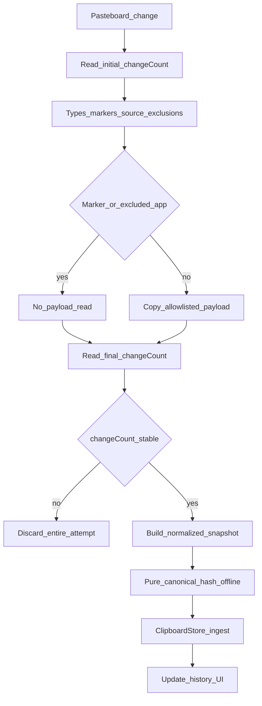
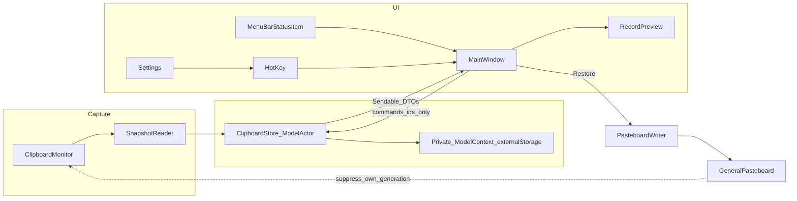

# Memopila — Clipboard Manager Plan

**Document type:** DESIGN  
**Status:** Accepted for v1 — ready to implement; payload backend gated on §3.5 spike (preferred: externalStorage, no BlobStore)  
**SSOT:** §3–§6 = normative contracts; §10 = phase done-when; §11 = test matrix by reference (do not restate contracts)  
**Product:** Memopila — native macOS clipboard manager (Pasta-like UI)

---

## 1. Goals and non-goals

### Goals (v1)

- Capture clipboard history as **deduplicated canonical snapshots** within an explicit UTI allowlist (text, rich text, URL, image, color, files).
- **Restore to Clipboard** without auto-paste: rewrite pasteboard, close window, return focus to the previous app.
- Organize with **Favorites** and **Tags** (many-to-many); search, sort, filter by source, type, tag.
- Run as a **menu-bar** app with configurable hotkey (default ⌥⌘V); optional Dock.
- Respect privacy: local-only data, exclude apps, skip transient/concealed/auto-generated markers, handle pasteboard access policy (**Capture paused**).
- Deduplicate by canonical content hash; retain by **age** and by **`maxCount` on non-favorites only** (favorites outside the count cap).

### Non-goals (v1)

- Auto-rules, payload editing, snippets.
- OCR, eyedropper-from-image, lock, export/import, iCloud sync.
- Accessibility auto-paste, Quick Look panel, text transforms, drag-out to other apps, undo-delete.
- Notarized / Mac App Store distribution; **App Sandbox off** for v1 source builds.
- Reading file contents from disk into history (never — scoped rule §3.3; other items’ image bytes may still be stored).
- Claiming complete automatic protection against all secrets (absence of markers ≠ safe content).

---

## 2. Policies

| Policy | Decision |
|--------|----------|
| **Data** | Local only under Application Support; no account, sync, or cloud |
| **Distribution (v1)** | Build and run from source (Xcode); no notarization, no MAS. Downloadable binary is a separate later deliverable |
| **Sandbox** | **Not sandboxed** in v1. Store file **URLs/paths** for restore to pasteboard; do **not** rely on security-scoped bookmarks. Bookmarks are out of v1 unless a future sandboxed distribution requires them |
| **Stack** | SwiftUI + AppKit; macOS 14+ (pasteboard-access APIs when on 15.4+) |
| **Payload persistence** | **Preferred v1:** one versioned `payloadPackage: Data` on `ClipboardRecord` with `@Attribute(.externalStorage)` — **no** custom BlobStore. Custom BlobStore is a **fallback only** if the Phase 1 spike fails (§3.5) |
| **App presentation** | Menu-bar-first (`NSApplication.ActivationPolicy.accessory` / `LSUIElement`); Dock via activation-policy toggle — **Phase 1 spike** on macOS 14 and each concrete supported OS at release |
| **Hotkey** | Default **⌥⌘V**, rebindable; Carbon `RegisterEventHotKey` (no global key monitor / Accessibility). Rebind order: (1) if new equals current, no-op; (2) register **new** while **old remains active**; (3) on success unregister old; (4) on failure keep old active and show Settings error. If an API path requires unregistering old first, **re-register old** on new-register failure |

---

## 3. P0 contracts

### 3.1 Pasteboard access and privacy

#### Access behavior (`NSPasteboard.AccessBehavior`, macOS 15.4+)

`accessBehavior` is the **current access policy**, not a per-read callback. An empty `items` list must **not** be treated as proof of denial.

| API state | App behavior |
|-----------|--------------|
| `.default` | **Bootstrap only** (below) — not a full `SnapshotReader` pass. Do **not** run continuous content polling |
| `.ask` | **No payload reads / no repeating polling.** **Capture paused**; explain that continuous capture needs silent access (`.alwaysAllow`) via System Settings. Must **not** create a loop of prompts |
| `.alwaysAllow` | Continuous background capture / polling (250 ms) without further system prompts |
| `.alwaysDeny` | Capture stopped; show **Capture paused** |
| macOS &lt; 15.4 | Do not call unavailable APIs; use the compatible read path (no accessBehavior) |

**Bootstrap when `accessBehavior == .default`:**

1. Perform **only the minimum** pasteboard access needed to trigger the system access prompt (e.g. a trivial types peek). **Do not** read payload representations, run full marker/source/payload `SnapshotReader`, or persist a snapshot.
2. Re-read `accessBehavior` after that attempt.
3. Start `SnapshotReader` / continuous polling **only** when `accessBehavior == .alwaysAllow`.
4. If `.ask` or `.alwaysDeny` → **Capture paused** without another read attempt.
5. **Never** resume payload reads under `.ask` without a silent-access grant (`.alwaysAllow`).

- Explain in UI why Memopila reads the clipboard in the background and why silent access is required for continuous capture.
- After returning from System Settings, **re-check** `accessBehavior` and resume polling **only** when actually `.alwaysAllow`. Resume must not promise success.

**Runtime policy re-check (continuous capture):** `accessBehavior` can change while the app runs in the background (user edits System Settings). It is a **current policy**, not a callback — a successful check at reader **start** does not guarantee policy at reader **end**.

1. On each monitor wake intended for continuous capture, re-read `accessBehavior` **before** any pasteboard content/`changeCount` access.
2. If it is no longer `.alwaysAllow` → **Capture paused** (`.ask` / `.alwaysDeny`); for `.default` run **bootstrap only**. Do **not** run the 250 ms content poll loop (no periodic `changeCount` reads, no `SnapshotReader`).
3. **Access during in-flight read (§3.2):** (a) re-check before the **final** `changeCount` read → `policyRevoked` without that read if needed; (b) **post-read access gate** after the reader returns and **before** ingest/pending/handled. Either failure discards the attempt and releases the slot; the same count stays eligible after `.alwaysAllow` returns.
4. Resume continuous **reading** only after a re-check shows `.alwaysAllow` again — typically when returning from System Settings or on app activation. Policy-only re-check allowed. Clear/Delete may use a **one-shot boundary `changeCount`** while Capture paused (§3.2).
5. **Pending Retry is not a pasteboard read** (§3.2): timer must not skip Retry when continuous capture is disallowed; `.ask` alone must not block pending save. v1 does **not** invalidate pending on access revoke.

**Acceptance:** bootstrap does **not** invoke full `SnapshotReader` / persist; **manual** OS dialog on 15.4+; `.ask` / `.alwaysDeny` start neither `SnapshotReader` nor periodic pasteboard/`changeCount` polling; mid-read policy drop → discard before ingest/pending; pending Retry may still persist under `.ask`; runtime `.alwaysAllow` → `.ask` stops **new** content polling until `.alwaysAllow` again.

#### Marker types (check **before** reading other representations when possible)

Conventions from [nspasteboard.org](https://nspasteboard.org). v1 **skips the entire pasteboard change** (no payload, no preview, no record) if any marker in Transient, Confidential, or Auto-generated is present.

| Class | Identifiers (complete v1 table — each needs a test) | Rule |
|-------|------------------------------------------------------|------|
| Transient | `org.nspasteboard.TransientType`, `de.petermaurer.TransientPasteboardType`, `com.typeit4me.clipping`, `Pasteboard generator type` | Do not save |
| Confidential | `org.nspasteboard.ConcealedType`, `com.agilebits.onepassword` | Do not save |
| Auto-generated | `org.nspasteboard.AutoGeneratedType` | Do not save |
| Source metadata | `org.nspasteboard.source` | Not a skip marker — attribution only (§5); not payload; not in contentHash |

- Lack of a marker does **not** guarantee content is not a password or secret. Do not claim full automatic secret protection.
- Also: **exclude apps**, Capture paused, local-only data policy.

**Tests required:** one automated case **per identifier** in the Transient, Confidential, and Auto-generated rows above (not one stub per abstract class).

### 3.2 Unit of storage = deduplicated canonical snapshot

- `ClipboardRecord` represents **one deduplicated canonical snapshot identity**. `copyCount` counts **observed captures** of that identity; it is **not** a guaranteed count of all user Copy operations (polling may coalesce intermediate copies; dedup merges identical content).
- Persist **all allowlisted** pasteboard items and **all allowlisted representations per item**, in **original order**, except file coalesce / file+image rules in §3.3.
- Completeness means **within the allowlist**, not arbitrary unknown UTIs.
- `displayType` (`text` / `richText` / `url` / `image` / `color` / `file` / `mixed`) is for **classification and UI only** — never discard other allowlisted representations because of it.
- SwiftData holds metadata + **`payloadPackage`** (`Data`, `@Attribute(.externalStorage)`) — one versioned package of all allowlisted representations (§3.5).
- Multi-file Copy → one record; multiple paths may live inside one representation on one item (§3.3) — not a single root `filePath?`, and not one item per path unless the pasteboard was structured that way.
- `SnapshotReader` must **immediately copy** needed data into Memopila’s own model. Do **not** retain `NSPasteboardItem` instances (they become invalid after ownership change). Restore builds **new** pasteboard items from stored data.

#### In-read size budget (`maxSinglePayloadBytes`)

`maxSinglePayloadBytes` (default **50 MiB**, §6) limits the **accepted and durable** `payloadPackage` size (`Data.count` after encode). It is **not** a peak-RAM budget. `@Attribute(.externalStorage)` only affects how SwiftData stores the binary adjacent to the model — it does **not** cap memory while building the package.

**Guarantees:**

- Accepted/persisted packages stay ≤ the limit (after forecast + final package `Data.count` check).
- After an oversize forecast, **no further** allowlisted representations are read for that attempt.

**Non-guarantees (honest RAM):**

- Peak RSS is **not** bounded by 50 MiB and is **not** “limit + one representation.” During one ingest, memory may simultaneously hold SnapshotReader copies of all accepted representations, the encoded `payloadPackage`, and codec temporaries — peak can exceed the package limit by roughly **a full package plus extra copies**, depending on implementation.
- `NSPasteboardItem.data(forType:)` may materialize a full representation `Data` before size is known.
- Package-framing overhead is included in forecasts; still not a kernel memory cap.
- Phase 1 spike **measures** peak RSS near a 50 MiB package; streaming is out of v1 unless that measurement is unacceptable.

**Procedure:**

1. Maintain a running **forecast** of canonical package size: accepted payload bytes so far **plus** predicted framing (item/representation counts already seen, UTI string lengths, length fields, `CanonicalFileListV1` path bytes, estimated package-codec overhead).
2. Before requesting the next allowlisted representation: if `forecast + lowerBoundForNextType` would exceed the limit → **stop** further reads, discard snapshot, finish changeCount guard, do not persist.
3. After each successful read: add actual bytes + framing deltas to the forecast; if over limit → abort as above (do not read subsequent representations).
4. Use **incremental** SHA-256 over canonical framing (§4); do not build one giant concat buffer solely for hashing.
5. After assembling the final `payloadPackage` `Data`, **re-check** `Data.count`; reject if over the limit.

**Required test:** several representations each individually under the limit, but cumulative forecast over the limit → snapshot not persisted and **later** representations are not read.

#### Pasteboard stability during read (markers inside the guard)

All pasteboard observation for one ingest — types, markers, source metadata, exclusions, and payload copy — happens **inside** one changeCount-guarded operation. Do **not** check markers outside this window (a Concealed change between an early marker peek and a later payload read must not be persisted).

1. Read **initial** `changeCount`.
2. **Once:** read types on **every** `NSPasteboardItem`; classify Transient / Confidential / Auto-generated markers and other types. Any forbidding marker (§3.1) on **any** item forbids the **whole** change — decide admit/skip **before** any payload read (do not re-scan markers later).
3. Read source metadata; resolve **admission source** and optional **display source** per §5.
4. Apply exclude-apps (**fail-closed**, §5) using **admission source only**.
5. If a forbidding marker **or** exclude-skip applies → do **not** read payload; still complete the guard (final `changeCount` only after the pre-final access check below); on stable skip, mark `changeCount` handled (§3.2 polling) only if post-read access gate passes.
6. Otherwise → copy allowlisted representations into an owned snapshot (file coalesce / framing per §3.3–§4), applying the **in-read size budget** (above); abort accumulation if over limit.
7. **Before final `changeCount` read (15.4+):** re-check `accessBehavior`. If no longer `.alwaysAllow` → return **`policyRevoked`** (stability **not** checked); discard the entire attempt; **do not** read final `changeCount`; no ingest / pending / handled mark; release slot via Monitor reconciliation. (A race remains between this check and the final read; do not widen it.)
8. Else read **final** `changeCount`.
9. If final ≠ initial → **discard** everything obtained in this attempt — never persist a partial/mixed result; do **not** update `lastHandledChangeCount` to the new final value.
10. On stable success, intentional skip, or stable read-failure outcome → run the **post-read access gate** (§3.2) **before** any ingest / pending / handled update. Only if the gate passes, apply ingest-outcome rules.

Self-write suppression for `PasteboardWriter` remains a separate rule (confirmed `changeCount` token only, §3.4).

**Marker tests:** (1) `ConcealedType` only on the second item → no payload read for any item; (2) marker on one item, stable `changeCount` → whole change skipped and marked handled.

#### Ingest outcome vs `lastHandledChangeCount`

Separate **read/skip completion** from **persist success**:

| Outcome | Mark `changeCount` handled? | Re-read same count on next ticks? |
|---------|------------------------------|-----------------------------------|
| Intentional policy skip (marker, exclusion, oversize forecast, unsupported-only, empty) | Yes (if stable **and** post-read access gate passed) | No |
| Declared allowlisted representation present but **read fails** (stable `changeCount`) | Yes (if post-read access gate passed) | **No** — discard entire snapshot; do **not** auto-retry SnapshotReader on the same count |
| Post-read access gate fails (policy no longer `.alwaysAllow`) | **No** | Yes — same count remains eligible after access returns; no pending |
| Store result **`rejected`** (deterministic, e.g. quota) after stable read | Yes | No |
| Store result **`notCommitted(retryable)`** after stable owned snapshot | Yes (stable read done) | **No** SnapshotReader loop. Keep sole **pending**; bounded Store Retry / user Retry / Dismiss |
| Store result **`committed`** | Yes | No — **consume pending**; do **not** Retry ingest |
| Store result **`indeterminate`** (commit outcome unknown) | Yes (stable read done) | No SnapshotReader loop. **Keep pending but do not auto/manual Retry** until resolved (below) |
| Mid-read unstable `changeCount` / **`policyRevoked`** before final count | No | Eligible again when continuous capture allowed |

**Owned snapshot timestamps:** when the changeCount guard completes successfully (stable read or stable intentional skip with an owned copy), freeze **`observedAt`** on that owned snapshot. Every automatic and user **Retry** of `ClipboardStore.ingest` must use that original `observedAt` and the same payload bytes — never the retry wall-clock. New-record timestamps and dedup metadata merges follow §4 (`min`/`max` with existing fields so a late retry cannot roll `lastCopiedAt` backward).

**Pending retry ownership (v1 — no `observationID` table):** `observedAt` alone does not identify an observation for store-level idempotency. One owner (typically `ClipboardMonitor`) holds at most **one** pending owned snapshot for retry. **Pending has priority over new captures:**

- Automatic retries of that snapshot run **sequentially** (no overlapping ingest of the same pending instance).
- The **Retry** control is disabled while an ingest of that pending snapshot is in flight, and **no** new Retry (auto or manual) may start while a Clear/Delete destructive pause is active (§3.2).
- **Admission for Retry ≠ admission for SnapshotReader** (same capture slot, different start conditions):

| Operation | May start when |
|-----------|----------------|
| New `SnapshotReader` | No destructive pause; slot free; epoch/ownership OK; continuous capture allowed (`.alwaysAllow` on 15.4+) |
| Retry of owned pending | No destructive pause; pending still owned by this operation; slot free; epoch/ownership OK — **not** gated on `.alwaysAllow` |

  `.ask` alone must not block disk-only Retry of already-copied bytes. Access revoke does **not** auto-invalidate pending in v1.
- On Store result **`committed`**, **consume** pending (no re-ingest). On **`notCommitted(retryable)`**, keep pending. On **`rejected`**, do not Retry that observation. On **`indeterminate`**, keep pending but block Retry until resolved.
- **Automatic Retry budget (v1):** at most **3** automatic attempts after the initial failed ingest (4 Store calls total including the first), with backoff **≈ 0.5 s, 2 s, 8 s** (exact jitter optional). The budget is **per pending snapshot** and is **not** reset by a manual Retry. After exhaustion → **no further automatic** Retry; pending remains for **manual Retry** / **Dismiss** and still **blocks new SnapshotReader**. A failed manual Retry that returns `notCommitted(retryable)` leaves pending in place **without** restarting the auto cycle. For **`indeterminate`**, both auto and manual Retry stay blocked; UI shows a **distinct** indeterminate state (not a normal save-error with Retry) with Dismiss / Clear / recovery actions only. Destructive pause still forbids starting Retry.
- **Dismiss** clears pending without ingest.
- **Process-local pending (v1):** pending lives **only in memory** for the current process. It is **not** crash-durable — no persisted retry queue / observation ID table. If the app crashes or is killed while A is pending, A may be lost even though the user did not Clear/Delete; on next launch Memopila captures from the **current** pasteboard only and does **not** recover intermediate clipboard states from while it was down. “A is not silently dropped for B” applies **within** a running process (pending ownership), not across restarts.
- **While pending exists:** do **not** invoke `SnapshotReader` for any newer `changeCount`. Under continuous capture, do not read new payloads, replace pending A with B, or enqueue a second snapshot. Within a running process, already-read A is not silently dropped for B except Clear/Delete invalidation.
- **After** pending is consumed or dismissed: next poll may process current pasteboard if continuous capture is allowed and `changeCount != lastHandledChangeCount`.
- UI must show an explicit **save / retry** status while pending blocks capture.
- Only after pending is clear may a **new** stable read create a new owned snapshot.

**First capture after process launch (v1):**

`lastHandledChangeCount`, pending, and suppression tokens are **process-local** — not persisted. After quit/relaunch the Monitor does **not** know whether the current pasteboard was already observed by a previous process.

- **Do not** persist `lastHandledChangeCount` in v1 (no cross-launch reconciliation of the pasteboard counter).
- When continuous capture becomes eligible after launch (including first `.alwaysAllow` wake), treat the **current** pasteboard as **one normal observation** if it passes the usual gates (markers, exclusions, size, changeCount stability, post-read access). Seed `lastHandledChangeCount` only from outcomes of **this** process.
- **Documented consequence:** if content A was already saved, the user quits and relaunches without copying again, the first successful observation of unchanged A may **dedup-hit and increment `copyCount`**. That is accepted: `copyCount` counts **observed captures**, not physical Copy keypresses.
- Do **not** invent silent “skip whatever is on the pasteboard at launch” without an explicit later design for persisted handled-count semantics.

**Explicit clear / delete vs in-flight capture** (no job queue):

**Authoritative capture generation lives on `ClipboardStore`** (same serial owner as ingest / Clear). `ModelActor` serializes the store’s `ModelContext`, **not** `ClipboardMonitor` fields (`lastHandledChangeCount`, pending, pause). Store generation checks alone do **not** protect monitor side effects after `await`.

**Store generation (Clear only):**

1. Before starting a reader, monitor obtains the current generation from the store; the owned snapshot / operation carries that **operation generation**.
2. `ClipboardStore.ingest` re-checks generation **inside** its serialized mutation (**no `await`** between check and commit). Stale → reject.
3. **Do not** bump generation on Manual Delete.

**Capture slot stages + `captureEpoch` (v1):**

One capture slot; stages **`preStart`** | **`active`**. Each reservation has an **owner id**. Releasing the slot when reader *starts* (without keeping single-flight through reconciliation) is forbidden — that would allow a second ingest while the first still reconciles.

| Stage | Meaning |
|-------|---------|
| `preStart` | Slot reserved; awaiting eligibility; **reader/Retry not started** |
| `active` | `SnapshotReader` or pending **Retry** started; includes Store call + monitor reconciliation |

1. **Reserve** before the first `await` (poll, auto Retry, or manual Retry) → stage `preStart`, record owner id + epoch at reservation.
2. On successful start of reader/Retry → transition **`preStart` → `active`** (same owner). Keep the slot until reconciliation finishes. While held (`preStart` or `active`): no second reader/Retry/`captureGeneration` wait.
3. **Release** only when: (a) `preStart` is **revoked** (below), (b) `preStart` aborts before start, or (c) `active` reconciliation completes. On release, the task must verify it still **owns** the slot; a late task must **not** free a slot already owned by a newer reservation.
4. **`captureEpoch`:** bump on **entry** to Clear/Delete (with pause). Do **not** apply one stale-epoch rule to both stages:

| State when Clear/Delete enters | Rule |
|--------------------------------|------|
| Slot in **`preStart`** | **Revoke** that reservation immediately. Late continuation: epoch/ownership mismatch → **inert** — no Monitor mutations, no reader/Retry start, **must not** release a slot it no longer owns. |
| Slot in **`active`** | **Do not** cancel required reconciliation solely because epoch changed. Finish Store result + monitor reconciliation (may temporarily re-arm pending during Clear drain). Destructive pause still forbids **starting** a new capture/Retry. After drain, Clear/Delete apply invalidate + barrier as usual. |
| After destructive workflow ends, old **`preStart`** resumes | Checks epoch + ownership → stops with no side effects. |

5. **Post-await gate before `preStart` → `active`** (no `await` between this gate and the stage transition; same serialized Monitor executor as token + slot). Shared checks: epoch/ownership; no destructive pause; this task still owns the reservation.

   - **New `SnapshotReader` path:** also require continuous capture (`.alwaysAllow` on 15.4+); re-read `changeCount`; apply **suppression token (§3.4)** (match → handle+consume, no reader; differ → discard token); if eligible → `active` + start reader.
   - **Pending Retry path:** require owning the pending snapshot and no other active Retry; **do not** require `.alwaysAllow` / continuous capture; **do not** re-read pasteboard for admission. If eligible → `active` + start `ClipboardStore.ingest` of the owned snapshot (no `SnapshotReader`).

6. **Post-read access gate (macOS 15.4+, SnapshotReader `active` only) — mandatory algorithm:**

   1. `SnapshotReader` returns (stable success, intentional skip, **or** representation read failure) with changeCount stability known.
   2. **Immediately** re-read `accessBehavior` (policy property, not a change callback).
   3. If still `.alwaysAllow` → proceed to mark handled / ingest / pending per ingest-outcome table.
   4. If **not** `.alwaysAllow` → **discard** the entire result: **no** `ClipboardStore.ingest`, **no** pending, **no** `lastHandledChangeCount` change (do **not** classify a read failure here as a stable handled skip). Reconcile and **release** the capture slot.
   5. After access returns to `.alwaysAllow`, the same pasteboard `changeCount` remains eligible for a **new** read attempt.

   This gate does **not** apply to pending Retry (in-memory snapshot; no pasteboard read). Pre-start access check alone is **insufficient**.

7. **`ClipboardStore.ingest` results** (conceptual; Monitor reconciles only on these):

| Result | Meaning | Monitor |
|--------|---------|---------|
| **`committed`** | SwiftData insert/update for this observation is durable | Consume pending; **no** Retry; `copyCount` applied once |
| **`rejected`** | Deterministic refusal (quota, etc.); nothing committed | No Retry; mark handled per table |
| **`notCommitted(retryable)`** | Transaction **did not** commit (or rolled back); safe to Retry | Keep/create pending; bounded Retry |
| **`indeterminate`** | Commit success/failure **cannot** be known | Keep pending; **block auto and manual Retry** until resolved (Dismiss, Clear, or explicit recovery that proves no duplicate identity commit). Never treat as `notCommitted` automatically |

   **v1 implementation preference:** use SwiftData so each save path yields a definite `committed` or rolled-back `notCommitted`/`rejected` (with explicit `rollback()` on failure). Reserve **`indeterminate`** for true ambiguity only.

   Under preferred **externalStorage**: metadata + `payloadPackage` commit/rollback together — no separate post-commit file-delete success path. Treat rare commit ambiguity as **`indeterminate`**. (If BlobStore fallback is active, see §3.5 fallback notes for promote/orphan rules.)

8. Store generation remains authoritative for **commit**; epoch + staged slot protect **monitor** scheduling.

**Async continuations:**

- **`preStart`:** after `await`, apply the post-await gate (reader vs Retry branches). Epoch/ownership failure → inert abort.
- **`active` (reader):** pre-final access check → final `changeCount` → post-read access gate → Store; reconcile on Store results above (incl. `indeterminate`).
- **`active` (any):** after Store returns, **must** run reconciliation to free the slot. Clear/Delete drain rules unchanged. Must **not** schedule a **new** Retry while destructive pause is active.
- On Clear success: update known store generation; apply **`countAtClearStart` barrier** (below); then clear pause.

**Serialize Clear/Delete (v1 = reject busy):** at most one destructive workflow; second command → busy (no queue). UI disabled until done. Resume only when the owning protocol finishes.

**`activeCapture`:** slot stage **`active`** — from reader/Retry **start** through Store return and monitor reconciliation. Destructive **drain** waits only for **`active`** (and after revoking any `preStart`). Poll / auto Retry / manual Retry share this coordination.

**While Clear/Delete pause is active:** forbid new readers, new Retries, and new slot reservations.

**Pasteboard `changeCount` for Clear/Delete when continuous capture is paused (v1):**

Clear/Delete are **user-initiated** history actions, not continuous capture. On 15.4+ under `.ask` / `.alwaysDeny`, the monitor still must not run the 250 ms content poll, but **may perform a one-shot boundary read of `changeCount` only** (not payload / not full `SnapshotReader`) at Clear/Delete start and when applying the barrier — solely to implement `countAtClearStart` / `countAtDelete` / deferred barrier. This is an explicit exception to “no pasteboard access while Capture paused,” limited to that counter.

**Barrier tradeoff (explicit — cannot promise both):**

| Start `changeCount` | Barrier rule |
|---------------------|--------------|
| **Known** (`countAtOpStart`) | On success (or deferred wake): `lastHandledChangeCount = max(lastHandledChangeCount, countAtOpStart)`. Pre-op A is suppressed; post-op **B** (newer than start) stays capturable. |
| **Unknown** (one-shot read failed) | Set `deferredBarrierPending = true` **without** advancing `lastHandledChangeCount`. On later wake: **do not** apply “current count as last resort.” Leave handled-count unchanged for this op. **v1 priority: never suppress B by guessing.** Cost: pre-op **A** may be re-captured (dedup / `copyCount` bump). Document in diagnostics. |

Do **not** claim both “no re-capture of A” and “never lose B” when the start count was unavailable.

**Clear History protocol (pause → revoke preStart → drain active → invalidate pending → clear → barrier → resume):**

Scope is an **explicit Store argument**, not an implied UI flag:

| Scope | Deletes |
|-------|---------|
| **`.nonFavorites`** (UI default) | All non-favorite `ClipboardRecord` (+ their `RecordTag` in the same transaction) |
| **`.all`** | All records including favorites (+ all their `RecordTag`) |

Both scopes use the **same** pause → revoke → drain → invalidate pending → commit → barrier → resume protocol.

1. Busy reject if another destructive workflow is active. Else enter with chosen **scope**; bump **`captureEpoch`**; set pause.
2. Record **`countAtClearStart`** via the boundary `changeCount` rule above (when available).
3. If slot is **`preStart`** → **revoke** it. If slot is **`active`** → **drain** full reconciliation (Retry may temporarily re-arm pending).
4. After drain (and any revoke): invalidate **all** pending.
5. **One** Store call: bump generation **and** SwiftData delete for **`scope`** in the same serialized mutation. Generation bumps **only** on successful commit.
6. **Success / error (Store):** on success, update known store generation; apply barrier per tradeoff table (`countAtClearStart` when known; never “current count after clear”; never current-count last resort). On commit failure: no success claim; UI error; history remains; pending stays invalidated; **no** generation bump.
7. Clear pause and busy on any exit. Newer counts after `countAtClearStart` remain capturable after resume.

**Manual Delete protocol (pause → revoke preStart → drain active → delete → resume — no store generation bump):**

1. Busy reject if another destructive workflow is active. Else enter; bump **`captureEpoch`**; set pause.
2. Record **`countAtDelete`** via the boundary `changeCount` rule (when available).
3. Revoke **`preStart`** if any; else drain **`active`** to full reconciliation.
4. Invalidate **matching** pending only; keep unrelated pending B.
5. Store delete after step 3–4.
6. **Success / error:** apply barrier per tradeoff table (`countAtDelete` when known). On **SwiftData delete commit success**: UI success (payload removed with the record under externalStorage). On **commit failure**: UI error; record stays; matching pending stays invalidated. Clear pause and busy. Newer counts after Delete start remain capturable.

**Required tests:**

**Pre-start:**

- Poll reserved slot, awaits `captureGeneration`; Clear revokes reservation and completes (barrier = B); late poll must not start reader or mutate Monitor; must not free a newer owner’s slot.
- Poll awaits `captureGeneration`; Manual Delete finishes first → deleted A not resurrected.
- Two ticks race `captureGeneration` → at most one reservation / one reader path.
- Poll awaits `captureGeneration`; Restore completes and publishes a confirmed token; after resume, poll must **not** start reader, token is consumed **once**, Restore must not bump `copyCount`.

**Active capture:**

- Reader A already running; Clear starts → Clear waits for full reconciliation of A, then invalidates pending, clears, sets barrier; A does not return.
- Retry A running; Clear → Retry finishes reconciliation (may temp re-arm pending); Clear invalidates pending after drain; A gone.
- Retry A running; Delete A → Delete waits for reconciliation, invalidates pending A, deletes; A does not return.
- A reading / ingest delayed; pasteboard → B → second reader must not start until A reconciles.
- Retry A active; timer + second Retry → no parallel ingest of same pending.
- Transition `preStart`→`active` concurrent with Delete/Clear entry → either atomically becomes drainable `active` or stays revoked `preStart`; destructive workflow must not miss an `active` op.
- Start read under `.alwaysAllow`, delay `SnapshotReader` return, switch policy to `.ask`, then complete read → **post-read gate**: no ingest, no pending, `lastHandledChangeCount` unchanged, slot released; after `.alwaysAllow` returns, same count remains eligible.
- Snapshot A pending under `.alwaysAllow`, then policy → `.ask` → new `SnapshotReader` does not start; **automatic** and manual Retry A may finish persist without pasteboard access.
- Auto-Retry budget exhausted → no further auto ingest; pending remains; blocks new reader; manual Retry does **not** reset auto budget; failed manual leaves pending without auto restart; `indeterminate` UI without Retry.
- New record **`committed`**; victims deleted in same SwiftData transaction → no pending re-arm, no second `copyCount`.
- Failed ingest commit → history intact; `notCommitted(retryable)`; no Memopila-managed orphan path under externalStorage.
- `indeterminate` → pending kept, Retry blocked until resolved.
- Unreadable / MCS1 hash mismatch `payloadPackage` → Restore aborts before `clearContents`.
- Clear `.nonFavorites` vs `.all`: favorites preserved or removed; `RecordTag` same txn; generation only on commit success; B after known `countAtClearStart` still capturable; unknown start count → no current-count last-resort barrier.

**Other:**

- During Delete, newer count B is not suppressed by `countAtDelete` alone.
- During **successful** Clear, B copied mid-operation is **not** suppressed (`countAtClearStart`); same for **failed** Clear.
- Clear/Delete under `.ask`/`.alwaysDeny`: one-shot boundary `changeCount` only, or deferred barrier **without** current-count last resort; no payload poll.
- Second Clear/Delete → busy; UI blocked.
- Delete A pending-not-started / pending B preserved.
- Store clear/delete fails → pause/busy released; UI error; pending not revived; Clear uses `countAtClearStart` when known.

Do **not** require Clear to finish barrier while a **`preStart`** poll still holds the slot unreclaimed — Clear **revokes** `preStart` first. Do **not** cancel **`active`** reconciliation solely via epoch.

These protocols are the v1 contracts — not open alternatives.

#### Polling and change detection (when continuous capture is allowed)

- Default interval: **250 ms** (not user-configurable in v1) — only while continuous capture is allowed (`.alwaysAllow` on 15.4+; compatible path on older OS).
- **One** timer **and** **one** capture slot with stages `preStart` / `active` (§3.2) — a second tick must not start another poll/Retry while the slot is held.
- **History completeness limit:** polling observes discrete samples. Multiple copies between two polls may collapse into **one** observed pasteboard state. Memopila does **not** guarantee a history row for every intermediate copy.

**`ClipboardMonitor` change detection:**

1. Re-check `accessBehavior` (§3.1) **first**.
2. If continuous capture is **not** allowed → **skip the new-reader branch and all pasteboard content/`changeCount` polling** on this tick (Capture paused / bootstrap-only). Policy-only re-check on Settings return / activation may run without content reads. **However:** a **pending Store Retry** may still run on this wake if its own admission checks pass and no destructive pause is active (disk-only; no pasteboard read). Do **not** early-return from the whole timer handler in a way that skips that Retry path.
3. If **capture paused for clear/delete** → skip new reader; also skip new Retry (destructive pause).
4. If a **pending** owned snapshot exists and continuous capture is allowed → skip new reader this tick; Retry may still proceed under admission rules.
5. If capture slot busy (`preStart` or `active`) → skip starting another operation.
6. Else for **reader** path only when continuous capture allowed: reserve **`preStart`**; `await` store generation; **post-await gate**; maybe `active` + `SnapshotReader`. For **Retry** path when pending admits: reserve **`preStart`**; gate without pasteboard/`alwaysAllow`; `active` + ingest.
7. After `SnapshotReader` returns: pre-final access check → final count → **post-read access gate** → Store; reconcile on Store results (incl. `indeterminate`). Pending Retry skips pasteboard access gates.
8. Reconcile Monitor from Store result (`committed` consumes pending; `indeterminate` blocks Retry).
9. Mid-read instability / `policyRevoked` / post-read gate fail → discard without handled mark as specified; `preStart` stale epoch → inert.
10. Bootstrap under `.default` does not mark content handled. Timer-tick token handling under continuous capture follows §3.4.

**Acceptance:** ten unchanged ticks → no spam. Token in post-await gate; post-read + pre-final access gates; **automatic** pending Retry under `.ask`; Clear `countAtClearStart` (B mid-Clear captured after resume); Delete `countAtDelete`; busy Clear/Delete; Store error releases pause. `.ask`/`.alwaysDeny` → no periodic content poll / no new `SnapshotReader`.

### 3.2.1 Supported representations allowlist

| UTI / type | Action |
|------------|--------|
| `public.utf8-plain-text` / `public.plain-text` | Non-file: preserve original bytes + UTI; derive UTF-8 preview/search separately |
| `public.utf16-plain-text` | Non-file: preserve original bytes + UTI; derive UTF-8 for preview/search; restore original bytes under original UTI |
| `public.rtf` | Non-file: preserve original bytes + UTI |
| `public.html` | Non-file: preserve original bytes + UTI |
| `public.url` | Non-file: preserve original bytes + UTI |
| `public.file-url` | **File-reference exception** (§3.3) — not “preserve original bytes” |
| `public.tiff` / `public.png` / `public.jpeg` / `public.image` | Non-file: preserve original bytes + UTI |
| `com.apple.cocoa.pasteboard.color` | Non-file: preserve original bytes + UTI (sole color type in v1) |
| `NSFilenamesPboardType` | **File-reference exception** (§3.3). Deprecated; still **read** for compatibility. Restore behavior explicitly defined and tested (§3.3) |
| `org.nspasteboard.source` | Metadata only (§5); not payload; not in contentHash |
| Transient / Confidential / Auto-generated markers (§3.1) | Detect only; skip entire change |
| **Any other UTI** | **Skip** |
| **File promises** / deferred providers | **Skip** in v1 |

**Representation fidelity:**

- **Non-file payload representations:** preserve original bytes and original UTI. Derived UTF-8 (preview/search) is outside the restore path.
- **File-reference representations:** see §3.3 (normalized paths in package; reconstruct pasteboard data on restore; hash `CanonicalFileListV1`).

**Mixed content / read failures:**

| Case | Action |
|------|--------|
| Unsupported UTI (not on allowlist) | Skip that representation |
| Declared allowlisted representation present but **read fails** (nil/error **or** ObjC pasteboard exception — below) | **Discard the entire snapshot** — no persist; if `changeCount` stable, **mark handled** — no 250 ms re-read loop; **must not crash** the app |
| After filtering, an item has zero allowlisted representations | Omit that item (not counted in MCS1 `itemCount`, §4) |
| Whole pasteboard empty / markers-only / unsupported-only / excluded source / forbidding marker | Do not create a record |

**AppKit read errors:** Apple documents that some `NSPasteboard` data paths can raise `NSPasteboardCommunicationException` (Objective-C exception), not only return nil — and not all failures are Swift `Error`s caught by `do/catch`. Before implementing:

1. Prefer the concrete read API used by v1 (`NSPasteboardItem` data accessors vs pasteboard-level `data(forType:)`).
2. If that path can throw an ObjC exception → add a **narrow Objective-C boundary** that converts it into a read-failure result for that representation. Do **not** install a global app-wide exception catcher.
3. If the chosen path only returns nil/error without that exception → the discard contract above is enough.

**Test:** allowlisted read failure yields no partial record, marks handled when stable, and does **not** terminate the process.

### 3.3 Files: references only — live filesystem state

**Product rule (v1 — scoped, not omniscient):** Memopila **never reads file contents from disk** for history. It stores **path references** only for file representations. It **skips image UTIs on the same item** as file references (§3.3 coalesce). It **may** store image bytes from **other items** in the same pasteboard change when those items have no file refs — UTI alone cannot prove those pixels are (or are not) a copy of a referenced file. Do **not** claim “never any bytes that might equal a file on disk.” No path↔image matching heuristics in v1.

**v1 file fidelity (chosen contract):** fidelity is to **paths, path order, and Finder-usable restore** — **not** necessarily to the original pasteboard UTI or original item boundaries for file representations.

- On capture: read `public.file-url` and legacy `NSFilenamesPboardType` per the **file-representation coalesce** rules below; persist **one** ordered normalized path list in the package (§3.3.1). Do not store original filenames plist bytes.
- Hash **`CanonicalFileListV1`** (§4) — never original plist bytes, never file contents.
- On Restore: write that list **once** as a **canonical modern** set of file `URL`s (e.g. `writeObjects`). Integration-test with Finder. Original file UTI / multi-path-in-one-item shape may become one URL per object as AppKit writes them — that is accepted for v1.
- **Do not** persist provenance of whether the list came from multi-path vs single-URL representation (YAGNI: no v1 UI depends on it; path count ≠ provenance; MCS1 does not include such metadata).
- No security-scoped bookmarks in v1.

#### File-representation coalesce and MCS1 framing (same item)

One item may expose both `public.file-url` and `NSFilenamesPboardType`. Emitting URLs from **both** without rules can duplicate the same file on Restore, and §4 requires a single deterministic `typeIdBytes` + payload per representation slot in `CanonicalSnapshotEncodingV1`.

**Path list:**

1. Normalize each file representation to an ordered path list (§3.3.1).
2. If both are present and lists are **equal** → one list. If lists **differ** → use **`public.file-url`** only (ignore `NSFilenamesPboardType`). Do **not** union/concatenate.
3. Manifest / Restore emit that list **once**.

**Effective file UTI for MCS1 `typeIdBytes`:** if `public.file-url` is present on the item → use `public.file-url`; else → `NSFilenamesPboardType`. Payload bytes for that slot are `CanonicalFileListV1` of the chosen path list (§4).

**Representation order into MCS1 (per item, original pasteboard order):**

1. Walk representations in original order.
2. On the **first** file-reference type (`public.file-url` or `NSFilenamesPboardType`) → emit **one** file slot with the effective UTI + coalesced `CanonicalFileListV1`.
3. Skip the **second** file-reference type if present.
4. Skip image UTIs (`public.tiff` / `png` / `jpeg` / `image`) when any file-reference type is present on the item.
5. Emit every other allowlisted non-file representation in place (text / URL / RTF / HTML / color), preserving relative order among themselves and relative to the single file slot.

Example: types `[public.utf8-plain-text, NSFilenamesPboardType, public.file-url, public.html]` with equal path lists → MCS1 reps: utf8-plain-text, **`public.file-url` + CanonicalFileListV1** (at the NSFilenames position), html. NSFilenames slot is skipped as the second file type; effective UTI is still `public.file-url`.

**Unit tests (assert full canonical framing bytes, not only “no duplicate file”):** equal path lists; unequal lists (file-url wins); file types before/after text and HTML in different orders.

#### File refs + image UTIs on the same item

A UTI alone cannot tell whether image types on an item that also has file refs are independent pixels or a Finder preview. **v1:** skip image UTIs when any file-reference type is present (step 4 above). Image-only items (no file refs) store image bytes as usual.

#### Mixed file + non-file representations on one captured item

Capture stores the coalesced file list plus allowed non-file allowlisted representations for that item (subject to the image exception above).

**Restore rule (v1):**

1. Emit file URLs for the coalesced path list **once** (may expand to multiple pasteboard objects per §3.3).
2. **Also** restore every stored non-file allowlisted representation from that captured item — **do not drop** them because files were rewritten.
3. Placement when file expand changes item boundaries: attach non-file representations to the **first** restored file-URL item produced from that original item (deterministic). Document in tests.
4. Round-trip acceptance for “mixed content” includes: file path(s) + text/url (or other allowed non-file types) on one source item ⇒ restore yields usable file URL(s) **and** the non-file data — without duplicated paths from dual file UTIs.

| Pasteboard content | Stored as |
|--------------------|-----------|
| Finder copy of a `.png` on disk | Ordered normalized path reference(s) only (image UTI on same item skipped) |
| Screenshot / image *pixels* on the pasteboard (no file refs) | Image payload representation(s) inside `payloadPackage` |
| One item with file-url + plain text | Paths + plain text bytes in `payloadPackage`; restore = file URL(s) + text on first file item |
| One item with equal file-url + NSFilenames lists | One path list; Restore once |
| One item with unequal file-url + NSFilenames | Prefer file-url list only |

#### 3.3.1 Path normalization (single algorithm)

Applies to `public.file-url` and `NSFilenamesPboardType` before package storage, hash, and UI.

**Must not** use APIs that resolve symlinks or collapse `..` in ways that change path identity when a symlink may precede `..` (e.g. avoid `standardizingPath`).

| Input kind | Rule |
|------------|------|
| `file:` URL | Parse with Foundation `URL` APIs. Extract the decoded path **exactly once** (e.g. `path(percentEncoded: false)`). **Never** apply additional percent-decoding to the resulting path string |
| Legacy filename path string | Treat as a **filesystem path**, not a URL. **Do not** percent-decode |

Also (deterministic v1 — **no optional variants**):

1. **Do not** collapse `.` or `..` components. Keep the path string exactly as extracted above.
2. Encode that string as **UTF-8** for `CanonicalFileListV1` and display.
3. **Do not** resolve symlinks; **do not** read or compare file contents.
4. Preserve original order of paths within the representation.

Identical strings after these rules ⇒ identical `CanonicalFileListV1`.

**Required tests:** percent-encoded space in URL; filename whose **literal** name contains `%20` (must not be double-decoded); path with `.` and `..` left intact; path through a symlink unchanged as string; spaces and Unicode; same path via each file representation → identical normalized string and identical **`CanonicalFileListV1`** bytes (full `contentHash` may still differ if UTI/structure differs — §4 / Phase 2).

### 3.4 Restore to Clipboard (not paste)

User-facing name: **Restore to Clipboard** (or **Copy & Close**).

**Focus rules:**

- Remember the previous (frontmost) application **before** Memopila’s window becomes key.
- **Successful** Restore: write pasteboard → close window → return focus to previous app.
- **Esc**: close window **without** changing clipboard → return focus to previous app.
- **Pasteboard write failure**: keep window open; do not treat as restored; show an error.
- **Enter**: restores the selected card only when focus is in the **results grid**. Enter in the **Search** field must not restore.

On successful Restore (double-click or Enter in grid):

1. Write back saved allowlisted items + representations; set `org.nspasteboard.source` **once** (bundle ID or empty string per §5) — see **PasteboardWriter** below.
2. Close the history window.
3. Return focus to the previous application.
4. **Do not** synthesize ⌘V; **do not** use Accessibility for auto-paste.

#### PasteboardWriter contract

`writeObjects(_:)` **adds** objects; it does **not** remove existing pasteboard items. Restore must therefore **clear then write**. `clearContents()` returns the `changeCount` at the moment Memopila takes ownership — that value is the anchor for the suppression token. There is **no** atomic cross-app pasteboard transaction: checks shrink the race window and detect many external changes, but cannot guarantee no concurrent writer between check and the next call.

1. **Load & validate package in memory first** (may run off the Monitor executor): reject if `hashSchemeVersion != 1`; load/decode `payloadPackage` (§3.5 binary plist); enforce **`payloadSizeBytes == payloadPackage.count`**; recompute **MCS1** and match `contentHash`. Reject Restore (error, **no** pasteboard mutation) on any failure. Then build all allowlisted `NSPasteboardItem`s. Set **`org.nspasteboard.source` exactly once** on the **first** prepared item only (or pasteboard-level once).
2. **`restoreInProgress` barrier (locked inter-component mechanism):** on the Monitor executor that owns capture decisions, set **`restoreInProgress = true` before any pasteboard mutation**. While true, timer ticks and post-await gates **must not** start a new `SnapshotReader` / `preStart`→`active`. UI may prepare items off-executor; handoff into this section is a sync Monitor hop — **no `await` between barrier set and barrier clear** that could let a tick start a reader.
3. Under the barrier, in order: **`clearContents()` → `ownedCount`** → pre-write check (`changeCount == ownedCount` or abort) → **`writeObjects`** (require `true`) → **post-write confirmation** → **publish confirmed `ownedCount` token or decide no-token** → **`restoreInProgress = false`**. Clear the barrier on every exit (success, abort, write failure). Token is created **only** on confirmed match; unconfirmed → no token, barrier still cleared.
4. **Never** assign an unconfirmed `pasteboard.changeCount` as the token. Prefer not suppressing a possible self-write over losing another app’s content.
5. **Write / abort failure:** show an error; keep the history window open; do **not** close or return focus as if restored. Do **not** claim prior clipboard contents were preserved.

**Suppression token lifecycle** (`ClipboardMonitor`; `changeCount` is an ownership counter, not a Memopila lock — in-app synchronization is required):

Token **publish**, **consume**, **`restoreInProgress`**, and capture-slot / post-await decisions run on the **same serialized Monitor executor**.

1. Hold at most **one** confirmed token (`ownedCount`) from a successful Restore.
2. Whenever the monitor observes a pasteboard count for capture decisions (timer tick under continuous capture, **or** the §3.2 post-await gate before `preStart` → `active`): if **`restoreInProgress`** → do **not** start a reader; if current `changeCount` **equals** the token → mark handled (`lastHandledChangeCount = token`), **consume** the token, and **do not** run `SnapshotReader` / ingest. Confirmed Restore is suppressed **once**.
3. If current `changeCount` **differs** from the held token → **discard** the token immediately and process the current count under normal rules (must not leave a stale token) — except while `restoreInProgress` blocks starting a reader.
4. Absence of a token (and barrier clear) → normal polling (own Restore may be re-observed; dedup handles identical content).

**Acceptance / required tests:**

- Restore B **replaces** prior content A (clipboard is B, not A+B).
- Multi-item Restore with a known source: `pasteboard.string(forType: org.nspasteboard.source)` returns **exactly** that bundle ID (not repeated/concatenated); source is excluded from payload and canonical hash (§4 / §5).
- External change **after** `clearContents()` and **before** the pre-write check: detected → Restore **aborts** without `writeObjects`.
- External change **after** a successful pre-write check but **before** Restore completion: post-write confirmation fails → **no** suppression token. The test must **not** claim Restore left foreign clipboard content untouched (API cannot guarantee that).
- In all race variants, an external change must **not** be suppressed by a wrong token; unconfirmed / absent token → monitor ingests current state (may re-observe own Restore).
- Confirmed Restore: suppressed **once**; matching `changeCount` becomes handled; later ticks do not re-read that count; a later external counter change is still captured.
- Poll in `preStart` awaiting `captureGeneration` while Restore publishes a confirmed token → after resume, no reader, token consumed once, `copyCount` not inflated by Restore.
- Concurrent timer tick at Restore completion: token is published before that tick’s capture decision can start a reader for the Restore count.
- **Injected tick between post-write confirmation and token publish:** with `restoreInProgress` still set, reader **must not** start; after barrier clears with confirmed token, that count is handled/consumed without `copyCount` inflation.

### 3.5 Ingest pipeline and payload persistence



#### Storage backend (v1 decision)

**Payload data** (text/RTF/image bytes, file path lists) must be persisted for Restore. A **custom BlobStore** (package dirs, temp→promote, orphan sweep, FS↔SwiftData two-phase commit) is **not** required for that — it is an architectural choice with high failure-state cost.

**Preferred v1:** SwiftData `@Attribute(.externalStorage)` on a single `payloadPackage: Data` per `ClipboardRecord`. Memopila still owns package **structure** and **MCS1 integrity**; SwiftData owns adjacent binary storage and delete lifecycle. Quota uses stored **`payloadSizeBytes`** (sum of package sizes), not a walk of unknown orphan files on disk.

**Phase 1 spike (mandatory before locking persistence):** on macOS 14+, verify:

1. Metadata-only history DTOs can be built **without** loading each `payloadPackage` (list/query must not force full binary materialization into every card).
2. Packages up to **`maxSinglePayloadBytes` (50 MiB)** round-trip: ingest, Restore decode, delete, reopen store after force-quit. **Measure peak RSS** while encoding/committing a near-limit package (informational for v1 — no streaming architecture unless measured peak is unacceptable).
3. Deleting a record removes its external data from the app’s usable store (no Memopila-managed orphan protocol required).
4. **Rollback / failure consistency (two levels — do not make the spike unsatisfiable):**
   - **Mandatory:** simulate failure **before** a successful commit (e.g. abort path that calls `rollback()` / never saves): after **reopen store**, the new row/`payloadPackage` is **not** visible; prior records and payloads remain. Cover both “new insert only” and “insert + delete victims in one mutation.”
   - **Optional / research:** if a **real** persistent-store write failure can be reproduced in a controlled way on a supported macOS version, document observed behavior. **Do not** fail the preferred-path spike solely because a low-level SwiftData/filesystem fault cannot be reliably injected. **Do not** treat the mandatory rollback test alone as proof that every real storage fault is safe.

**If spike passes** (items 1–3 + mandatory rollback) → ship without `BlobStore`; §6 preferred quota/commit rules are the only active set. **If spike fails** on those gates → do **not** implement BlobStore until a **fallback-specific** quota/commit/orphan section is written into this PLAN (see appendix).

**Mutation ownership (v1):**

- Pure hash encoding may run **before** entering the store (deterministic, no persistence).
- **Dedup lookup**, limit checks, package build, and SwiftData commit for an ingest run as **one** serialized `ClipboardStore` operation (two concurrent identical pastes cannot both miss and insert duplicates).
- Flow: `SnapshotReader` → pure hash → **`ClipboardStore.ingest`** (lookup + preflight + encode `payloadPackage` + SwiftData) → UI.
- All mutations of `ClipboardRecord` / tags / settings go only through `ClipboardStore`. UI passes IDs + commands; never mutates persistent models directly.

#### Payload package v1 (`formatVersion = 1`)

One **`Data`** value per record (`payloadPackage`), not a directory tree.

**Locked codec (v1):** binary **property list** via `PropertyListEncoder` / `PropertyListDecoder` with `outputFormat = .binary`, encoding an explicit **Codable** schema below. No JSON, no custom hand-rolled binary framing, no alternate codecs under `formatVersion = 1`. A future package format requires a new `formatVersion` and a migration path.

| Field | Meaning |
|-------|---------|
| `formatVersion` | `1` (Int); unsupported → unreadable |
| `items` | Ordered pasteboard items (original retained order) |
| `items[].representations` | After file coalesce (§3.3) |
| `items[].representations[].uti` | UTI / type id (effective file UTI when coalesced) |
| `items[].representations[].kind` | `"bytes"` \| `"filePaths"` |
| `items[].representations[].bytes` | Raw payload for `kind == "bytes"` (`Data` in the plist) |
| `items[].representations[].paths` | Ordered normalized paths for `kind == "filePaths"` (`CanonicalFileListV1` source) |

Also store on the record (metadata, always loaded for quota/UI): **`payloadSizeBytes`**.

**Stability contracts:**

- **Identity of clipboard content** = MCS1 / `contentHash` (§4) — golden byte tests belong here.
- **Package durability** = decode this Codable schema from a saved **fixture** `Data` (round-trip + reject bad `formatVersion`). Do **not** treat exact `PropertyListEncoder` output bytes as an identity contract unless a fixture regression requires it.
- **`hashSchemeVersion`:** v1 writes and accepts **only `1` (MCS1)**. On Restore, dedup, or any hash verify: if `hashSchemeVersion != 1` → **reject** as unsupported (do **not** silently rehash with MCS1). Unknown future schemes need an explicit migration, not a quiet fallback.

**Invariant (commit + Restore):** `payloadSizeBytes == payloadPackage.count`. Set both from the same final encoded `Data` at commit. On any load of `payloadPackage` for Restore (or other full-package read), re-check equality; mismatch → **corrupt / inconsistent**. List DTOs and quota use metadata only. Integration test: inconsistent metadata → Restore rejects before pasteboard mutation.

**Integrity before Restore (mandatory):**

1. Reject `hashSchemeVersion != 1`. Decode binary plist package; reject missing/corrupt data, `formatVersion != 1`, schema violations, missing `bytes`/`paths` for the declared `kind`; enforce `payloadSizeBytes == payloadPackage.count`.
2. Validate file-list `paths` with the same normalization rules as capture (no disk file-body read).
3. Rebuild `CanonicalSnapshotEncodingV1` (MCS1 only) from decoded package contents; compare SHA-256 hex to `ClipboardRecord.contentHash`. Mismatch → **unreadable**.
4. **Do not call `clearContents()`** until decode + size invariant + hash verification succeed and all pasteboard items are prepared in memory (§3.4).

Under externalStorage there is **no** package path/`..`/symlink containment problem — those rules apply only if BlobStore fallback is active.

#### BlobStore fallback (only if Phase 1 spike fails)

**Not an auto-drop-in.** Preferred §6 (`Σ payloadSizeBytes`, single SwiftData transaction, no orphan walk) is a **different accounting model** from filesystem packages + orphans (orphans are not attached to any record’s `payloadSizeBytes`).

If the spike fails, **before any BlobStore implementation** amend this PLAN with an **activated** fallback rule set covering at least: package directory layout + path containment; temp→promote commit order; orphan discovery/accounting and how orphans enter `maxStorageBytes`; post-commit unlink vs SwiftData success; startup recovery. Until that amendment exists, BlobStore remains deferred. Do not run both backends in production.

---

## 4. Dedup semantics

A **dedup hit** means the **canonical snapshot hash** is identical. Update record metadata only; **never rewrite** the existing `payloadPackage`.

(If representations or **item boundaries** differed, the hash would differ — there is no “same hash but different structure” case when framing is applied.)

**Versioning:** package `formatVersion` and canonical-hash scheme version are **independent**. Changing the hash framing/encoding must bump the hash scheme version (magic below **and** `ClipboardRecord.hashSchemeVersion`). Do not silently reuse old digests across schemes.

### CanonicalSnapshotEncodingV1

All multi-byte integers are **UInt64 big-endian**. Hash covers **payload** allowlisted representations only.

**Excluded:** `org.nspasteboard.source` and all Transient / Confidential / Auto-generated marker types. Changing source alone must **not** create a new record when payload encoding is identical.

```
CanonicalSnapshotEncodingV1:
  magic/version:  ASCII "MCS1" (4 bytes)   // Memopila Canonical Snapshot v1
  itemCount:      UInt64   // retained items only (after filter/normalize)

  for each retained item, in original pasteboard order among retained:
    representationCount: UInt64   // payload reps after coalesce (§3.3)

    for each payload representation in that item’s canonical order (§3.3):
      typeIdByteLength: UInt64
      typeIdBytes:      UTF-8 UTI/type string

      payloadByteLength: UInt64
      payloadBytes:      canonical payload for that type
```

**`itemCount`:** count of items that remain after filtering and normalization and that contribute at least one payload representation. Items omitted because they have **zero** allowlisted payload reps (§3.2.1) are **not** encoded and do **not** inflate `itemCount`. “Original order” means order among **retained** items, not a sparse encoding of empty pasteboard slots.

`contentHash = SHA-256(CanonicalSnapshotEncodingV1)` stored as lowercase hex (64 chars). Compute via **incremental** SHA-256 updates over the framed fields (do not require a single pre-built buffer of the entire encoding).

Persist alongside the digest:

- `ClipboardRecord.contentHash: String`
- `ClipboardRecord.hashSchemeVersion: UInt16` — **1** for MCS1 / v1

Dedup compares only records with the **same** `hashSchemeVersion`. Digests from different schemes are not the same identity. **v1 implementation must reject `hashSchemeVersion != 1`** on ingest verify / Restore / any path that would apply MCS1 (no silent reinterpretation). Future MCS2+ requires an explicit migration that recomputes hashes from stored packages.

| Class | `payloadBytes` |
|-------|----------------|
| Plain / rich text / URL / image / color / non-file | **Original** stored representation bytes under that UTI |
| File-list types (`NSFilenamesPboardType`, file URL lists, etc.) | `CanonicalFileListV1` (below), **not** raw pasteboard plist bytes and **not** file contents |
| Single `public.file-url` | `CanonicalFileListV1` with `pathCount = 1` using the normalized path |

```
CanonicalFileListV1:
  pathCount: UInt64

  for each path in original order (after §3.3.1 normalization):
    pathByteLength: UInt64
    canonicalPathBytes: UTF-8
```

**Structural invariant:** one item with two representations ≠ two items with one representation each — `itemCount` / per-item `representationCount` framing makes the encodings differ.

On duplicate identity (dedup hit), merge metadata from the ingest’s **`observedAt`** (and that observation’s source), never from retry wall-clock:

- `firstCopiedAt = min(existing.firstCopiedAt, observedAt)`
- `lastCopiedAt = max(existing.lastCopiedAt, observedAt)` — a late retry of an older observation must **not** roll `lastCopiedAt` backward
- `copyCount` increments once per **distinct observation** of this identity (successful first persist of a pending owned snapshot), **not** per save/retry attempt. Re-submit after success is prevented by **pending retry ownership** (§3.2), not by comparing `observedAt` alone
- `lastSourceAppBundleID` / `lastSourceAppName` update **only** when this observation is **not older** than the already stored last observation (i.e. when `observedAt >= existing.lastCopiedAt` before the merge, or equivalently when this observation wins the `max` for `lastCopiedAt`); an older retry must not overwrite newer attribution
- Preserve tags and favorite; do **not** clear them
- Move to top of history ordering by the resulting `lastCopiedAt` (and product UI rules)

**New record** from a deferred/retried owned snapshot: both `firstCopiedAt` and `lastCopiedAt` are set from that snapshot’s original `observedAt`.

**SoC:** canonical encoding + SHA-256 are a **pure, deterministic** function/type with no SwiftData or UI. `ContentDeduper` may orchestrate hash + lookup; `ClipboardStore` owns persistence.

---

## 5. Source attribution and exclude-apps

- Fields: `firstCopiedAt`, `lastCopiedAt`, `copyCount`, `lastSourceAppBundleID`, `lastSourceAppName`.

Distinguish **admission source** (gates payload) from **display source** (UI / diagnostics only).

#### Reading `org.nspasteboard.source` (capture)

Do **not** use pasteboard-level `string(forType:)` alone for admission — it concatenates matching strings across items and can corrupt a repeated bundle ID into an invalid/concatenated value.

Per-item algorithm:

1. Collect values from **each** `NSPasteboardItem` whose `types` include `org.nspasteboard.source` (read per item).
2. **No** item declares the type → source **absent**.
3. An item **declares** the type but `string(forType:)` / decode returns **nil** or non-string → treat as **present but invalid** (not absent). Admission = **Unknown**; non-empty exclusions → **skip** capture; empty exclusions → may capture with Unknown attribution.
4. Every successfully read present value is the **same valid** bundle ID (including identical repeats) → that ID.
5. Any **empty**, **invalid**, nil-on-declared, or **conflicting** values → **Unknown**; non-empty exclusions → **skip**.
6. Never admit on a concatenated pasteboard-level string.

**Required tests:** same valid ID on multiple items → that ID; conflicting IDs → Unknown / skip when exclusions non-empty; type declared + nil read → invalid (not absent), no payload when exclusions non-empty; pasteboard-level concat must not be the admission path.

**Valid bundle ID (single validator everywhere — Settings load, source admit, DTOs):** reverse-DNS style.

- UTF-8 length 1…255; no whitespace or ASCII control characters.
- Split on `.` into **≥ 2** components; **no** empty component (rejects `com.example.`, `.example.app`, `com..example`, `...`).
- Each component: non-empty; letters/digits/hyphen only (`A–Z` `a–z` `0–9` `-`); must not start or end with `-`.
- Empty string is a **present** marker meaning unknown (nspasteboard.org) — **not** a valid bundle ID.

**Required invalid cases:** leading/trailing `.`, empty component, whitespace, lone `...`.

**`org.nspasteboard.source` interpretation:**

| Marker | Admission source | Display / soft attribution |
|--------|------------------|----------------------------|
| Non-empty, **valid** bundle ID | That bundle ID | Same |
| Present but **empty**, **invalid**, or **declared but unreadable (nil)** | **Unknown** | **Unknown** — **never** substitute frontmost |
| Marker **absent** (type not declared on any item) | See exclude policy | Frontmost allowed as **best-effort** only when exclusion list is **empty** |

**Exclude-apps (fail-closed) — admission decisions:**

| Exclusion list | Rule |
|----------------|------|
| **Empty** | Capture allowed (subject to markers / access). Soft attribution: valid source → that ID; absent marker → frontmost OK; empty/invalid marker → **Unknown** (no frontmost) |
| **Non-empty** | Admit payload **only** when a **valid** bundle ID is present **and** not on the list. Marker **absent**, empty, invalid, or declared-but-unreadable → **skip**. **Frontmost must never bypass** |

**Product / trust boundary (Settings + README):** exclusions are a **policy filter on self-reported metadata**, not an authenticated security boundary.

- With exclusions enabled, apps without a valid `org.nspasteboard.source` are skipped.
- The marker is **informational** (nspasteboard.org attribution). A writer can put **another app’s** bundle ID; Memopila cannot authenticate it from the marker alone.
- Do **not** imply that exclusions guarantee confidentiality against a malicious or spoofing pasteboard writer.

- On Restore, always write `org.nspasteboard.source` **exactly once** (§3.4): saved valid bundle ID when known, else **empty string** (unknown).
- Source is **metadata**, not payload; **not** in `contentHash`.

**Required tests:** (1) `""` + non-empty exclusions → no payload; (2) marker absent + non-empty exclusions → no payload even if frontmost allowed; (3) valid source not excluded → capture; (4) empty exclusions + empty/invalid marker → capture with Unknown, not frontmost; (5) empty exclusions + absent marker → frontmost soft attribution OK; (6) invalid IDs rejected by shared validator; (7) type declared + nil read → invalid, skip when exclusions non-empty.

---

## 6. Retention, storage limits, and deletion

Two **independent** caps — max **count** and max **age** (whichever binds).

### Defaults (v1)

| Setting | Default |
|---------|---------|
| `maxCount` | Default **500** non-favorite records; **allowed range 1…10_000** (v1). **0 is not allowed** — a zero free-cap cannot insert a new non-favorite without immediately violating `freeCount ≤ maxCount` |
| `maxAge` | **30 days** (from `lastCopiedAt`) |
| `maxStorageBytes` | **512 MiB** sum of all records’ **`payloadSizeBytes`** (soft product limit; not a user-facing setting in v1 unless added later). **Contract:** limits the **logical size of persisted clipboard payload packages**, **not** total filesystem usage by the app (SwiftData metadata, indexes, store overhead, and framework-internal files are outside this quota) |
| `maxSinglePayloadBytes` | **50 MiB** accepted/durable package `Data.count` (§3.2); **not** a peak-RAM ceiling |

### Rules

- **Age** measured from **`lastCopiedAt`**.
- **Favorites** (pinned): excluded from **`maxCount`**, from age eviction, and from storage-driven victim planning. **Never** auto-evict favorites. Tags do **not** pin a record for count purposes—only `isFavorite` does in v1.
- Non-favorites are the only records counted toward `maxCount` and the only automatic eviction candidates.
- Clear History / Manual Delete follow §3.2 (`scope` `.nonFavorites`|`.all`; `countAtClearStart` / `countAtDelete`; paused boundary `changeCount`; captureEpoch; busy reject).
- **`RecordTag` cascade (all delete paths):** every removal of `ClipboardRecord` rows — manual Delete, age/count retention, Clear History, and ingest/storage **victims** — deletes matching `RecordTag` rows in the **same** SwiftData transaction as the records. Under preferred externalStorage, payload data is removed with the record — no separate post-commit file-unlink protocol.
- Deleting a **Tag** deletes all `RecordTag` for that tag in the same transaction; **does not** delete records.
- `RecordTag` uniqueness `(recordId, tagId)` is a **`ClipboardStore` invariant** (check-before-insert). Do **not** require SwiftData `#Unique` composite while min target is macOS 14.

### Age schedule (`maxAge`)

Run age-based deletion of non-favorites older than `maxAge`:

1. At **app startup** (after store open).
2. After **successful** storage mutations that change history (ingest commit, Clear History, settings that shrink caps, **successful unfavorite**, etc.).
3. On a **periodic timer while running**: default **once per 24 hours**.

Age cleanup uses the same serial `ClipboardStore` mutation path (SwiftData delete of records + `RecordTag` in one transaction).

**Unfavorite + age:** after a successful unfavorite, run age cleanup **in the same mutation pipeline** (immediately after the toggle commit), so a record already past `maxAge` can be removed right away rather than waiting for the 24h timer. UX may briefly show the item until the mutation finishes.

### Count cap (`maxCount`) on ingest, settings change, and Favorite toggle

`maxCount` applies only to **non-favorite** records (`freeCount`).

**On ingest of a new unique non-favorite:**

- Plan oldest non-favorite victims so that **after insert** `freeCount ≤ maxCount`.
- Favorites never count toward `maxCount` and are never count-cap victims.
- Example: 500 favorites + new unique non-favorite ⇒ allowed (`freeCount` becomes 1).
- New captures are **not** auto-favorite in v1.
- Count-cap victims share the **same** SwiftData transaction as the insert (union with storage victims, no duplicates).

**On Settings save that lowers `maxCount`:**

- Apply **immediately** in one `ClipboardStore` mutation: delete oldest non-favorites until `freeCount ≤ newMaxCount` (same victim rules as ingest). Do not wait for the next copy.

**Favorite toggle** (always via `ClipboardStore` serial mutation owner):

- **Favorite on:** record leaves `freeCount`; no eviction required for the count cap.
- **Favorite off (unfavorite):** enforce `maxCount` in the **same** mutation. Evict oldest **other** non-favorites until `freeCount ≤ maxCount`, **preserving** the just-unfavorited record. Under the invariant `maxCount ≥ 1` and pre-toggle `freeCount ≤ maxCount`, at least one other free victim exists whenever the post-unfavorite free set would exceed the cap — **no** separate “reject toggle” UX path. Assert the planned victim set restores the invariant; do not invent an unreachable error branch.
- Then run **immediate age cleanup** for newly eligible non-favorites (see above).

### Storage preflight and safe commit (new ingest)

Entire sequence runs inside **one** `ClipboardStore` mutation with **no `await` suspension** between invariant checks and SwiftData commit. **Never** delete existing history before the new record is successfully committed.

**Uniform storage metric (v1, preferred backend):** `maxStorageBytes` / preflight use the **sum of `payloadSizeBytes`** over all `ClipboardRecord`s (metadata only — do **not** load every `payloadPackage` to measure). `newPayloadBytes` = final encoded package `Data.count`. Victim bytes = each victim’s stored `payloadSizeBytes` (once). This is a **payload-package quota**, not a measurement of total Application Support / SQLite / external-storage filesystem footprint.

**Package bytes:** encode the payload package to its **final** `Data` **once** before preflight; set `newPayloadBytes` and the new record’s `payloadSizeBytes` from that same `Data.count` (invariant §3.5). Do not re-encode for a second “verification” pass with different bytes.

**Victim planning order (acyclic):**

1. **Dedup lookup** — match ⇒ metadata only; no new package; no eviction.
2. Build final `payloadPackage` `Data`; set `newPayloadBytes`; reject if &gt; `maxSinglePayloadBytes`.
3. Measure `actualStoredBytes` = Σ `payloadSizeBytes` over existing records (from metadata).
4. Plan **count victims** for post-insert `freeCount ≤ maxCount`; `countVictimBytes` = sum of those victims’ `payloadSizeBytes`.
5. `requiredAdditionalBytes = max(0, actualStoredBytes + newPayloadBytes - maxStorageBytes - countVictimBytes)`.
6. Plan **storage victims** = oldest non-favorites **not in** count victims until reclaimed bytes ≥ `requiredAdditionalBytes` (or none left).
7. `allVictims` = unique union; `projectedBytes = actualStoredBytes + newPayloadBytes - victimBytes`.
8. If still over limit without deleting favorites → **reject** with **no** SwiftData deletes (deterministic reject → mark change handled; no SnapshotReader loop).
9. Else: **one** SwiftData transaction — insert new record (`payloadPackage`, `payloadSizeBytes`, metadata) **and** delete `allVictims` **including their `RecordTag` rows**. Failure → rollback; history intact; return **`notCommitted(retryable)`** / **`rejected`** / rare **`indeterminate`**. Success → **`committed`**. No separate temp/promote/orphan unlink step on the preferred path.

### Confidentiality of stored data

- History payloads live under Application Support **without additional app-level encryption** in v1.
- **Local-only** means no cloud sync — **not** encryption at rest.
- UI/privacy copy must not imply that history is encrypted or that unmarked secrets are filtered.

---

## 7. Architecture

This PLAN is the system design. **Do not** add a separate `SYSTEM_DESIGN.md`, per-decision ADR set, or full C4 pack unless a future decision truly needs one.



### Layers (SRP) — keep boundaries lean

No mandatory Repository / UseCase / Interactor / Coordinator. No `observationID` without a crash-durable pending requirement. No BlobStore until §3.5 spike fails **mandatory** gates and PLAN gains fallback rules. Add test seams only when needed to reproduce SwiftData or system API failures.

| Component | Responsibility |
|-----------|----------------|
| `ClipboardMonitor` | Policy before `changeCount`; post-read access gate before ingest; Retry admission ≠ reader; slot `preStart`/`active`; Clear/Delete busy (§3.2–§3.4) |
| `SnapshotReader` | Full capture when continuous reading is allowed by platform policy (`.alwaysAllow` on 15.4+; compatible path on older macOS without `accessBehavior`); changeCount guard; pre-final + post-read access gates on 15.4+; markers once; per-item source; file coalesce |
| Canonical hash encode (pure) | Incremental SHA-256 over `CanonicalSnapshotEncodingV1` / `CanonicalFileListV1` — no giant concat buffer; no SwiftData/UI |
| Dedup helpers | Pure encode + in-store lookup only (never unlocked parallel lookup) |
| `PayloadPackageCodec` | Binary property-list Codable ↔ `Data` (`formatVersion = 1` only); size invariant; reject `hashSchemeVersion != 1`; MCS1 verify for Restore (§3.5) |
| `ClipboardStore` | **`@ModelActor` (or equivalent)** — sole mutation owner; capture generation (Clear); ingest returns `committed` / `rejected` / `notCommitted(retryable)` / `indeterminate`; no `await` between generation check and commit |
| Read models | Store exposes **read methods** returning immutable **Sendable DTOs** (cards, tags, settings snapshots). List DTOs omit `payloadPackage`. UI never receives managed SwiftData models |
| `PasteboardWriter` | Source once; clear→write under Monitor **`restoreInProgress`**; confirm `ownedCount`; publish token or no-token then clear barrier (§3.4) |
| `WindowPresenter` | Remember previous app before key; show/hide; restore focus |
| `HotKeyMonitor` | Carbon register/unregister; rebind keeps old until new succeeds (§2) |
| `LoginItemManager` | Launch at login |
| `ActivationPolicyController` | Dock vs accessory — Phase 1 spike on concrete OS versions |
| SwiftUI | Renders DTOs; issues commands to `ClipboardStore`; no direct persistent model reads/writes |

**UI ↔ store read boundary (before Phase 3):** prefer DTOs from `ClipboardStore` over a second SwiftUI `modelContext` query path. After actor saves, UI refreshes via store-published snapshots / explicit reload — not by sharing the private `ModelContext` with MainActor views. No extra Repository/UseCase layers. **Never** put `@Attribute(.externalStorage)` properties in `#Predicate` filters.

### Data model (conceptual)

- `ClipboardRecord` — `displayType`, `firstCopiedAt`, `lastCopiedAt`, `copyCount`, `lastSource*`, `isFavorite`, `contentHash`, `hashSchemeVersion` (UInt16, v1 = 1), truncated preview/search fields, **`payloadSizeBytes`**, **`payloadPackage: Data`** (`@Attribute(.externalStorage)`)
- Package `formatVersion` independent from `hashSchemeVersion` / MCS magic (§3.5).
- `Tag` + `RecordTag` (`recordId`, `tagId`) — uniqueness enforced by `ClipboardStore` on macOS 14+ (not `#Unique` composite)
- `AppSettings` — hotkey, exclusions, retention count/age (defaults §6), `showDockIcon`, `loginAtStart` (polling interval fixed at 250 ms, not a setting)

### Preview and search extraction (UI indexes only)

Full supported payload remains in `payloadPackage` / Restore regardless of these caps:

| Use | Default cap (v1) |
|-----|------------------|
| Card preview text | **2 000** Unicode scalar values |
| Search extract text | **10 000** Unicode scalar values (separate from card preview; tune in Phase 1–3 if needed) |

**Text decode for indexes (single path, v1):**

- Derive preview/search strings only from text-like allowlisted UTIs (`public.utf8-plain-text` / `public.plain-text` / `public.utf16-plain-text`, and other text reps if indexed). Original representation **bytes** always stay in `payloadPackage` for Restore.
- Decode with one shared helper: UTF-8 for UTF-8/plain; for `public.utf16-plain-text`: honor UTF-16 BOM when present; **if BOM is absent, decode as UTF-16LE** (fixed v1 choice — unit-tested; change only by explicit contract edit if AppKit evidence requires it later).
- Invalid UTF-16 / undecodable sequences → **no** text index for that representation; **do not** fail capture or drop the payload.
- Apply preview/search caps to **Unicode scalar values** of the successfully decoded string only.
- Do not invent a separate text-decoding subsystem beyond this helper.

Do **not** load multi‑MB strings into every card. Exact caps may be validated on real data in Phase 1–3; the invariant is “payload unbounded by UI caps, indexes bounded.”

---

## 8. UI

- Sidebar: History | Favorites | Apps | Types | Tags (+ New Tag)
- Card grid; context menu: favorite, tags, delete, Reveal in Finder (file items)
- Double-click / Enter (grid focused) → **Restore to Clipboard** + close + focus previous app
- Esc → close without clipboard change + focus previous app
- Detail: **preview only** in v1 (no payload edit); respect preview caps above
- **Clear History** — toolbar/Settings action with confirmation dialog:
  - Primary: **Clear non-favorites** → Store scope **`.nonFavorites`** (default)
  - Secondary: **Clear everything including favorites** → Store scope **`.all`** (extra confirmation wording)
  - Both use the same §3.2 Clear protocol (`countAtClearStart`, pause/drain/barrier)
- Settings: hotkey, exclusions, retention (count + age), login, Dock, privacy/access status
- Exclusions UI must state: (1) with exclusions enabled, history requires a valid `org.nspasteboard.source` not on the list; (2) the marker is self-reported / not authenticated (§5)
- Short note in Settings (and README): other clipboard managers may compete for hotkeys / pasteboard access policy; Memopila handles hotkey registration conflicts (§2) but does not implement a compatibility subsystem
- Banner when **Capture paused** (access policy)
- Banner / status when **pending save Retry** blocks new capture; distinct UI for **`indeterminate`** (no Retry button) vs normal `notCommitted` Retry (§3.2)
- Persist window size/position

---

## 9. Permissions and privacy UX

| Concern | v1 behavior |
|---------|-------------|
| Pasteboard access (15.4+) | Re-check policy **before** `changeCount`/content access; continuous only while `.alwaysAllow`; `.ask`/`.alwaysDeny` = no periodic pasteboard poll; **manual** OS dialog |
| macOS &lt; 15.4 | Compatible read path; no accessBehavior API |
| Exclude apps | Non-empty list: admit **only** via **valid** bundle ID (§5); absent/empty/invalid → skip; empty list: empty marker = Unknown (no frontmost) |
| Transient / confidential / auto-generated markers | Skip entire change (§3.1); unit test **each** listed identifier |
| Self-writes | Suppress only confirmed `ownedCount` after clear+write (§3.4); no token on race → monitor ingests current state |
| Accessibility | Not required for v1 |
| Files | Normalized paths only (§3.3.1); Unavailable when missing; no content copy; no symlink resolve |
| At-rest encryption | **None** in v1 — local-only ≠ encrypted |
| Secrets without markers | No guarantee; do not claim full protection |
| Sandbox | Off in v1 |

---

## 10. Implementation phases and acceptance criteria

**SSOT:** normative rules live in **§3–§6** (and §7 components). This section states **phase done-when** only — do not restate full contracts here. New race/edge cases → add a test next to the owning contract in §3–§6, then a one-line phase pointer if needed.

### Implementation order (vertical slices)

1. **Phase 1 spike** — externalStorage (§3.5); record pass/fail; **no** BlobStore ahead of need.
2. **First vertical slice** — plain text → stable `SnapshotReader` → MCS1 → SwiftData → history list → Restore. One working path before other representations.
3. **Privacy + concurrency** — markers, exclusions, access policy, `restoreInProgress` / token, pending Retry, Clear/Delete (§3.1–§3.4). Strict contract tests where data loss or privacy is at stake.
4. **Expand storage + UI** — other reps, files/images, retention, favorites/tags, search, hotkey polish. Add real failure handling as injectable seams appear.

Early slices must still obey accepted contracts; they implement **one scenario at a time** on working code, not every UTI/error combination first.

### Phase 1 — Spike + shell

**Done when:**

- §3.5 spike recorded (metadata DTOs, ~50 MiB + peak RSS, delete + reopen, **mandatory** simulated rollback; optional real store-fault research). Pass → preferred backend; fail on mandatory gates → BlobStore only after PLAN fallback amendment.
- App shell: menu bar, window, Carbon hotkey (rebind keeps old until new succeeds), Esc/Enter focus rules, Dock/activation spike on supported OS versions, pasteboard access paused UX (15.4+ bootstrap / `.alwaysAllow` continuous; &lt;15.4 compatible path).
- Xcode layout + test targets defined from component boundaries (§7).

### Phase 2 — First vertical slice + capture/restore core

**Done when:**

- Plain-text path works end-to-end; then multi-item/multi-rep round-trip within allowlist (§3.2–§3.4).
- Contracts under test (by reference): markers §3.1; UTF-16LE decode §7; source once §5/§3.4; exclude fail-closed §5; changeCount guard + size forecast §3.2; file coalesce/paths §3.3; `restoreInProgress` token §3.4; launch observation §3.2.

### Phase 3 — Dedup, history UI, retention

**Done when:**

- Dedup / MCS1 framing / `copyCount` / `observedAt` merges (§4); serialized ingest (§3.5/§6).
- Retention + storage preflight (§6); list DTOs omit `payloadPackage` (§7); favorites never auto-evicted.

### Phase 4 — Favorites, Tags, DnD, context menus

**Done when:** Tag/`RecordTag` rules, unfavorite + `maxCount`, Settings `maxCount` shrink (§6).

### Phase 5 — Rich text, files, color/image polish

**Done when:** Remaining allowlisted reps; multi-file Restore + Unavailable paths (§3.3); Clear scopes (§3.2); package integrity before clear (§3.5); preview-only detail.

### Phase 6 — Login, polish, privacy copy

**Done when:** Login item; window frame; Clear confirmation; privacy copy does not over-claim (§9).

---

## 11. Testing strategy

| Level | Scope (by contract ref) | Approach |
|-------|-------------------------|----------|
| Unit | §3.1 markers; §3.2 size/pending; §3.3 paths/coalesce; §3.5 package codec; §4 MCS1/file-list; §5 source/exclude; §6 retention/preflight | TDD on the owning section — Red → Green → Refactor |
| Integration | §3.2 slot/Clear/Delete/Retry; §3.4 Writer + `restoreInProgress`; §3.5 SwiftData + `payloadPackage`; §6 commit | Contract test first; inject seams for Store failures |
| System / manual | §3.1 access prompts; §2 hotkey/Dock; focus; Login | Automate stable cases; OS dialogs on **concrete supported** macOS versions |

**Rules:**

- **One SSOT:** do not duplicate full invariant prose here — link §3–§6. Put new race cases next to the contract that owns them.
- Supported OS set is explicit (§2); automate reproducible scenarios; verify system APIs on those versions — do not try to prove every theoretical guarantee on every macOS release in the PLAN.
- Do **not:** 100% coverage theater; mock/DI stacks only for ceremony; Repository/UseCase/Coordinator without need; `observationID` without crash-durable pending requirement; BlobStore before spike failure + PLAN amendment; a FS-diagnostics subsystem for every theoretical fault.

---

## 12. Deferred (next versions)

- Auto-rules
- Edit payload
- Snippets
- Security-scoped bookmarks / App Sandbox
- Custom BlobStore (only if externalStorage spike fails **and** PLAN gains an activated fallback quota/commit/orphan section — otherwise out of v1)
- App-level encryption at rest / user-facing `maxStorageBytes` control
- OCR, eyedropper-from-image, lock, export/import, iCloud
- Accessibility auto-paste, Quick Look, transforms, drag-out, undo-delete
- Notarized binary / MAS
- Separate `SYSTEM_DESIGN.md` / Clean Architecture layering (not required — this PLAN is sufficient)
