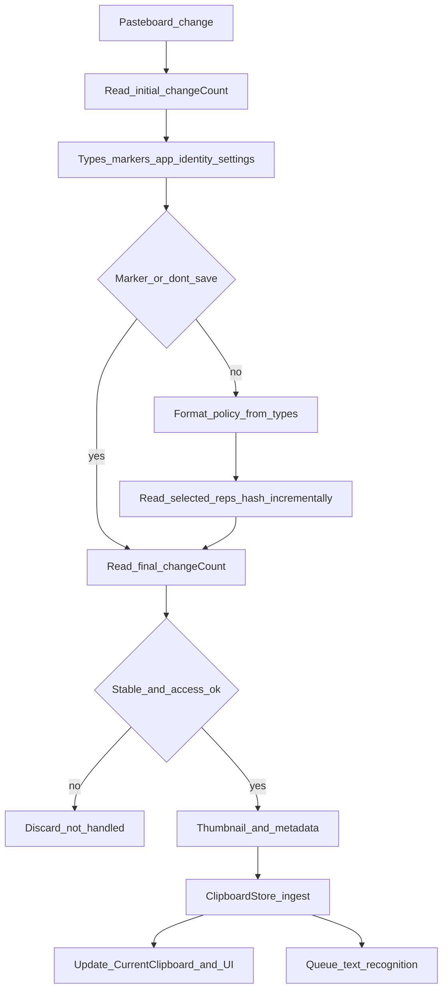
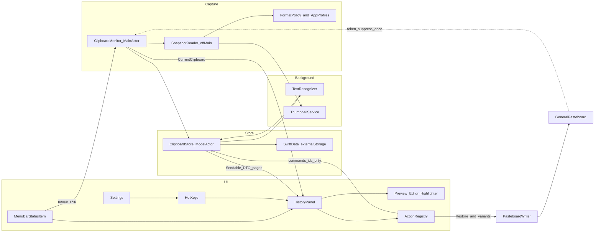

# Memopila — Clipboard Manager Plan

**Document type:** DESIGN  
**Status:** v1 plan, revised after review (macOS 27.x pasteboard access, memory budgets, Pasta parity, record editing, per-app settings, pause / skip, text in images, source page, text actions, code highlighting). Ready for the Phase 1 spike. Statements marked **(spike)** are assumptions the Phase 1 spike must confirm; record the result next to them before relying on them.  
**SSOT:** §3–§6 = normative contracts; §7 = architecture + memory budgets; §8 = UI; §10 = phase done-when; §11 = test matrix by reference (do not restate contracts)  
**Product:** Memopila — native macOS clipboard manager that replaces [Pasta](https://getpasta.com/): the same UI model (§8) plus what Pasta lacks, starting with record editing (§3.6).

---

## 1. Goals and non-goals

### Goals (v1)

- **Pasta-parity UI** (§8): menu-bar app; hotkey window with sidebar (History, Favorites, Apps, Types, Collections), search and a card grid with thumbnails.
- Capture clipboard history as **deduplicated canonical snapshots** of allowlisted formats (text, rich text, URL, image, PDF, color, files) plus formats the user opts into with **format rules** (§3.2.2).
- **Show the current clipboard even when it is not saved**: a red *Current — not saved* card with the reason and quick fixes (§3.2.3).
- **The selected card is the clipboard.** Memopila shows what the clipboard holds, extended by history: the card the clipboard holds has a thin (1 pt) green line, drawn over the inner side of the selection's accent border (↑ ↓ ← →, a click), so the selected card on the clipboard has a double frame: blue outside, green next to the content. **Select** (double-click, ↩, ⌘1…⌘9) makes the selected record the clipboard content — it moves to the top, the window closes and the focus returns to the previous app. No card has the green line when the clipboard holds something that is not in history. Optional **paste after copying** (Settings → General, off by default, Accessibility) also presses ⌘V. Text that is not a record yet — the text found in an image (selected or all), a source link — goes to the clipboard **as a new card**, so that card gets the green line. First-run feedback: a paste-first default, *Paste as Plain Text* (⇧⌘V in the target app does that), copies that never appeared in history and a separate *In Clipboard* label were all wrong for a clipboard manager.
- **Edit records**: edit text content and set a custom title on any record (§3.6).
- **Per-app settings** (§5.1): save / don't save / delete after a short time, format rules, text recognition, source page — set in two clicks from any card through the actions menu (§8.4).
- **Pause capture** (timed) and **Skip next copy** (§3.7).
- **Search text inside images** with on-device recognition, plus copying that text, selected or all, as a new card (§3.8).
- **Source page**: *Copied from example.com* for browser copies (§5.2).
- **Text actions** (§3.9) and **syntax-highlighted code preview** (§8.5).
- Organize with **Favorites** and **Collections** (UI name for tags, many-to-many); search; filter by source app, type, collection.
- **Low memory footprint**: history lives on disk; RAM stays within explicit budgets (§7.3).
- Respect privacy: local-only data, per-app *Don't save*, pause, skip transient/concealed/auto-generated markers, follow the macOS pasteboard access policy (**Capture paused**).
- Deduplicate by canonical content hash; retain by **age** and by **`maxCount` on non-favorites only** (favorites outside the count cap).

### Non-goals (v1)

- Auto-rules (conditional transforms, auto-tagging), snippets. Per-app settings and format rules (§5.1, §3.2.2) are not auto-rules: they only decide what is stored and for how long.
- Image editing, edit history / versions. (Formatted text is edited with its formatting, §3.6.)
- Eyedropper-from-image, lock, export/import, iCloud sync.
- System Quick Look panel (an in-app preview instead, §8.5), text actions beyond the fixed set (§3.9), paste stack.
- Mac App Store distribution; **App Sandbox off**. Releases are built by CI (`release.yml`): signed ad hoc, or with Developer ID and notarized once the owner adds the signing secrets.
- Persisting file contents from disk (never — §3.3). Display-only QuickLook thumbnails of copied files are allowed.
- Claiming complete automatic protection against secrets (absence of markers ≠ safe content): the secret detection of §3.10 is pattern-based and says so.

---

## 2. Policies

| Policy | Decision |
|--------|----------|
| **Data** | Local only under Application Support; no account, sync, or cloud. Network is never used (no link previews) |
| **Distribution (v1)** | Build and run from source (Xcode). Sign with a stable **Apple Development** identity (a free personal team is enough), not ad-hoc "Sign to Run Locally": the per-app pasteboard access choice in System Settings is tied to the app's code identity, and an identity that changes on every build is expected to reset it **(spike)**. Downloadable binary is a later deliverable |
| **Sandbox** | **Not sandboxed** in v1. Store file **URLs/paths** for restore; no security-scoped bookmarks |
| **Stack** | SwiftUI + AppKit, Swift 6 language mode. Build with the current Xcode (27.x) and macOS 27 SDK |
| **Minimum macOS** | **15.4.** Covers every release Apple still supports (15, 26, 27; Sonoma support ended September 2026). Sequoia is still a sizeable share of Macs — it was about half of active installs in January 2026, while Tahoe reached about 54 % of devices by the end of August 2026 — so a 26.0 minimum would cut a noticeable part of potential GitHub users. 15.4 rather than 15.0 makes `accessBehavior` always available. Cost: one more OS in the test matrix, and the UI must look right without Liquid Glass (standard controls; glass-specific APIs behind `#available(macOS 26, *)`, 27-only APIs behind `#available(macOS 27, *)`). macOS 14 is out: no SwiftData `#Index` / `#Unique`. Raise the minimum when Apple drops Sequoia |
| **OS test matrix** | Latest 15.x and 26.x (VMs are enough), 27.0.x / 27.1, 27.2+. 27.2 is listed separately: its release notes remove the `EnablePasteboardPrivacyDeveloperPreview` default (186955507), so the pasteboard access alert is expected to be enforced from 27.2 **(spike)** |
| **Payload persistence** | One SwiftData `PayloadRepresentation` row per stored representation with `@Attribute(.externalStorage) bytes` (§3.5). No single package blob, no custom BlobStore |
| **Memory** | History lives on disk. No in-memory mirror of history. RAM budgets (§7.3) are phase acceptance criteria |
| **App presentation** | Menu-bar-first (`NSApplication.ActivationPolicy.accessory` / `LSUIElement`); Dock via activation-policy toggle — Phase 1 spike on each OS of the matrix |
| **Window** | Non-activating `NSPanel` **(spike)**; fallback: activating window + remembered previous app (§8.1) |
| **Hotkey** | Default **⌥⌘V** (same as Pasta), rebindable in Settings. Carbon `RegisterEventHotKey` (no global key monitor / Accessibility). While registered it overrides Finder's ⌥⌘V *Move Item Here* — accepted. Only one app can hold a combination: if registration fails (`eventHotKeyExistsErr`, e.g. Pasta is still running), keep the previous binding and show a Settings error that names the likely cause. Rebind order: (1) if new equals current, no-op; (2) register **new** while **old remains active**; (3) on success unregister old; (4) on failure keep old active and show the error. If an API path requires unregistering old first, **re-register old** on new-register failure. Optional hotkeys for Pause and Skip next copy (§3.7) follow the same rules, unset by default |

---

## 3. P0 contracts

### 3.1 Pasteboard access and privacy

#### Access behavior (`NSPasteboard.AccessBehavior`)

Facts from Apple's documentation:

- **`.default`:** "If an app has never triggered a pasteboard access alert, its General pasteboard will report `.default` behavior. Such an app is not shown in the corresponding System Settings pane. Once programmatic pasteboard access triggers the first pasteboard access alert, the state automatically changes to `.ask`."
- **`.ask`:** the system asks before granting programmatic access; access that is both user-originated and paste-related is always allowed.
- **`.alwaysAllow`:** all access allowed without notifying the user.
- **`.alwaysDeny`:** programmatic access denied without notifying the user.
- Only the **General** pasteboard is gated: "All other pasteboards default to always allow access" (matters for tests, §11).
- `accessBehavior` is read-only; the user changes it per app in System Settings. It is declared `@objc dynamic`, so KVO may work **(spike)**.
- Writes (Restore) are not gated.

**Spike questions** — answer on every OS of the matrix (§2) and record the results here:

1. Is the alert enforced by default? Expected: off on 15.4–27.1 (developer preview only), on from 27.2.
2. Which calls raise it: `changeCount`, `types`, `data(forType:)` / `string(forType:)`? Expected: content reads only.
3. With enforcement off, does `accessBehavior` stay `.default` after a successful content read?
4. Does a gated read block until the user answers? What does a denied read return?
5. Does KVO on `accessBehavior` fire? Exact System Settings pane name and whether a deep link exists.

**Capture policy:**

| State | Capture |
|-------|---------|
| `.alwaysAllow` | Continuous capture (250 ms poll) |
| `.default` **and** silent default verified for the current OS build (below) | Continuous capture |
| `.default`, not verified | **No background content reads.** Onboarding shows **Enable capture**; pressing it runs the bootstrap read |
| `.ask` | **Capture paused.** Banner + guidance: System Settings → Privacy & Security → *pane (spike)* → Memopila → Always Allow. No reads, no prompt loops |
| `.alwaysDeny` | **Capture paused**, same guidance |

**Bootstrap read** (only from the explicit **Enable capture** action while the state is `.default`; the paused banner's **Check again** only re-reads `accessBehavior` and never reads content):

1. Read **one small content representation** of the current pasteboard (e.g. `string(forType:)` of a text type, else `data(forType:)` of the first declared type) and discard it — not persisted, not hashed. Empty pasteboard → ask the user to copy any text first. A `types`-only peek is not enough if the spike shows it does not raise the alert.
2. Re-read `accessBehavior`:
   - `.alwaysAllow` → start capture.
   - still `.default` → no alert was raised: enforcement is off on this OS. Persist `silentDefaultVerifiedOSBuild = current OS build` and start capture.
   - `.ask` / `.alwaysDeny` → Capture paused with guidance. On enforcing systems this is the normal outcome (the first alert moves the state to `.ask`); its main effect is that Memopila is now listed in System Settings.
3. At most one alert per user action; **never** an alert from background polling. After an OS update the verification no longer matches, so the next launch asks for Enable capture again instead of reading in the background.

**Runtime re-check:**

1. Re-read `accessBehavior` at the start of every tick, before any `changeCount` or content access. Not allowed → skip the tick (Capture paused).
2. **Post-read gate:** when a reader returns, re-read `accessBehavior` before ingest. Not allowed → discard the whole result, do not mark the change handled, pause. The same `changeCount` stays eligible once access returns.
3. On app activation, on return from System Settings, and on KVO change (if it works) → re-check; resume only when allowed. Resume must not promise success.
4. Safety net: if a background read ever moves `.default` → `.ask`, capture pauses immediately (at most one unexpected alert).

**Acceptance:** no alert without a user action on enforcing systems; `.ask` / `.alwaysDeny` start no reader and no periodic poll; mid-read policy drop → discard before ingest, change remains eligible; capture resumes only when allowed; an OS update with state `.default` requires Enable capture again.

#### Marker types (checked before reading other representations)

Conventions from [nspasteboard.org](https://nspasteboard.org). v1 **skips the entire pasteboard change** (no payload, no preview, no record, no Current card) if any Transient, Confidential, or Auto-generated marker is present on any item.

| Class | Identifiers (complete v1 table — each needs a test) | Rule |
|-------|------------------------------------------------------|------|
| Transient | `org.nspasteboard.TransientType`, `de.petermaurer.TransientPasteboardType`, `com.typeit4me.clipping`, `Pasteboard generator type` | Do not save |
| Confidential | `org.nspasteboard.ConcealedType`, `com.agilebits.onepassword` | Do not save |
| Auto-generated | `org.nspasteboard.AutoGeneratedType` | Do not save |
| Source metadata | `org.nspasteboard.source` | Not a skip marker — app identity only (§5); not payload; not in contentHash |

- Lack of a marker does **not** guarantee content is not a secret. Do not claim full automatic secret protection; point users to Pause and Skip next copy (§3.7).
- Markers and per-app *Don't save* (§5.1) always win over format rules (§3.2.2).

**Tests required:** one automated case **per identifier** above; marker only on the second item → no payload read for any item; marker + stable `changeCount` → whole change skipped and marked handled.

### 3.2 Unit of storage = deduplicated canonical snapshot

- `ClipboardRecord` represents **one deduplicated canonical snapshot identity**. `copyCount` counts **observed captures** of that identity, not every user Copy (polling may coalesce copies; dedup merges identical content).
- Persist the **stored representations** of every item in **original order**: allowlisted ones (§3.2.1) plus types kept by format rules (§3.2.2), minus file coalesce / file+image rules (§3.3), redundant image formats (§3.2.2) and types skipped by rules.
- `displayType` (`text` / `richText` / `url` / `image` / `pdf` / `color` / `file` / `mixed`) is for classification and UI only — never discard other stored representations because of it.
- Multi-file Copy → one record.
- `SnapshotReader` **immediately copies** data into owned values. Do **not** retain `NSPasteboardItem` instances. Restore builds **new** pasteboard items from stored data.

#### Size budget (`maxSinglePayloadBytes`)

- Default **32 MiB**, Settings range **4–256 MiB**, per-app override (§5.1, §3.2.2); **hard max 256 MiB**. It limits the stored size of one snapshot: Σ representation bytes + Σ UTF-8 file path bytes.
- The decision of **which** types to read is made from `types` only (§3.2.2), before any payload read.
- Read one representation at a time inside `autoreleasepool`; feed bytes to the incremental SHA-256 (§4) and the owned snapshot; nothing else keeps a copy.
- Before each read: if `acceptedBytes + lowerBoundForNextType` exceeds the limit → stop reading. After each read: if `acceptedBytes` exceeds the limit → stop. No further representations are read for that attempt.
- Oversize → no record; the change is marked handled (if stable); Current card *Not saved — larger than N MiB* with **Save anyway** (§3.2.3).
- **RAM honesty:** AppKit materializes a full representation as `Data` (no streaming read API), so peak memory during capture ≈ accepted bytes + the representation being read + SwiftData write buffers. There is no package-encoding copy. Budget in §7.3.

**Required test:** several representations each under the limit, cumulative over it → not persisted, later representations not read, Current card shows the reason.

#### Pasteboard stability during read (markers inside the guard)

All observation for one change — types, markers, app identity, per-app settings, format decisions, source page, payload copy — happens **inside** one `changeCount`-guarded attempt:

1. Read **initial** `changeCount`; note the frontmost app (identity fallback, §5).
2. **Once:** read types on **every** item; any forbidding marker (§3.1) on any item forbids the whole change. Decide before any payload read.
3. Read `org.nspasteboard.source`; resolve the **app identity** (§5) and its settings (§5.1).
4. Apply the app's capture mode: *Don't save*, or a Strict-mode skip (§5) → read no payload.
5. Forbidden or skipped → still complete the guard.
6. Else apply the format policy (§3.2.2) to the declared types → list of representations to read; read them under the size budget. Read source-page metadata if enabled (§5.2).
7. Read **final** `changeCount`. If final ≠ initial → **discard** everything from this attempt; do **not** mark handled (the new count is read on a later tick).
8. Run the **post-read gate** (§3.1). Fail → discard, not handled.
9. Apply the outcome table below.

#### Outcomes

| Outcome | Mark `changeCount` handled? | Current card (§3.2.3) |
|---------|------------------------------|-----------------------|
| Marker skip / app set to *Don't save* / Strict-mode skip | Yes | None (content never shown) |
| Skip next copy armed (§3.7) | Yes, without any read | None |
| Empty pasteboard | Yes | None |
| Only unsupported / rule-skipped types | Yes | Red *No supported formats* (lists types; **Keep formats…**) |
| Oversize | Yes | Red *Larger than N MiB* (**Save anyway**, **Raise limit for app…**) |
| Declared representation read fails (nil, error, ObjC exception) | Yes (no retry loop) | Red *Read failed* (**Save anyway**) |
| Unstable `changeCount` / post-read gate fails | No | Unchanged |
| Store `committed` / `merged` | Yes | Normal card (skipped formats listed in the preview and the **<App> ▸** menu) |
| Store `rejected` (deterministic, e.g. quota) | Yes | Red *Not saved: reason* |
| Store `failed` twice (§3.2 coordination rule 3) | Yes | Red *Save failed: reason* (**Save anyway**) |
| Store `dropped(stale)` (Clear/Delete/Edit raced, rule 5) | Yes | None |

**Owned snapshot timestamp:** when the guard completes, freeze `observedAt` on the snapshot. Retries and **Save anyway** of the same snapshot use that `observedAt`; dedup merges follow §4.

#### Capture coordination (v1)

**Isolation:**

- `ClipboardMonitor` is `@MainActor`: timer, access checks, pause and skip state (§3.7), `lastHandledChangeCount`, single-flight flag `isCapturing`, `destructiveInProgress`, operation sequence `opSeq`, Restore suppression token (§3.4), `CurrentClipboard` state (§3.2.3).
- `SnapshotReader` runs off the main actor (detached task) and returns a `Sendable` owned snapshot. Off-main `NSPasteboard` reads **(spike)**; fallback: read on the main actor, one representation per run-loop turn, so a slow lazy provider in the source app cannot freeze the UI for the whole snapshot.
- `ClipboardStore` is an actor (a fresh `ModelContext` per call, §7.3) and the only mutation owner of history (§3.5).

**Rules:**

1. **Tick order** (synchronously on the main actor, no `await` until a reader starts): access check (§3.1) → user pause (§3.7) → read `changeCount`; equal to `lastHandledChangeCount` → done → suppression token (§3.4): match → handled, consume, done → `!isCapturing` (a change still being read is not the next copy; review finding) → Skip next copy armed (§3.7): handled, disarm, done → `!destructiveInProgress` → `isCapturing = true`, `readerSeq = opSeq`, start the reader.
2. **Completion.** Reader returns → main actor: post-read gate → `await store.ingest(snapshot, readerSeq)` → apply the outcome table → `isCapturing = false`.
3. **Save failure.** The store rolls back and returns `failed(error)`. The monitor retries the same snapshot **once** after ~1 s. A second failure → drop the snapshot (no payload bytes are kept in RAM), mark handled, red Current card with **Save anyway** (re-reads the pasteboard only if `changeCount` is unchanged). Capture continues with later changes. After **3 consecutive** failed snapshots → *Capture paused: storage error* banner with **Resume**.
4. **No pending queue, no crash durability.** If the app dies mid-capture, that observation is lost. `lastHandledChangeCount` is process-local and not persisted: after launch the current pasteboard is captured as one normal observation (if unchanged content was saved before, dedup may bump `copyCount` — accepted). Do not invent a "skip whatever is on the pasteboard at launch" rule.
5. **Clear / Delete / Edit vs an in-flight capture.**
   - The user starts the operation on the main actor: `opSeq += 1`; `destructiveInProgress = true` (no new reader, **Save anyway** disabled); the store call carries `opSeq`. A second Clear/Delete while one runs → **busy** (UI disabled, no queue).
   - The store keeps `lastClearSeq` and a small in-memory tombstone list `{contentHash, opSeq}` (last 64 entries) for Delete and Edit.
   - `ingest(snapshot, readerSeq)` returns `dropped(stale)` when `readerSeq < lastClearSeq`, or when `snapshot.contentHash` has a tombstone with `opSeq > readerSeq`. The check runs inside the same serialized mutation as the commit (no `await` between check and save).
   - The monitor marks `dropped(stale)` as handled. This is safe: a reader can only be in flight if it started before the operation; content copied during the operation either makes that read unstable (re-read later with a newer `readerSeq`) or appears as a newer `changeCount`.
   - `destructiveInProgress = false` when the store returns (success or failure). On failure: UI error, history unchanged.
   - Result: cleared, deleted or pre-edit content is never resurrected by an in-flight capture; unrelated content captured concurrently with a Delete is kept; content copied after the operation started is captured.
6. **Polling:** one timer, **250 ms** (tolerance ~50 ms; not user-configurable), only while capture is allowed and not paused. Polling observes discrete samples: several copies between two polls collapse into one observation. Timer cadence for an accessory app with the window closed (App Nap, Low Power Mode) **(spike)**: if ticks are delayed beyond 1 s, hold a `ProcessInfo` activity while capture is enabled.

**Clear History scopes** (explicit Store argument): **`.nonFavorites`** (UI default) deletes all non-favorite records; **`.all`** deletes all records. Representations, thumbnails and `RecordTag` rows of deleted records go in the **same** transaction.

**Required tests:**

- Ten unchanged ticks → no reads; two ticks during one read → one reader.
- Reader of A in flight, Clear → A dropped and handled; B copied during Clear captured afterwards.
- Reader of A in flight, Delete record A → A not resurrected; reader of unrelated C in flight, Delete X → C saved.
- Reader of pre-edit content in flight, Edit → pre-edit record not recreated.
- Policy → `.ask` mid-read → discarded, not handled; eligible after `.alwaysAllow`.
- Save fails once → retried and committed; fails twice → red card, capture continues; 3 consecutive → paused banner.
- **Save anyway** re-reads only if `changeCount` is unchanged.
- Launch → current pasteboard captured once.
- Clear `.nonFavorites` vs `.all`; second Clear/Delete → busy; store failure → UI error, history intact.

### 3.2.1 Supported representations allowlist

| UTI / type | Action |
|------------|--------|
| `public.utf8-plain-text` / `public.plain-text` | Preserve original bytes + UTI; derive UTF-8 preview/search |
| `public.utf16-plain-text` | Preserve original bytes + UTI; derive UTF-8 preview/search; restore original bytes |
| `public.rtf`, `com.apple.flat-rtfd` | Preserve original bytes + UTI |
| `public.html` | Preserve original bytes + UTI |
| `com.apple.webarchive` (also the legacy name `Apple Web Archive pasteboard type`) | Preserve original bytes + UTI |
| `public.url`, `public.url-name` | Preserve original bytes + UTI |
| `public.file-url`, `NSFilenamesPboardType` | **File-reference exception** (§3.3) |
| `public.png`, `public.heic`, `public.jpeg`, `com.compuserve.gif`, `public.tiff` | Preserve original bytes + UTI, subject to the redundant-image rule (§3.2.2) |
| `com.adobe.pdf` | Preserve original bytes + UTI (not a redundant raster) |
| `com.apple.cocoa.pasteboard.color` | Preserve original bytes + UTI |
| `org.nspasteboard.source` | Metadata only (§5) |
| Source-page types (§5.2) | Metadata only; never stored as representations |
| Transient / Confidential / Auto-generated markers (§3.1) | Detect only; skip entire change |
| **Any other UTI** | Skip, unless a format rule keeps it (§3.2.2) |
| **File promises** / deferred file providers | Skip in v1 |

**Universal Clipboard:** content copied on another device arrives lazily over the network; reading it may block and counts against the size budget. It is captured like local content, but without a marker its source is **Unknown**, never the app in front on this Mac (review finding). Setting **Ignore content from other devices** (default off) skips changes that carry the remote-clipboard type (`com.apple.is-remote-clipboard` **(spike: verify identifier)**).

**Representation fidelity:** non-file representations keep original bytes and UTI. Derived UTF-8 (preview/search) is outside the restore path. File-reference representations follow §3.3.

**Mixed content / read failures:**

| Case | Action |
|------|--------|
| Type not stored (not allowlisted, skipped by rule, redundant image) | Not read |
| Declared stored representation present but **read fails** (nil, error, or ObjC exception) | **Discard the entire snapshot**; mark handled if stable; red Current card; **must not crash** |
| Item with zero stored representations | Omit the item (not counted in MCS1 `itemCount`, §4) |
| Whole pasteboard empty / markers-only / *Don't save* app | No record |

**AppKit read errors:** some `NSPasteboard` paths can raise `NSPasteboardCommunicationException` (Objective-C exception). If the chosen read API can raise it, wrap reads in a **narrow Objective-C boundary** that converts the exception into a read failure. No global exception catcher.

**Test:** allowlisted read failure → no partial record, handled when stable, process keeps running.

### 3.2.2 Format policy and user format rules

The policy decides, **from the declared `types` only**, which representations are read and stored. Markers and per-app *Don't save* are evaluated first and always win.

**Default policy:**

1. Allowlist (§3.2.1).
2. **Redundant image formats.** If an item declares more than one raster image type, read only the first available in this order: **GIF > PNG > HEIC > JPEG > TIFF**; the others are never read. GIF goes first because it may be animated. PDF is vector and not a redundant raster: keep PDF and the chosen raster. Rationale: a full-screen screenshot on a 5K / 6K display is ~59 / ~81 MB as uncompressed TIFF and a few MB as PNG.
3. A record whose TIFF was skipped restores the stored raster only. If a target app turns out to need TIFF, Phase 4 adds a lazy TIFF data provider that converts on demand (§12 otherwise).

**User format rules** (Settings → Formats for all apps; Settings → Apps → *App* for one app, §5.1):

- Rule = `{ app: any | bundle ID, type: exact UTI | prefix (e.g. com.adobe.), action: keep | skip, maxSize: MiB? }`.
- Precedence: app + type > app only > type only > default policy. Within a level, the first rule in list order wins.
- **`keep` on a non-allowlisted type** → stored as opaque bytes, restored byte-for-byte under the same type, hashed like any bytes representation (§4).
- **`keep` on an image type** disables the redundant-image rule for that type (example: *Adobe Photoshop: keep `public.tiff`*).
- **`maxSize`** raises or lowers the size budget for matching snapshots (the largest matching value wins), never above the hard max (256 MiB).
- App matching uses the app identity (§5).
- Changing rules affects new captures only. The same copy stored with different formats has a different `contentHash` (§4) — accepted.

**Quick creation:** the red Current card and the actions menu of every card (§8.4) offer **Keep skipped formats from <App>**, **Don't save format from <App>** and **Raise size limit for <App>…**.

**Inspector:** Settings → Formats → **Inspect current clipboard** lists items, declared types and the decision for each (store / skip by rule / redundant / unsupported). Sizes are shown only for representations it actually reads; it reads only when the button is pressed, within the hard max, and keeps nothing.

**Tests:** precedence levels; prefix rule; Photoshop *keep TIFF*; PNG + TIFF by default → TIFF never read (assert no read call); non-allowlisted *keep* restores byte-exact; markers and *Don't save* beat rules.

### 3.2.3 Current clipboard state (red card)

- `ClipboardMonitor` keeps `CurrentClipboard` for the latest stable change **in memory only** (never persisted): `changeCount`, status, app identity, declared type names, known size (lower bound), optional thumbnail.
- Status → UI:
  - `saved(recordID)` → normal card (first in History by recency). Skipped formats are listed in the preview metadata and under **<App> ▸ Keep Skipped Formats**; no card badge (apps such as Xcode always add private types, so a badge was noise).
  - `notSaved(reason)` → **red card** first in History: reason (*Larger than 32 MiB*, *No supported formats*, *Read failed*, *Save failed: …*, *Not saved: quota*), source app, type list, known size.
  - `privacySkipped`, `appSkipped`, `paused`, `skipped` → no card (content is never shown; pause uses the banner).
- The red card is replaced as soon as the clipboard changes.
- Its thumbnail comes only from data already read within the budget. It never triggers extra reads and is never persisted.
- **Actions:**
  - **Save anyway** — user-initiated one-shot capture of the current pasteboard, only if `changeCount` is unchanged, for the app the red card named (clicking it makes the panel key, which is not who copied; review finding). Same format policy with the size limit raised to the hard max; for *No supported formats* it keeps all declared types.
  - **<App> ▸** quick actions (§5.1) — keep formats, raise limit, don't save.
  - **Dismiss**.

**Tests:** each status maps to the right card; marker / *Don't save* changes never show content; Save anyway rejected after a clipboard change; red card disappears on the next change.

### 3.3 Files: references only — live filesystem state

**Product rule (v1):** Memopila **never persists file contents** from disk. It stores **path references** for file representations. It **skips image UTIs on the same item** as file references (§3.3 coalesce). It **may** store image bytes from **other items** in the same change when those items have no file refs. Do **not** claim "never any bytes that might equal a file on disk." No path↔image matching heuristics.

**Display-only thumbnails:** file cards show a QuickLook thumbnail (`QLThumbnailGenerator`) at card size, generated on demand from the file on disk, kept only in the in-memory thumbnail cache (§7.3), never persisted and never hashed. It works for any file size (QuickLook generates out of process). Missing file → **Unavailable** (dimmed card, Reveal disabled). The card footer shows file count and total size (`stat` off the main actor).

**v1 file fidelity (chosen contract):** fidelity is to **paths, path order, and Finder-usable restore** — not necessarily to the original file UTI or item boundaries.

- On capture: read `public.file-url` and legacy `NSFilenamesPboardType` per the coalesce rules below; persist **one** ordered normalized path list per item. Do not store original filenames plist bytes.
- Hash **`CanonicalFileListV1`** (§4) — never plist bytes, never file contents.
- On Restore: write the list **once** as a canonical modern set of file `URL`s (e.g. `writeObjects`). Integration-test with Finder.
- Do not persist whether the list came from multi-path vs single-URL representations.
- No security-scoped bookmarks in v1.

#### File-representation coalesce and MCS1 framing (same item)

**Path list:**

1. Normalize each file representation to an ordered path list (§3.3.1).
2. Both present and **equal** → one list. **Different** → use **`public.file-url`** only. Never union/concatenate.
3. Restore emits that list **once**.

**Effective file UTI for MCS1 `typeIdBytes`:** `public.file-url` if present on the item, else `NSFilenamesPboardType`. Payload bytes for that slot are `CanonicalFileListV1` of the chosen list (§4).

**Representation order (per item, original pasteboard order):**

1. Walk representations in original order.
2. On the **first** file-reference type → emit **one** file slot with the effective UTI + coalesced list.
3. Skip the **second** file-reference type.
4. Skip image UTIs when any file-reference type is present on the item.
5. Emit every other stored non-file representation in place, preserving relative order.

Example: types `[public.utf8-plain-text, NSFilenamesPboardType, public.file-url, public.html]` with equal lists → reps: utf8-plain-text, **`public.file-url` + CanonicalFileListV1** (at the NSFilenames position), html.

**Unit tests (assert full canonical framing bytes):** equal lists; unequal lists (file-url wins); file types before/after text and HTML in different orders.

#### Mixed file + non-file representations on one item

Capture stores the coalesced file list plus the item's other stored non-file representations (image exception above).

**Restore rule:**

1. Emit file URLs for the coalesced list **once**.
2. Also restore every stored non-file representation of that item.
3. When file expansion changes item boundaries, attach the non-file representations to the **first** restored file-URL item from that original item.

| Pasteboard content | Stored as |
|--------------------|-----------|
| Finder copy of a `.png` | Normalized path reference(s) only (image UTI on same item skipped); card thumbnail via QuickLook |
| Screenshot / image pixels (no file refs) | One raster representation (§3.2.2) |
| One item with file-url + plain text | Paths + text; restore = file URL(s) + text on the first file item |
| Equal file-url + NSFilenames lists | One list; restore once |
| Unequal file-url + NSFilenames | file-url list only |

#### 3.3.1 Path normalization (single algorithm)

Applies to `public.file-url` and `NSFilenamesPboardType` before storage, hash, and UI. **Must not** use APIs that resolve symlinks or collapse `..` (e.g. avoid `standardizingPath`).

| Input kind | Rule |
|------------|------|
| `file:` URL | Parse with Foundation `URL`. Extract the decoded path **exactly once** (e.g. `path(percentEncoded: false)`). **Never** percent-decode the result again |
| Legacy filename path string | A filesystem path, not a URL. **Do not** percent-decode |

1. **Do not** collapse `.` or `..`; keep the string exactly as extracted.
2. Encode as **UTF-8** for `CanonicalFileListV1` and display.
3. **Do not** resolve symlinks; **do not** read or compare file contents.
4. Preserve path order.

**Required tests:** percent-encoded space in a URL; literal `%20` in a filename (not double-decoded); `.` and `..` kept; symlink path unchanged; spaces and Unicode; same path via each file representation → identical `CanonicalFileListV1` bytes.

### 3.4 Restore to Clipboard (not paste)

User-facing name: **Select** (internally Restore).

**Focus and keys:**

- Remember the previous frontmost app before the window shows (with the non-activating panel it simply stays frontmost).
- **Enter** restores the selected card whether focus is in the **grid or the search field**. While typing, selection follows the first result; arrow keys move the selection without leaving search.
- **⇧Enter** — Copy as plain text (below).
- **Esc** — clears a non-empty search; otherwise closes the window without changing the clipboard and returns focus.
- **Successful** Restore: write pasteboard → close window (unless pinned, §8.1) → previous app stays/returns frontmost.
- **Write failure:** keep the window open, show an error, do not treat as restored.

**Variants:**

- **Restore:** all stored representations; the record gets the green clipboard line.
- **New text** (`copyNewText`): the text found in an image (the selection, else all of it), a source link (⌥-click), the Diagnostics report. Stored as a new record with the original's source (secret policy applies, §3.10), then written like a restore — never a clipboard write that history does not show. The window stays open: this copies part of an item, like ⌘C in its text.
- Text actions and other transformations do not copy: they create a new card (*Duplicate As*, §3.9). No *Copy as plain text*: ⇧⌘V (Paste and Match Style) in the target app does it.
- **Paste after copying** (Settings → General → *After Copying*, off by default): once the panel has given up key status (it closes; when pinned it resigns key and stays visible), post ⌘V through the session event tap, on the key that types *v* in the current Latin layout (Dvorak, AZERTY) and with only ⌘ set. Requires Accessibility; without it items are only copied.

**After any confirmed write** (Restore or a variant): the store moves the source record to the top: `lastCopiedAt = max(lastCopiedAt, restoreTime)`; `copyCount` unchanged. The written content is suppressed by the token, so variant outputs (plain text, text actions, recognized text) are **not** added to history; to keep a transformed text, apply the action in the editor and save (§3.6).

#### PasteboardWriter contract

`writeObjects(_:)` **adds** objects; Restore must **clear then write**. `clearContents()` returns the `changeCount` at which Memopila takes ownership — the anchor for the suppression token. There is no atomic cross-app pasteboard transaction.

1. **Load and verify first** (in the store, off the main actor): integrity checks of §3.5. Any failure → error, **no** pasteboard mutation. Build all `NSPasteboardItem`s in memory. Set `org.nspasteboard.source` **exactly once** on the first item: saved valid bundle ID, else empty string (§5).
2. On the main actor, **synchronously, with no `await`** from start to end (ticks run on the same actor and cannot interleave): `clearContents()` → `ownedCount` → pre-write check (`changeCount == ownedCount`, else abort) → `writeObjects` (must return `true`) → post-write confirmation (`changeCount == ownedCount`) → publish the token only if confirmed.
3. **Never** use an unconfirmed `changeCount` as the token. Prefer not suppressing a possible self-write over losing another app's content.
4. Abort / write failure: error, window stays open; do **not** claim the previous clipboard was preserved.
5. Release the loaded representation bytes right after the write.

**Suppression token** (main actor):

1. At most **one** confirmed token (`ownedCount`).
2. On a tick, before Skip next copy and before starting a reader: if `changeCount` equals the token → mark handled, consume the token, no reader, no ingest. A confirmed write is suppressed **once**.
3. If `changeCount` differs → discard the token and process the count normally.
4. No token → normal polling (an own Restore may be re-observed; dedup handles it).

**Required tests:**

- Restore B replaces A (clipboard is B, not A+B).
- Multi-item Restore: `string(forType: org.nspasteboard.source)` returns exactly the bundle ID once; source not in payload or hash.
- External change after `clearContents()` before the pre-write check → abort without `writeObjects`.
- External change after the pre-write check → no token; the test must not claim foreign content was untouched.
- A wrong token never suppresses an external change.
- Confirmed Restore suppressed once; later external change captured.
- Restore moves the record to the top without changing `copyCount`.
- Copy as plain text / text action / text from image writes only plain text + source marker and adds no record.

### 3.5 Ingest pipeline and payload persistence



#### Storage model

- `ClipboardRecord` — metadata only (§7.2); list and search fetch these rows only.
- `PayloadRepresentation` — one row per stored representation: `itemIndex`, `repIndex`, `uti`, `kind` (`bytes` | `filePaths`), `bytes: Data?` with `@Attribute(.externalStorage)`, `paths: [String]?`, `byteCount`. Relationship from the record with **cascade** delete.
- `RecordThumbnail` — one optional row per record (`data`, longest side ≤ 512 px, alpha preserved; HEIC if the spike confirms alpha support, else PNG). Separate entity so list fetches never load it; cascade delete.
- `ClipboardRecord.payloadSizeBytes = Σ byteCount` (bytes count, or Σ UTF-8 path bytes); `storageFormatVersion = 1`.
- Never put `bytes` or thumbnail data in `#Predicate` filters.

**Why rows instead of one package blob:** no encode copy at ingest (peak ≈ 1× snapshot), previews load only the representation they need, and list queries cannot touch payload bytes.

**Integrity before Restore (mandatory):**

1. Reject `hashSchemeVersion != 1` and `storageFormatVersion != 1`.
2. Rows sorted by `(itemIndex, repIndex)` are contiguous from 0; each row has the field its `kind` requires; `bytes.count == byteCount`; `Σ byteCount == payloadSizeBytes`.
3. File paths validate with the capture normalization rules (§3.3.1; no file reads).
4. Recompute MCS1 (§4) from the rows; SHA-256 hex must equal `contentHash`.
5. Any failure → **unreadable**: error, no `clearContents()`.

**Commit:** one SwiftData save inserts the record + representations + thumbnail and deletes the retention/storage victims (§6) with their representations, thumbnails and `RecordTag` rows. On error → `rollback()`, history intact, result `failed(error)`. Deterministic refusal → `rejected(reason)`. Store results: `committed` | `merged` (dedup hit) | `rejected` | `failed` | `dropped(stale)`.

**Mutation ownership:** hashing is pure and runs in `SnapshotReader`. Dedup lookup, limit checks, victim planning and commit run as **one** serialized `ClipboardStore` operation with no `await` between checks and save. All mutations of records, collections, rules, app settings and settings go through `ClipboardStore`; the UI passes IDs and commands only. Text recognition results (§3.8) are metadata-only mutations.

**Phase 1 storage spike (mandatory, macOS 15 / 26 / 27):**

1. Paged card DTO fetches (`fetchLimit` / `fetchOffset` + `propertiesToFetch`) and search predicates do not materialize representation bytes or thumbnails.
2. Representations of 32 MiB and 256 MiB (hard max) round-trip: ingest, Restore, delete, reopen after force-quit. Measure peak footprint against §7.3.
3. Deleting a record removes its external data files.
4. A failure before commit (`rollback()` / no save) leaves nothing visible after reopening the store; covers "insert only" and "insert + victim deletes".
5. Whether the long-lived `@ModelActor` context keeps inserted `bytes` resident after save. If it does, ingest uses a short-lived `ModelContext` per operation.

If a mandatory gate fails → amend this PLAN with a fallback (layout, commit order, orphan accounting, recovery) **before** implementing any custom blob store.

### 3.6 Editing records

**Custom title** — any record: `customTitle: String?`. Shown on the card above the content preview; searchable; not part of `contentHash`. Shortcut ⌘R or context menu **Rename…**; empty title clears it.

**Edit text** — records with `displayType` `text`, `richText` or `url` (not images, PDFs, colors, files, mixed) that hold **one** pasteboard item (a copy of several bookmarks or notes is shown read-only: the window shows the first item's text, and saving would drop the others — review finding), in the **record window** (§8.5): one window for looking at a record and editing it (first-run feedback: preview and editor were nearly the same screen behind two buttons, and an overlay could not be moved).

- The text is editable in place — click into it, or open with ⌘E — with code highlighted as you type (re-coloured 0.3 s after the last edit, up to 200 000 UTF-16 units). The **title** is a labelled field in the inspector; it saves itself when the field is left, on ↩ and before the window moves on or closes; Tab goes on to the text, Esc only leaves the field. The toolbar holds Undo / Redo and one **Transform** menu with the text actions in sections *Case*, *Lines*, *JSON*, *Encode* (§3.9, on the selected text or all of it, undoable; first-run feedback: four menus took the toolbar); an action that does not apply to that text is disabled with its reason as a tooltip, as in ⌘K (checked off the main thread 0.25 s after an edit or a selection change, up to 100 000 UTF-16 units; above that every action stays on and reports when it does not apply). *Find* is ⌘F, *Find and Replace* ⌥⌘F (system find bar). The status bar has live counts (the selection's characters and lines when there is one), the text's size once it is within 80 % of the *Largest item* limit (orange, red above it — then Save is disabled with the reason instead of failing), the *View* menu, an *Edited* mark (and the dot in the close button) and, with changes, **Changes…**, **Revert** (undoable with ⌘Z) and **Save** (⌘S). No separate *Save and Close* (⇧⌘S is *Save As* / *Duplicate* on the Mac): Esc then ↩ saves and closes, ⌘↩ saves and selects.
- **Save never closes the window**; only Select and Esc / ⌘W / the close button do (first-run feedback). Save is disabled while saving or loading and when the text is empty, with the reason as a tooltip; *Save and Select* likewise.
- **Unsaved text never blocks:** closing (Esc, Space, ⌘W, the close button) and moving to another record (‹ ›, ↑ ↓ ← →) show the standard sheet *Do you want to save the changes to this record?* — **Save** (↩) saves and goes on, **Don’t Save** (⌘D) drops the text edit and goes on, **Cancel** (Esc) stays. First-run feedback: the arrows silently stopped working and the inline *Discard your changes?* in the status bar was easy to miss. A changed title is never lost: it saves itself either way. Esc while editing without changes only leaves the text; Esc in the find bar closes the find bar.
- **Changes…** opens a sheet with the edited text against the saved one, line by line (removed / added lines with both line numbers, 3 lines of context, unchanged runs folded), with *Save* (↩) and *Close* (Esc). Computed once when opened, off the main thread, and bounded (`LineDiff` in `MemopilaCore`): the common start and end are skipped without comparing, at most 500 differing lines per side are matched (beyond that the middle shows as removed, then added), at most 2 000 rows, lines cut at 1 000 characters.
- **View** menu (how the text is shown, never what is saved, kept for the next record): *Wrap Lines*; *Line Numbers* — *Automatic (for Code)* (shown when the text is highlighted as code), *Always*, *Never*; *Show Invisible Characters* (· space, → tab, ° no-break space, ¬ line break, drawn over the visible part only); *Monospaced Font* (on by default, for logs, JSON and code; off = the system font for prose, independent of highlighting); text size (⌘+ / ⌘− / ⌘0). Line numbers count lines of text, not wrapped rows; the line starts are recounted on each edit only while numbers show. Deliberately no minimap, folding, multiple cursors or other IDE features: the window stays light (§7.3).
- **Formatted text** (records with RTF, RTFD, HTML or a web archive) opens with its formatting and is edited as rich text, in the same text view — nothing is added for it but AppKit's own rich text (first-run feedback: shown plain it lost what made it rich). It reads the richest readable format — RTFD, RTF, HTML, web archive — up to 4 MB (above that, plain text, to stay light). Nothing blocks the app while it loads: RTF is read off the main thread, HTML through WebKit's asynchronous loader (which may wait for remote images and styles; review finding: a browser copy froze the app; it runs in a short-lived WebKit process, whose sandbox messages in Xcode's console are harmless), web archives up to 1 MB with a 2 s limit. Bold ⌘B, italic ⌘I, underline ⌘U (toolbar buttons too) toggle on the selection or for what is typed next, undoable; the text actions replace text and keep the formatting of where they start. It is shown as a document with a wider margin, on the page `RichPage` decides, the same for its card: **the background the copy names** (its document background, or one on most of its text — a styled web page, code from VS Code) in its own colours; **a dark page** when it names none and most of its text is light (code from a dark editor theme); **else none of its own**: it follows the window — white in Light Mode, and in Dark Mode a dark page with the colours inverted (AppKit's adaptive colour mapping; owner feedback: black text on a white page was not expected for a copy without a background). It is zoomed so the size most of the text has reads at about 14 pt (× 1 … 2.5; first-run feedback: Dark Mode colour mapping and the 9–11 pt of web and app text were hard to read). Fonts are the record's own: ⌘+ / ⌘− zoom further instead; no highlighting, language or monospaced font. Wrapped lines follow the zoom and the window size (the text view is kept as wide as what shows, in document units); links open in front of the record window. *Edited* compares text and formatting, so a change of formatting alone counts; *Changes…* says *Only the formatting changed.* when the words did not. *View → Show Formatting* off (only without unsaved changes) edits it as plain text with the code features; saving then keeps only the text (*Formatting will be removed*).
- **Save** of formatted text writes one item with RTF (flat RTFD when it holds attachments), HTML (for browsers and web apps, which read only HTML) and `public.utf8-plain-text`, all counted against the size limit; `displayType` stays `richText`. Otherwise **Save** replaces the record's representations **in place** with one item holding `public.utf8-plain-text`. Recompute `contentHash`, `payloadSizeBytes`, `cardPreview`, `searchText`; `displayType` becomes `url` if the whole text is a single URL, else `text`. Keep favorite, collections, `copyCount`, timestamps, `customTitle`, source page; set `editedAt`. No version history. The record loses the green clipboard line (the clipboard still holds the old text).
- **Select** in the record window (↩ when the text is not being edited, ⌘↩ always) saves unsaved changes first, then restores (§3.4); the window closes and the focus goes back to the app.
- Empty text → save disabled. Text larger than `maxSinglePayloadBytes` → save rejected with a message.
- **Secrets** (§3.10) in saved text are treated as in a copy: masked only while detection is on and for the enabled kinds; *Don't save* refuses the save with a message; *Delete after* sets `expiresAt` (unless favorite) and re-arms the expiry timer.
- **Dedup collision:** if the new hash equals another record → merge into that record (favorite = OR; collections = union; `copyCount` = sum; `firstCopiedAt` = min; `lastCopiedAt` = max; `customTitle` = the existing one, else the edited one), delete the edited record, select the survivor, show *Merged with an existing record*; the record window then shows the survivor. One transaction.
- **Concurrency:** Edit is a `ClipboardStore` mutation; it adds the old hash to the tombstones (§3.2 coordination rule 5). Record deleted meanwhile → *Record no longer exists*.

**Tests:** plain edit; rich → plain with warning; URL detection; collision merge; line diff for *Changes…* (`LineDiffTests`); title shown and searchable; Select with unsaved changes; text action in the editor + undo; in-flight capture of pre-edit content not recreated.

### 3.7 Pause capture and Skip next copy

**Pause** — menu bar menu (§8.8), the window's banner and an optional global hotkey: *Pause for 5 minutes / 15 minutes / 1 hour / Until I resume*.

- While paused: no content reads and no capture; the timer only checks whether the pause ended. Status icon shows the paused state; the window shows *Capture paused until 14:35 — Resume*.
- Persisted (`pausedUntil` / `pausedIndefinitely`), so a relaunch or reboot does not silently resume.
- **Resume** (manual or timer): read the current `changeCount` (counter only) and mark it handled, so content copied during the pause is **never** captured. Discard any suppression token.
- Independent of the access-policy pause (§3.1); both can be shown.

**Skip next copy** — menu bar menu and an optional global hotkey.

- Arms a one-shot flag (status icon shows it). The next **new** `changeCount` that is not Memopila's own write (token, §3.4) is marked handled **without any content read**; then the flag clears.
- *Cancel skip* disarms. Process-local: quitting disarms it.

**Tests:** copies during a pause are not captured after resume; timed pause ends on time and survives relaunch; Skip next skips exactly one external change with no read calls; a Restore while Skip is armed is suppressed by the token and leaves Skip armed.

### 3.8 Text in images (on-device recognition)

- **Engine:** Vision text recognition (`VNRecognizeTextRequest`, accurate level, language correction on), on device, no network.
- **Languages:** automatic detection plus preferred languages (default: the system's preferred languages, e.g. Russian + English), set in Settings → Text recognition. The supported list is queried at runtime (`supportedRecognitionLanguages`); Russian availability and quality on 15 / 26 / 27 **(spike)**.
- **Which records:** `displayType` `image`, and `pdf` without a text layer. PDFs with a text layer use PDFKit text extraction instead (cheap, exact).
- **When:** after the record commits, on a background queue at utility priority, **one job at a time**; never blocks capture. On launch, unfinished jobs resume. Respects the global toggle and the per-app setting (§5.1).
- **Input:** the stored raster downsampled with ImageIO to ≤ 4096 px on the long side (no full-size decode), released right after the job.
- **Output:** `ocrText` (≤ 10 000 scalars) and `ocrState` (`pending | done | noText | failed | off`) via a metadata-only store mutation: timestamps, position and `contentHash` do not change. Record deleted meanwhile → result dropped.
- **UI:** search includes `ocrText` (§8.6); card badge **T** when text was found; preview shows the recognized text with **Copy text**; context menu / ⌘K **Copy Text from Image** (§3.4 variant).
- **Budget:** ≤ +100 MB transient per job (§7.3). Time for a 5K screenshot measured in Phase 5 (informational).

**Tests:** state machine (pending → done / noText / failed); record deleted mid-job; per-app off → `off`; PDF with text layer uses PDFKit; search finds recognized text; recognition never changes `lastCopiedAt`.

### 3.9 Text actions

Fixed v1 set (pure functions on `String`; off the main actor for text over 100 KB):

| Action | Available when |
|--------|----------------|
| Trim whitespace | Always |
| Remove line breaks (join lines with a space) | Multi-line text |
| UPPERCASE / lowercase / Title Case | Always |
| Sort lines A→Z / Remove duplicate lines | Multi-line text |
| Format JSON / Minify JSON | Text parses as JSON |
| URL-encode / URL-decode | Decode: valid percent-encoding |
| Base64 encode / decode | Decode: valid Base64 that decodes to UTF-8 text |

- **Input:** the record's text via the decode helper (§7.4); formatting is not preserved (same as Copy as plain text).
- **Where:** card context menu and ⌘K → **Duplicate As ▸** — Plain Text, No Formatting · Text from Image · each text action: the result becomes a **new card** at the top and is selected; the original stays (actions inside the manager change history, not the clipboard; copying the result is a normal ↩). Secret policy (§3.10) applies to the new card. Editor (§3.6) toolbar menus apply to the selection or whole text, undoable, then Save as usual.
- Unavailable actions are shown disabled with the reason in the tooltip.

**Tests:** golden cases per action; invalid JSON / Base64 / percent-encoding → disabled; Copy As adds no record; editor apply + undo.

### 3.10 Secrets in copied text

Terminals, browsers and editors do not mark credentials as concealed (password managers do, §3.1), so a copied token would otherwise stay in history for 30 days. The user still needs them for a while (a JWT for an afternoon of API calls), so the default keeps them for a limited time instead of dropping them.

- **Detection** (`SecretDetector`, pure, in the reader after the payload is read): prefix-based patterns only — private keys (`-----BEGIN … PRIVATE KEY-----`), JWTs, GitHub / GitLab / npm / Slack / Stripe / Google / OpenAI / Anthropic tokens, AWS access key IDs — and card numbers (13–19 ASCII digits, known network prefix, Luhn) only when they are nearly the whole text (≤ 64 characters; other numerals never count — 京 is worth 10¹⁶ and overflowed the check). Git SHAs, UUIDs and hashes are never flagged. The plain text of **every item** is scanned, up to 256 KB each; a copy without any plain text (RTF or HTML only) is scanned in its markup, where a token stays as typed (review finding: only the first item's plain text was).
- **Policy** (Settings → Capture → Secrets): *Save as usual* / *Don't save* (handled, no Current card) / **Save, delete after 15 min · 1 h · 8 h (default) · 1 day · custom**. The shorter of the app's own *Delete after* and the secret retention wins. Each kind can be switched off.
- **Card:** masked — kind and the first characters only; the preview shows the full text. Favoriting (⌘D) clears the expiry as for any record (§6). A dedup hit keeps the mask.
- **Tests:** each kind detected; SHAs, UUIDs, prose, Luhn-invalid and long-text numbers ignored; disabled kinds ignored; *Don't save* skips; *Delete after* sets expiry and the mask; shorter app retention wins.

---

## 4. Dedup semantics

A **dedup hit** means the canonical snapshot hash is identical. Update record metadata only; **never rewrite** existing representations (editing is a separate explicit operation, §3.6).

**Versioning:** `storageFormatVersion` and the canonical-hash scheme are independent. Changing hash framing bumps the scheme (magic below **and** `ClipboardRecord.hashSchemeVersion`).

### CanonicalSnapshotEncodingV1

All multi-byte integers are **UInt64 big-endian**. The hash covers **stored payload** representations only.

**Excluded:** `org.nspasteboard.source`, source-page metadata, all marker types, `customTitle`, `ocrText`, `expiresAt`, thumbnails. Changing source alone must **not** create a new record.

```
CanonicalSnapshotEncodingV1:
  magic/version:  ASCII "MCS1" (4 bytes)   // Memopila Canonical Snapshot v1
  itemCount:      UInt64   // retained items only

  for each retained item, in original pasteboard order among retained:
    representationCount: UInt64   // stored reps after coalesce and format policy

    for each stored representation in that item's canonical order (§3.3):
      typeIdByteLength: UInt64
      typeIdBytes:      UTF-8 UTI/type string

      payloadByteLength: UInt64
      payloadBytes:      canonical payload for that type
```

**`itemCount`:** items that contribute at least one stored representation. Items with zero stored representations are not encoded.

`contentHash = SHA-256(CanonicalSnapshotEncodingV1)`, lowercase hex. Computed **incrementally** while reading (no concatenated buffer).

| Class | `payloadBytes` |
|-------|----------------|
| Text / rich text / URL / image / PDF / color / rule-kept types | **Original** representation bytes |
| File-list types | `CanonicalFileListV1` — not plist bytes, not file contents |

```
CanonicalFileListV1:
  pathCount: UInt64

  for each path in original order (after §3.3.1 normalization):
    pathByteLength: UInt64
    canonicalPathBytes: UTF-8
```

**Structural invariant:** one item with two representations ≠ two items with one representation each.

Persist `contentHash: String` and `hashSchemeVersion: Int` (= 1). Dedup compares only records with the same scheme. v1 rejects `hashSchemeVersion != 1` on Restore and any verify path; future schemes need an explicit migration.

**Metadata merge on a dedup hit** (from the snapshot's `observedAt` and source, never retry wall-clock):

- `firstCopiedAt = min(existing, observedAt)`; `lastCopiedAt = max(existing, observedAt)`.
- `copyCount += 1` once per distinct observation (the single-flight monitor never submits the same snapshot twice after success).
- `lastSourceAppBundleID` / `lastSourceAppName`, `sourceURL` / `sourceWindowTitle` and `expiresAt` (§6) update only when `observedAt >= existing.lastCopiedAt` — the newest observation decides.
- Preserve favorite, collections, `customTitle`, `ocrText`.
- New record: `firstCopiedAt = lastCopiedAt = observedAt`.

**SoC:** canonical encoding + SHA-256 are a pure, deterministic type with no SwiftData or UI.

---

## 5. Source app identity, per-app settings, and source page

Fields: `firstCopiedAt`, `lastCopiedAt`, `copyCount`, `lastSourceAppBundleID`, `lastSourceAppName`.

**App identity of a change** — one value, used for the Apps sidebar, per-app settings (§5.1) and format rules (§3.2.2):

1. `org.nspasteboard.source` yields a valid bundle ID (per-item algorithm below) → that ID (*marker*).
2. Marker present but empty / invalid / unreadable / conflicting → **Unknown** (never frontmost).
3. Marker absent → the frontmost application when the change was detected (*frontmost*, best effort); Memopila itself only while its panel is key. Not available → Unknown. Refinements: an app that stopped being frontmost since the previous poll is remembered, and the macOS screenshot agents (`com.apple.screencaptureui`, `com.apple.screenshot.launcher`) map to the Screenshot app. A screenshot is written by the agent while another app stays frontmost, so an **image-only** change (raster image, no text, link or file) without a marker goes to the Screenshot app whenever an agent was frontmost, launched, activated, deactivated or exited in the last 10 s (first-run feedback: screenshots were attributed to the app behind them) — and whenever a running agent was seen working: it is not relaunched or activated for a screenshot taken with the keyboard, so on every 0.25 s poll its CPU time is read (`proc_pid_rusage`, one call per running agent) and 15 ms or more since the last poll counts as activity (first-run feedback: a screenshot taken over Finder was attributed to Finder). After reading, a PNG whose XMP says `exif:UserComment` = *Screenshot* (what macOS writes into screenshots; the first 64 KB are searched, `ScreenshotMark`) is the Screenshot app's whatever was in front, and that app's settings apply. And also, without any agent seen, whenever Memopila's panel is key or Memopila is frontmost: Memopila never puts an image-only copy of its own on the clipboard (its writes are recognised before any read), so such a change is a screenshot taken over it (first-run feedback: they were attributed to Memopila, which is open most of the time). A browser's *Copy Image* also carries the URL, so it keeps its app; the Diagnostics log names the source of every saved change; Memopila frontmost without its panel key (Settings window, launched from Xcode) → Unknown; the content already on the clipboard at launch → Unknown, also when the panel opened with the launch is key — and not saved at all while any app is *Don't Save* (it may be theirs, as in Strict mode). An observation of Unknown origin merging into a record keeps that record's known source, page and expiry. Who copied is fixed when the poll first sees a change, not when its reader starts later; the panel counts as the source only if it was key at the previous poll too (opening it right after copying elsewhere is not a copy in Memopila), and a window of Memopila's own (record window, Settings) that is key while Memopila is active counts like the panel (review findings).

Many apps (browsers, terminals, editors) do not write the marker **(spike: survey common apps)**, so frontmost is the usual source in practice. Neither is authenticated: an app can claim another bundle ID, and a background copy or a copy made just before switching apps (within one 250 ms poll) can be attributed to the wrong app.

**Identity modes** (Settings → Capture):

| Mode | Behavior |
|------|----------|
| **Standard** (default) | Per-app settings apply to the app identity above (marker or frontmost) |
| **Strict** — *Only trust apps that identify themselves* | While any app is set to *Don't save*, changes whose identity is not a valid marker (frontmost or Unknown) are skipped entirely (fail-closed). Other per-app settings still use the identity |

#### Reading `org.nspasteboard.source`

Do **not** use pasteboard-level `string(forType:)` — it concatenates values across items.

1. Collect values from **each** item whose `types` include `org.nspasteboard.source`.
2. **No** item declares the type → marker **absent**.
3. Declared but nil / non-string → **present but invalid** → Unknown.
4. Every present value is the **same valid** bundle ID → that ID.
5. Any empty, invalid, nil-on-declared, or conflicting values → Unknown.
6. Never use a concatenated string.

**Valid bundle ID (single validator — Settings, identity, DTOs, rules):** UTF-8 length 1…255; no whitespace or control characters; split on `.` into ≥ 2 non-empty components; each component letters/digits/hyphen only, not starting or ending with `-`. Empty string is a present marker meaning unknown — not a valid ID.

**Trust boundary (Settings + README):** per-app *Don't save* is a convenience filter on self-reported or circumstantial data, not a security boundary. Do not imply confidentiality against a spoofing writer. For one-off secrets, point to Pause and Skip next copy (§3.7).

- On Restore, write `org.nspasteboard.source` **exactly once** (§3.4).
- Source is metadata, not payload; not in `contentHash`.

**Required tests:** valid marker → identity; same valid ID on several items → that ID; conflicting IDs → Unknown; declared + nil → Unknown; absent → frontmost; panel key → Memopila; validator rejects leading/trailing `.`, empty component, whitespace, `...`; Standard + absent marker + frontmost set to *Don't save* → skipped; Standard + absent marker + normal frontmost → captured; Strict + a *Don't save* app + absent marker → skipped; never a concatenated string.

### 5.1 Per-app settings

Settings → **Apps** lists every app seen in history or added manually (icon, name, one-line summary). The **Any app** row holds the defaults.

| Setting | Values | Default |
|---------|--------|---------|
| Capture | Save / Don't save / Save, delete after 15 min · 1 hour · 1 day · custom | Save |
| Formats | Format rules for this app (§3.2.2): keep / skip types, size limit | None |
| Recognize text in images (§3.8) | On / off | On |
| Record source page (§5.2) | On / off | On |

- Evaluated inside the guard right after markers (§3.2). *Don't save* → no payload read, change handled, no Current card.
- *Delete after* sets `expiresAt` (§6).
- Changes apply to new captures. Switching an app to *Don't save* or *Delete after* offers **Also delete N existing items from <App>** (unchecked by default).
- Settings are keyed by bundle ID; Unknown identity uses the Any app defaults.

**Quick actions** — so anything that slipped into history can be filtered in two clicks. Every card, the red Current card and every app in the Apps sidebar expose an **<App> ▸** submenu (same entries in the ⌘K panel, §8.4):

- Don't Save from <App>
- Delete from <App> After ▸ 15 minutes / 1 hour / 1 day
- Don't Save Format ▸ *types stored in this record* (app-scoped skip rule)
- Keep Skipped Formats ▸ *types skipped for this record* (app-scoped keep rule)
- Raise Size Limit for <App>…
- Recognize Text in Images from <App> (toggle)
- <App> Settings…

Cards also get a top-level **Delete and Don't Save from <App>**. Every settings change shows a toast with **Undo** (reverts the setting; deleted records stay deleted). Unknown identity → the submenu is disabled with *App unknown*.

**Tests:** each capture mode; *Delete after* sets `expiresAt`; quick actions create the expected setting/rule; Undo reverts it; *Also delete existing* deletes only that app's non-favorite records.

### 5.2 Source page

- `sourceURL: String?`, `sourceWindowTitle: String?` — metadata of the newest observation (merge rule, §4); not payload, not hashed.
- **Sources**, read inside the guard only when *Record source page* is on (§5.1), never counted in the size budget:
  1. `org.chromium.source-url` — seen in pasteboard dumps from Chromium-based apps; which apps write it and its exact format **(spike)**.
  2. Safari / WebKit: the main resource URL of a stored `com.apple.webarchive` representation (`WebMainResource` → `WebResourceURL`).
  3. Other browsers, e.g. Firefox **(spike: find their types)**.
  4. Window title: only when Accessibility is already granted (for paste after copying) — title of the frontmost app's focused window at detection time. Never prompts for Accessibility by itself.
- Only `http`, `https` and `file` URLs up to 2 048 bytes; anything else is ignored.
- **UI:** preview line *Copied from example.com* (click opens it in the default browser; ⌥-click copies the URL); card tooltip; context menu **Open Source Page**; search matches host, URL and window title (§8.6).
- The source-page types are metadata only: never stored as representations and never kept by format rules.

**Tests:** Chromium type → URL; webarchive → URL; non-http(s)/file ignored; setting off → nil; newest observation wins; not in `contentHash`.

---

## 6. Retention, storage limits, and deletion

### Defaults (v1)

| Setting | Default |
|---------|---------|
| `maxCount` | **500** non-favorite records; range **1…10 000** (0 not allowed) |
| `maxAge` | **30 days** from `lastCopiedAt` |
| Short retention | Per app (§5.1): 15 min / 1 hour / 1 day / custom; none by default |
| `maxStorageBytes` | **512 MiB** by default, Σ `payloadSizeBytes` over all records (logical payload quota, not total disk usage); Settings → History → *Storage limit* (256 MB … 8 GB, any value 64 MiB … 16 GiB kept). Lowering it deletes the oldest non-favorites at once (`planStorageShrink`; favorites count but stay) |
| `maxSinglePayloadBytes` | **32 MiB**, Settings 4–256 MiB, per-app overrides, hard max 256 MiB (§3.2) |

### Rules

- **Favorites:** excluded from `maxCount`, age eviction, short retention and storage victim planning. Never auto-evicted. Collections do not pin.
- Non-favorites are the only automatic eviction candidates.
- **Short retention:** at ingest, `expiresAt = observedAt + retention` when the app's capture mode is *Delete after*; on a dedup hit the newest observation decides (its app's retention, or `nil`). Favoriting clears `expiresAt`; unfavoriting does not restore it.
- **Cascade on every delete path** (manual Delete, retention, expiry, Clear, ingest victims, edit merge, *Also delete existing*): representations, thumbnail and `RecordTag` rows go in the **same** transaction. External data goes with the record.
- Deleting a **Collection** deletes its `RecordTag` rows; records stay.
- `RecordTag` uniqueness `(recordId, tagId)` via `#Unique` (upsert on duplicate is harmless here).

### Age and expiry schedule

- Delete non-favorites older than `maxAge`: at startup; after successful history mutations (ingest, Clear, settings that shrink caps, unfavorite); every 24 h while running. After a successful **unfavorite**, run age cleanup in the same pipeline — so taking cards older than `maxAge` out of Favorites **asks first** (*Remove from Favorites and delete?*, with how many are deleted) and then deletes them (review finding: they vanished at the next copy, unasked).
- Lowering *Keep up to* or *Delete items older than* in Settings asks first when it deletes anything, with the number of non-favorites deleted (`countNonFavorites(copiedBefore:)`); the storage limit asks when history is larger than the new limit, and also while the usage is not known yet.
- Delete non-favorites with `expiresAt <= now`: at startup and from one timer set to the nearest `expiresAt` (re-armed after each mutation; minimum granularity 30 s).

### Count cap on ingest, settings change, and favorite toggle

- **New unique non-favorite:** plan oldest non-favorite victims so that after insert `freeCount ≤ maxCount`; victims share the insert transaction.
- **Settings lowers `maxCount`:** apply immediately in one mutation.
- **Favorite on:** no eviction. **Favorite off:** evict oldest **other** non-favorites until `freeCount ≤ maxCount` (the invariant guarantees a victim exists), then age cleanup.

### Storage preflight and safe commit (new ingest)

One `ClipboardStore` mutation, no `await` between checks and commit. Never delete existing history before the new record commits.

1. **Dedup lookup** — match ⇒ metadata merge only (`merged`).
2. `newPayloadBytes` = Σ snapshot bytes; reject if above the effective size limit.
3. `actualStoredBytes` = Σ `payloadSizeBytes` (metadata only).
4. Count victims for `freeCount ≤ maxCount`; `countVictimBytes`.
5. `requiredAdditionalBytes = max(0, actualStoredBytes + newPayloadBytes - maxStorageBytes - countVictimBytes)`.
6. Storage victims = oldest non-favorites not already chosen, until reclaimed ≥ required.
7. `allVictims` = union.
8. Still over the limit without favorites → `rejected(quota)`, no deletes.
9. Else one transaction: insert record + representations + thumbnail, delete `allVictims` with cascades. Error → rollback → `failed`. Success → `committed`.

### Confidentiality of stored data

- History lives under Application Support **without app-level encryption** in v1. Local-only ≠ encrypted.
- UI and privacy copy must not imply encryption or that unmarked secrets are filtered.
- Logs never contain clipboard content: `os.Logger` with `privacy: .private` for anything derived from payloads; no payload bytes, previews, recognized text, paths or source URLs in logs.

---

## 7. Architecture

This PLAN is the system design. No separate `SYSTEM_DESIGN.md`, ADR set or C4 pack unless a future decision needs one.



### 7.1 Components

No mandatory Repository / UseCase / Coordinator layers. Add test seams only where needed (pasteboard access policy, store failures, frontmost app).

| Component | Responsibility |
|-----------|----------------|
| `ClipboardMonitor` (`@MainActor`) | Access policy (§3.1), timer, pause / skip (§3.7), single flight, `opSeq`, token, `CurrentClipboard`, Clear/Delete/Edit busy state (§3.2) |
| `SnapshotReader` (off main) | Guarded read, markers once, app identity (§5), format policy, size budget, file coalesce, source page (§5.2), incremental MCS1 hash |
| `FormatPolicy`, `AppProfiles` (pure) | Default policy + rules → which types to read and the effective size limit (§3.2.2); identity → per-app settings (§5.1) |
| `ThumbnailService` | Ingest: ImageIO downsampled thumbnail + pixel size (no full decode). Display: QuickLook thumbnails for files (§3.3). Shared memory cache (§7.3) |
| `TextRecognizer` | Background recognition queue, one job at a time (§3.8) |
| `ClipboardStore` (actor) | Sole mutation owner of history; ingest results; tombstones / `lastClearSeq`; retention and expiry; edit/merge; collections; DTO read methods |
| `ActionRegistry` | One list of actions with availability rules, shared by the context menu, the ⌘K panel, the Apps sidebar menu and the menu bar (§8.4, §8.8) |
| `TextActions` (pure) | §3.9 |
| `CodeHighlighter` | Lazy, preview only (§8.5) |
| Read models | Immutable `Sendable` DTOs; card DTOs carry no payload bytes and no thumbnail data |
| `PasteboardWriter` | Verify → build items → synchronous clear/write/confirm on the main actor; variants; paste after copying (§3.4) |
| `WindowPresenter` | Non-activating panel, screen choice, pin, frame per display (§8.1) |
| `HotKeyMonitor` | Carbon register/unregister for the window, Pause and Skip hotkeys; rebind keeps old until new succeeds (§2) |
| `LoginItemManager` | `SMAppService.mainApp` |
| `ActivationPolicyController` | Dock vs accessory |
| SwiftUI | Renders DTOs; issues commands to `ClipboardStore`; never reads or writes persistent models directly |

UI refreshes from store-published change notifications + explicit paged reloads; the private `ModelContext` is never shared with views.

### 7.2 Data model

- **Schema versioning:** the models form `StoreSchemaV1` (`VersionedSchema`). Additive changes before the first release migrate automatically; the first change after a release freezes V1, adds V2 and a `SchemaMigrationPlan`.
- **Unreadable store:** the store files (store, `-shm`, `-wal`, external data folder) move to *Unreadable History <date>* next to it and a new store starts; a banner offers *Show in Finder* and stays, across relaunches, until dismissed. If an empty store cannot be opened either, the files were not the problem (a full disk, no permission): they go back where they were and history is kept in memory with the red banner (review finding). History is never deleted automatically.
- `ClipboardRecord` — `id: UUID`, `displayType`, `firstCopiedAt`, `lastCopiedAt`, `copyCount`, `lastSourceAppBundleID`, `lastSourceAppName`, `isFavorite`, `contentHash`, `hashSchemeVersion` (= 1), `storageFormatVersion` (= 1), `payloadSizeBytes`, `cardPreview` (≤ 300 scalars), `searchText` (≤ 10 000 scalars), `customTitle?`, `editedAt?`, `expiresAt?`, `ocrText?`, `ocrState`, `sourceURL?`, `sourceWindowTitle?`, `codeLanguage?` (manual preview override), `pixelWidth?` / `pixelHeight?`, `colorHex?`, `fileCount?`, `fileNames?` (for search), `skippedTypes?` (badge), relationships `representations` (cascade) and `thumbnail` (cascade). `#Index` on `contentHash`, `lastCopiedAt`, `isFavorite`, `lastSourceAppBundleID`, `displayType`, `expiresAt`. Dedup uniqueness is enforced by `ClipboardStore`, not `#Unique` (SwiftData resolves `#Unique` conflicts by upserting, which would bypass the merge rules).
- `PayloadRepresentation`, `RecordThumbnail` — §3.5.
- `Tag` (UI: Collection) — `id`, `name`, `sortOrder`. `RecordTag` (`recordId`, `tagId`) with `#Unique`.
- **Configuration lives in `UserDefaults`, not SwiftData** (`SettingsStore`): it is small, read on every capture, and must not depend on the history store opening. `AppProfile` and `FormatRule` are `Codable` values stored as JSON.
- `AppProfile` — `bundleID` (unique by construction), `captureMode` (`save` / `dontSave` / `deleteAfter(minutes)`), `sizeLimitMiB?`, `recognizeText`, `recordSourcePage`.
- `FormatRule` — `appBundleID?` (nil = all apps), `typePattern?`, `isPrefix`, `action`, `maxSizeMiB?`; list order is the tie-breaker.
- `AppSettings` — window hotkey, pause / skip hotkeys, identity mode, retention, size limit, `showDockIcon`, `loginAtStart`, `pasteAfterRestore`, `ignoreRemoteClipboard`, `silentDefaultVerifiedOSBuild`, `pausedUntil?`, `pausedIndefinitely`, text recognition on/off + languages, window frame per display. Polling interval is fixed (250 ms).

### 7.3 Memory budgets

History lives on disk; RAM holds only what is on screen plus bounded caches. Budgets are measured as **physical footprint** (Activity Monitor *Memory*, `footprint`, Instruments) on Apple silicon:

| Scenario | Budget |
|----------|--------|
| Idle, window closed, 500 records | ≤ 50 MB |
| Window open, scrolling through 10 000 records | ≤ 150 MB |
| Capture of a snapshot of size S | ≤ idle + 2 × S, transient |
| Text recognition job | ≤ idle + 100 MB, transient, one job at a time |
| Preview with code highlighting open | ≤ window-open budget + 30 MB |
| 10 s after the window closes / after a capture or recognition job | within idle + 10 MB |

**Practices (normative):**

- No in-memory mirror of history: the grid loads DTO pages (`fetchLimit` / `fetchOffset`, `propertiesToFetch`) for visible cards plus a small prefetch.
- Card text ≤ 300 scalars; search runs as a store predicate with a limit; `searchText` and `ocrText` never go into card DTOs.
- Thumbnails are produced once at ingest with ImageIO downsampling (`CGImageSourceCreateThumbnailAtIndex`, longest side ≤ 512 px). Full-size images are never decoded for cards; preview downsamples to the view size; recognition downsamples to ≤ 4096 px.
- One `NSCache` for card thumbnails and QuickLook file thumbnails, `totalCostLimit` 24 MB.
- Window closed for 10 s → drop DTO pages, caches and the highlighter (the panel shell stays for instant reopen). Memory pressure (`DispatchSource.makeMemoryPressureSource`) → drop immediately and postpone recognition jobs.
- `autoreleasepool` around each pasteboard representation read, Restore item building and each recognition job; no retained `NSPasteboardItem`.
- The monitor holds no payload bytes after a snapshot completes (no pending queue, §3.2).
- Restore and preview load representations of one record and release them right after use.

**Verification:** Phase 1 records baselines; Phases 3–6 assert the budgets in a scripted scenario (UI test + `task_vm_info.phys_footprint`) and with Instruments (Allocations, VM Tracker) before the phase is done.

### 7.4 Preview and search extraction

Full payload stays in `PayloadRepresentation` regardless of these caps.

| Use | Cap |
|-----|-----|
| Card preview (`cardPreview`, stored) | **300** Unicode scalars |
| Search extract (`searchText`, stored, never in DTOs) | **10 000** Unicode scalars |
| Recognized text (`ocrText`, stored, never in card DTOs) | **10 000** Unicode scalars |
| Detail preview (loaded on demand from the text representation) | **20 000** Unicode scalars |

**Text decode helper (single path):** UTF-8 for UTF-8/plain; `public.utf16-plain-text` honors a BOM, else UTF-16LE (unit-tested). RTF/RTFD/HTML → plain text via `NSAttributedString` off the main actor, only when no plain-text representation exists. Undecodable → no text index for that representation; never fail capture. Caps apply to Unicode scalars of the decoded string.

### 7.5 Repository layout

- `Packages/MemopilaCore` — Swift package with everything that does not need AppKit, SwiftData or Vision: privacy markers, app identity and per-app admission, format policy, file paths, MCS1 hashing, `SnapshotReader` behind a `PasteboardSource` protocol, text decoding and actions, source page parsing, retention and dedup planning, payload integrity, `CaptureCoordinator` and `IngestStaleGuard`. Builds and tests on Linux and macOS (`swift test --package-path Packages/MemopilaCore`).
- `Packages/MemopilaServices` — macOS-only package: SwiftData store (`ClipboardStore`, models, DTOs), pasteboard adapters (`GeneralPasteboardSource`, `PasteboardWriter`, an Objective-C exception boundary), ingest enrichment and thumbnails (ImageIO, PDFKit), text recognition (Vision). Tested on macOS (`swift test --package-path Packages/MemopilaServices`).
- `App/Memopila.xcodeproj` + `App/Memopila/` — the macOS app (monitor, history model, panel, hotkeys, views, settings); the target uses a synchronized folder, so new source files need no project edits. Strings in `Localizable.xcstrings` (English, Russian).
- `.github/workflows/ci.yml` — core tests on Linux (Swift container) and macOS, app build with Xcode on macOS.

---

## 8. UI

Reference: Pasta's window (dark theme, ~720 × 490 pt): sidebar on the left, search bar on top, a 3-column grid of cards.

### 8.1 Window

- Non-activating `NSPanel` that can become key, so the previous app stays frontmost and keyboard input still reaches search and grid **(spike: text input, Esc, focus, full-screen spaces, multi-display; fallback: activating window + remembered previous app)**.
- Floating level; `collectionBehavior` `.canJoinAllSpaces` + `.fullScreenAuxiliary` (shows over full-screen apps). The record window, Settings and Diagnostics too (owner feedback: with `.moveToActiveSpace` a link opened in a browser on another Space left the record window behind, and it vanished on the way back to it).
- Opens on the screen with the mouse pointer; size and position remembered per display (default 720 × 490 pt, min 520 × 360). Search is focused and empty on every open; selection on the first card.
- Closes on: Esc (empty search), hotkey again, and — unless **pinned** — Restore and focus loss. Opening another Memopila window (Settings, Diagnostics) always hides it first, pinned or not, so the floating panel never covers that window (as in Pasta).
- **Pin** (⚓ button, as in Pasta): the window stays on screen when focus moves to another app and after Restore, until unpinned or closed with Esc / hotkey.
- Follows system appearance; standard materials (Liquid Glass on 26+ comes from the SDK; 15.x gets the classic look from the same controls).

**Tooltips:** every icon-only control has one, with its shortcut. The panel and the floating windows allow tooltips while Memopila is not the active app (`allowsToolTipsWhenApplicationIsInactive`) — AppKit hides them otherwise, which is the usual state of a non-activating panel (first-run feedback: the editor's wrap toggle, a bent arrow, could not be identified).

### 8.2 Layout

- **Sidebar** (toggle button, ⌥⌘S as in Pasta; ⌃⌘S also works): **History**, **Favorites**; **Apps** — source apps with icons, most recent first (right-click → **<App> ▸** quick actions, §5.1); **Collections** — drop a card on one to add it; *Delete Collection…* asks first and keeps the records; **+ New Collection** pinned at the bottom. No item counts (as in Pasta). A selection filters the grid; search applies inside it. The choice also shows as a chip in the search field (✕ goes back to History), so a filter stays visible with the sidebar hidden.
- **Filter bar** above the grid: kind — All · Text · Links · Images (with PDF) · Files · Colors (when any) — and period — Any Time · Today · Last 7 Days · Last 30 Days. Combined with the sidebar and the search (`HistoryQuery.kinds`, `.since`). An empty result says why and offers *Show All of History*. At its right end the **status**: a green dot while capture runs, orange pause while it does not (paused, not allowed, storage error — each also has a banner) or the next copy is skipped, and the count — *1 234 items*, *12 found* with a search or filter, *3 selected · 120 items* with several selected (first-run feedback: the panel showed neither); a narrow panel keeps the number, then only the dot.
- **Top bar** at the window's top edge (transparent title bar, no traffic lights): search field (with the sidebar chip and a clear button), then sidebar toggle, pin and a gear menu as in Pasta — Pause / Resume (⌘.), Skip Next Copy, Clear History…, Keyboard Shortcuts (⌘/), Pin Window (⌘P), Hide Sidebar (⌥⌘S), Settings… (⌘,), About, Diagnostics… (with ⌥ held), Quit.
- **Grid:** a fixed **columns × rows** grid that fills the visible area, as in Pasta — 3 × 3 by default, presets 2 × 2 … 6 × 5 in Settings → General and with ⌘+ / ⌘−; cards resize with the window; new and removed cards scale and fade in and out (store changes only, not searches); cards on a solid text-background color (darker than the panel in dark mode). The selection has an accent border; the card the clipboard holds has a thin green line, drawn over the inner side of that border (at the edge when the card is not selected) — a double frame when both are on one card (first-run feedback: a green *In Clipboard* label was clutter). When the panel opens the selection is on the card the clipboard holds (none when the clipboard holds something else) and follows clipboard changes until the user moves it. A custom title sits in its own tinted strip so it never reads as clipboard content. Hovering a card shows ♥ (favorite), ✎ (Edit Record) and ⋯ (menu) in its footer, so they never cover the content; narrow cards drop the size from the footer first, then the collection name. A search marks its words on the cards and, when a card does not show the match, says where it was (app name, page address, file name, text in the image, further in the text). **Several cards** can be selected (⌘-click, ⇧-click, ⇧-arrows): ⌘⌫, ⌘D and the card menu act on all; *Select* says the clipboard holds one record. after a copy with the window pinned the card shows a checkmark and the trackpad gives haptic feedback.
- **Card content:**
  - Text — `customTitle` (if set) as a heading, then the first lines, monospaced (no syntax colors on cards).
  - Rich text — formatted, as in the record window (owner feedback: the card showed it plain): the first 600 characters with their fonts (the size most of the text has scaled to the card's 11.5 pt, 8 … 20 pt), bold, italic, underline, strike-through, links and colours, on the page `RichPage` decides (§8.5) — the copy's own background as a rounded page, a dark page for light text, else the card's background with the colours inverted in Dark Mode. RTF (or flat RTFD) is read off the main thread; HTML through `HTMLPreview` (MemopilaCore: inline styles, `white-space: pre`, entities, headings, lists; no WebKit, so the grid starts no web process and loads nothing from the network). Only the first item's RTF or HTML row is read, up to 512 KB (else the plain text, as before); kept in a small cache keyed by the content, so an edit shows at once. Search words are marked on it as on plain text.
  - URL — monospaced, link color.
  - Image / PDF — thumbnail centered, aspect-fit, on a checkerboard background (transparency).
  - Color — swatch + hex.
  - File — QuickLook thumbnail or icon + file name; *Unavailable* dimmed when missing.
  - Secret (§3.10) — kind and the first characters, masked.
- **Drag and drop:** a card drags into other apps (as in Pasta) with its stored types, loaded from the store only when the drop target asks; file cards drag as the file.
- **Card footer:** source app icon (type icon when unknown) + metric (*N lines, M characters* for multi-line text, *N characters*, *W × H px*, *N files · 12.3 MB*, *#RRGGBB*) + relative time (*Now*, *2m*, *3h*, *4d*) badges: the card's collections (folder and name, *Name +1* for more, all names in the tooltip — first-run feedback: membership was visible only from inside each collection), heart (favorite), pencil (edited), **T** (text found in image), clock (expires soon). Tooltip: source page (§5.2). Cards have no border except the selection and the clipboard line; ⌘1…⌘9 hints appear while ⌘ is held.
- **Red Current card** first in History (§3.2.3).
- **Banners** above the grid: Enable capture (onboarding), Capture paused (access policy or user pause, with Resume), storage errors.
- Empty states for History, filters and search.

### 8.3 Keyboard

| Key | Action |
|-----|--------|
| Typing | Goes to search |
| ↑ ↓ ← → | Move selection (also while search is focused) |
| ↩ / double-click | Copy the selected card to the clipboard and go back to the app (§3.4) |
| ⌘1 … ⌘9 | Copy the Nth visible card |
| ⌘C | Copy the selected card, never pasting (even with *paste after copying*) |
| ⌘K | Actions panel for the selection (§8.4) |
| Space (empty search or keyboard on the cards) / ⌘Y (anywhere) | Edit Record: the record window (§8.5); in it, ↑ ↓ ← → move to other records while its text is not being edited, Space closes |
| ⌘E | Edit Record with the cursor in the text (§3.6) |
| ⌘R | Rename (custom title) |
| ⌘D | Toggle favorite |
| ⌘⌫; ⌫ / ⌦ only after a click on a card | Delete the selected cards; *Undo* in the message for 6 s (favorites ask first). A click on a card takes the keyboard from the search to the cards; in the search ⌫ / ⌦ only edit its text, also when it is empty (user feedback), and a held key never deletes cards. Typing with the keyboard on the cards goes back to the search |
| ⌘A with an empty search | Select every loaded card |
| ⌥↩ / ⌥ double-click | Select and paste, once |
| ⇧ ↑ ↓ ← →, ⌘-click, ⇧-click | Select several cards |
| ⌘/ | Keyboard shortcuts |
| ⌘F | Focus search |
| ⌥⌘S (or ⌃⌘S) | Toggle sidebar |
| ⌘P | Pin / unpin the window |
| ⌘+ / ⌘− | Bigger / smaller cards (grid presets) |
| ⌘. | Pause / resume capture |
| Esc | Clear search → close |
| ⌘, | Settings |

### 8.4 Actions menu

All actions come from `ActionRegistry`, so the context menu, the **⌘K panel** (searchable list for the selected card: type to filter, ↩ runs) and the Apps sidebar menu always match. Unavailable actions are disabled with a reason.

Card context menu (also behind the card's **⋯** hover button). Actions that do not apply are left out rather than shown disabled, so the menu stays short (first-run feedback: four "Copy…" items side by side were confusing):

- **Select** (↩, the same as a double-click: the record becomes the clipboard content) · Add to / Remove from Favorites (⌘D) · *Remove from “Name”* while that collection is open · **Collections: Name, …** ▸ (*Add to Collection* ▸ when in none) with a checkmark per collection and New Collection…
- **Edit Record** (⌘E or Space: the record window, §8.5) · Rename… · **Duplicate As ▸** — Plain Text, No Formatting · Text from Image · text actions (§3.9); the result is a new card, the clipboard is untouched
- Open Source Page (§5.2) · Reveal in Finder · Copy Path / Copy Paths (files: the full paths, one per line, as a new text card on the clipboard)
- **Rules for <App> ▸** — the quick actions of §5.1 plus *Delete This and Stop Saving from <App>*
- Delete (⌘⌫)
- **Delete All…** for a whole list: *Delete N Shown…* in the gear menu and on the panel's count (the current filter and search), *Delete All from <App>…* on a sidebar app, *Delete All Items in It…* on a collection. It asks how many, keeps favorites unless *Delete Favorites Too*, and has the usual Undo (first-run feedback: there was no way to clean up by filter or app). A record copied again, edited into or derived during the Undo period is not deleted after all (review finding).

Gear menu: Pause Capture ▸ 5 / 15 min · 1 hour · Until I Resume (⌘.) — or Resume · Skip Next Copy · Clear History… · Pin Window (⌘P) · Hide Sidebar (⌥⌘S) · Settings… · About · Diagnostics… · Quit.

### 8.5 Record window

One window (not the system Quick Look panel) to look at a record and to edit it (§3.6), opened by Space, ⌘Y, the ✎ button, **Edit Record** or ⌘E (cursor in the text). Like Settings it replaces the panel, which comes back when it closes; unlike an overlay it can be moved and resized and remembers its frame; it is built once and kept, so it opens at once (Settings is built a second after launch for the same reason). The window title is the record's title or type, the subtitle its source app. First-run feedback: icon-only controls and details behind an ⓘ left too much to guess, so the window is laid out as:

- **Toolbar:** ‹ › with *3 of 120* (the panel's current list, loading the next page near the end; with unsaved changes they ask to save first), Undo / Redo, *Transform* and Find (text only), the inspector toggle (⌥⌘I) and **Select** (↩; *Save and Select* ⌘↩ with changes).
- **Content:** the text, the image, the file or the colour. Images and PDFs zoom (⌘+ / ⌘− / ⌘0, pinch, toolbar: percent, *Fit*, *Actual Size* = one image pixel per screen pixel), scroll when larger than the window, sit on the background Preview and Quick Look use (no checkerboard: a window screenshot's transparent shadow margin showed as a strange patterned frame) and open in Preview (*Open in Preview*, from a temporary file); loaded up to 4096 px. **Text in Image** sits under the image (first-run feedback: in the inspector it was out of sight): a header with the state — line count, *Recognizing…*, *No text found*, *Could not be recognized*, *Off for this app* with **Recognize Text** (turns recognition on for the source app) — and *Copy Selected Text* / *Copy All Text*; below it the selectable text. The pane folds away with its chevron and gets taller or shorter by dragging its header; both are kept. A recognition that finishes while the record is open shows at once.
- **Inspector** (right, can be hidden; in a window narrower than 780 pt it hides itself and shows only when asked, so the text or image keeps the room), short and in separated sections (first-run feedback: everything in one pile): **Title** field, **Source** (app, page link — click opens, ⌥-click copies it as a new card — and window title), **Collections** (the ones the record is in, each with ⓧ to remove it, or *In no collection*, then **Add to Collection** — a menu with a checkmark per collection and *New Collection…*, which asks for the name in place), **Details** folded by default (first / last copied, copies, size, readable format names, skipped formats). The highlighting language moved to the status bar, the text in an image under the image.
- **Status bar:** what the keys do right now — *Click the text to edit · ← → other records · ↩ selects · Esc closes*, *Editing · Esc stops editing*, or *⌘S saves · ⌘↩ saves and selects · Esc asks to save* — then counts or the selection, the **language** menu (text: the language highlighted, *Automatic (detected …)*, *Plain Text* or a language, saved as `codeLanguage`, as in code editors), *View*, *Edited*, **Changes…** / **Revert** / **Save** (§3.6); for images and PDFs the pixel size and the stored size.

Opened to look at, nothing in it has the focus: ↑ ↓ ← → move to other records (with unsaved changes after the save sheet), Space or Esc closes, ↩ selects. Every control has a label or a tooltip with its shortcut.

- **Text:** the whole text, editable for text, rich text (with its formatting, §3.6) and links (read-only for mixed items).
- **Link:** a header above the editable link — the host large, the page title when the browser put one on the clipboard (`public.url-name`, or the window title when the link is the page's own address), the full link — and **Open** (⌘O) in the default browser.
- **Colour:** the swatch and its **HEX**, **RGB** and **HSL**, written as CSS does (`#1E90FF`, `rgb(30, 144, 255)`, `hsl(210, 100%, 56%)`; `rgba` / `hsla` with transparency; `ColorValues` in `MemopilaCore`), each copied with one click as a new card.
- **Code:** syntax highlighting when the text looks like code (content heuristics; source app is an editor or terminal as a hint), kept up to date while editing. Language auto-detected; the picker overrides it and is saved as `codeLanguage`. Theme follows light/dark. Released when the view closes (§7.3). **Decision (Phase 5):** an own lightweight tokenizer in `MemopilaCore` (`CodeHighlighter`: detection plus keywords, strings, comments, numbers, keys, tags for 19 languages). Highlightr (JavaScriptCore + highlight.js) costs tens of MB and tree-sitter needs a grammar per language and has no detection; preview-grade coloring does not need either. Revisit if users ask for more precision.
- **Image / PDF:** downsampled to the view size; the recognized text is selectable, ⌘F (and *Find* in the toolbar) searches it, opening its pane, and **Copy Selected Text** / **Copy All Text** put it on the clipboard as a new card (§3.4, §3.8).
- **File:** the file itself through Quick Look (`QLPreviewView`, as Finder previews it; created while the window shows the record and closed with it), or the stored thumbnail and *Unavailable* when it was moved or deleted. Opening the file first tells whether Memopila may read it: in a folder macOS protects (Desktop, Documents, Downloads, removable volumes) that the user has not allowed, the thumbnail shows with *Memopila may not read this folder* and **Allow in System Settings…** (Files and Folders) instead of a Quick Look that only logs sandbox errors (first-run test); the first time, macOS asks. The preview is closed only with its view — never by the reused window — and a closed preview never gets another item (Quick Look asserts on it: a crash on closing the window, first run); with several files an 👁 per path picks the one shown. Below: full path (selectable; with several files each has its own copy button), size, **Reveal in Finder** and **Copy Path** / **Copy Paths** (one per line; to the clipboard and into history as a text card, like Copy Text).
- **Color:** swatch and hex.

### 8.6 Search

- Case- and diacritic-insensitive substring match (`localizedStandardContains`) over `searchText`, `ocrText`, `customTitle`, source app name, source page host / URL / window title, and file names. Several words → all must match.
- Results ordered by `lastCopiedAt` (newest first); sidebar filter AND search.
- Budget: ≤ 50 ms per keystroke for 10 000 records on Apple silicon (Phase 3 measurement). If SwiftData misses it, move search text to an SQLite FTS5 side index and record the decision here.

### 8.7 Settings

Opening Settings or Diagnostics hides the panel; closing them brings it back. Both are plain AppKit windows (`SecondaryWindows`), and the app uses the AppKit lifecycle with an Edit menu for text fields: with SwiftUI scenes the system showed the Settings scene on its own — at launch and after the panel closed — and the app could not prevent it (first-run feedback). The system may not quit Memopila for having no windows (automatic termination is off). Closing the panel or the last window gives the keyboard back to the app that had it. No window is restored at launch; a manual launch (not at login) opens the panel, so the app is visibly running even when a crowded menu bar hides its icon under the notch (Diagnostics shows where the icon is). The Settings window (and Diagnostics) floats above other apps until closed: Memopila has no Dock icon and no ⌘Tab entry, so a window that fell behind another app could not be found again. There is no Dock icon option (switching the activation policy hid open windows). Explanations sit in section footers.

Five tabs (first-run feedback: seven, with Formats repeating Apps, were too many):

- **General:** all three shortcuts (window, pause, skip), grid, clipboard access status (§3.1), launch at login, *After Copying: Also paste into the app you were in* (off by default) with Accessibility status, text recognition on/off and languages (§3.8).
- **History:** *Keep up to* and *Delete items older than* as pickers (presets plus any current value), *Storage limit*, usage (items, favorites, stored data of the limit, location), Clear History (`.nonFavorites`) and Clear Everything (`.all`), both confirmed.
- **Privacy:** Secrets (§3.10), identity mode Standard / Strict with the trust-boundary note (§5), Ignore content from other devices, a plain list of what Memopila does with data (§9).
- **Apps:** per-app settings (§5.1); **All Apps** at the top holds the size limit, the format rules for all apps and *Inspect Current Clipboard* (§3.2.2).
- **About:** icon, version, links to the source and issues.

### 8.8 Menu bar

Status icon states: normal, paused, Skip armed, capture blocked (access policy or storage error).

A click on the icon opens the panel (as in Pasta); the commands live in the panel's gear menu (§8.2). Right-click or ⌃-click shows a short menu so Quit and Resume stay reachable: **Open Memopila** (shows the hotkey) · **Enable Capture** when needed · **Pause ▸** 5 minutes / 15 minutes / 1 hour / Until I resume — or **Resume** while paused · **Skip Next Copy** / **Cancel Skip** · Settings… · Diagnostics… · Quit. Implemented as an AppKit `NSStatusItem`: SwiftUI's `MenuBarExtra` always opens a menu or a window on click.

---

## 9. Permissions and privacy UX

| Concern | v1 behavior |
|---------|-------------|
| Pasteboard access | §3.1: Enable capture onboarding; continuous only while allowed; `.ask` / `.alwaysDeny` = Capture paused with System Settings guidance; never an alert from background polling |
| Per-app *Don't save* | App identity = marker or frontmost (Standard) / marker only (Strict) — a convenience filter, not a security boundary (§5) |
| Pause / Skip next copy | Content copied while paused or skipped is never read (§3.7) |
| Markers | Skip entire change; test each identifier (§3.1) |
| Self-writes | Suppress only a confirmed `ownedCount` once (§3.4) |
| Accessibility | Only for **paste after copying** (§3.4, off by default; asked for when it is turned on); when granted, also used for source window titles (§5.2) |
| Text recognition | On device; no network (§3.8) |
| Files | Paths only; display-only QuickLook thumbnails; Unavailable when missing (§3.3) |
| At-rest encryption | None in v1 |
| Logs | No clipboard content (§6) |
| Sandbox | Off in v1 |

---

## 10. Implementation phases and acceptance criteria

**SSOT:** normative rules live in §3–§8. This section states phase done-when only.

### Phase 1 — Spikes + shell

**Done when:**

- Storage spike (§3.5 items 1–5) recorded, including memory baselines (§7.3).
- Access spike (§3.1 questions 1–5) recorded on 15.x, 26.x, 27.0.x and 27.2+.
- Window spike: non-activating panel — text input, Esc, focus stays in the previous app, full-screen spaces, multiple displays — on 15.x and 27.x.
- Carbon hotkey works on 27.x; the conflict error appears when Pasta holds ⌥⌘V.
- Off-main `NSPasteboard` reads; timer cadence with the window closed (App Nap, Low Power Mode); ImageIO HEIC thumbnails with alpha.
- Text recognition: Russian and English availability, time and memory on a 5K screenshot (15 / 26 / 27).
- Source page and identity: which common apps write `org.chromium.source-url`, `org.nspasteboard.source`; Safari web archive URL; Firefox types.
- Signing: the pasteboard access choice survives a rebuild with the Apple Development identity.
- App shell: menu bar, panel, hotkey, Esc/Enter rules, Enable capture onboarding, Capture paused banner.

### Phase 2 — First vertical slice

**Done when:** plain text end to end — capture → MCS1 → store → grid → Restore — with markers (§3.1), app identity (§5), access gates (§3.1), capture coordination (§3.2), Restore token (§3.4), Current card statuses (§3.2.3), Pause and Skip next copy with the menu bar menu (§3.7, §8.8), launch observation (§3.2).

### Phase 3 — History UI, search, per-app settings, retention

**Done when:** Pasta layout (§8.2) with Apps/Types filters, keyboard map (§8.3), paged DTOs, thumbnails pipeline (§7.1), search within budget (§8.6), dedup merges (§4), per-app capture modes and short retention (§5.1, §6), actions menu with ⌘K and quick actions (§8.4), source page (§5.2), retention + storage preflight (§6), memory budgets for idle and window open (§7.3).

### Phase 4 — Formats and files

**Done when:** all allowlisted representations (§3.2.1), redundant-image rule and format rules (global and per app) + inspector (§3.2.2), Save anyway, files with coalesce / normalization / QuickLook thumbnails / Unavailable (§3.3), integrity before Restore (§3.5), Clear scopes (§3.2), capture memory budget (§7.3). Decide on the lazy TIFF provider.

### Phase 5 — Editing, text tools, recognition

**Done when:** custom titles and text editing with merge on collision (§3.6), text actions in menus and the editor (§3.9), Copy as plain text (§3.4), code highlighting in the preview within budget (§8.5), text recognition with search and Copy text (§3.8), Favorites, Collections (`RecordTag`), unfavorite + `maxCount`, Settings `maxCount` shrink (§6), preview overlay (§8.5).

### Phase 6 — Polish

**Done when:** login item, window frame per display, paste after copying (§3.4), privacy copy does not over-claim (§9), VoiceOver labels on cards and controls, English and Russian localization, UI checked on 15.x without Liquid Glass, all memory budgets re-verified.

---

## 11. Testing strategy

| Level | Scope (by contract ref) | Approach |
|-------|-------------------------|----------|
| Unit | §3.1 markers; §3.2 size budget; §3.2.2 format policy; §3.3 paths/coalesce; §3.9 text actions; §4 MCS1/file list; §5 identity / per-app settings; §5.2 source page parsing; §6 retention / expiry / preflight; §3.6 edit/merge; §7.4 decode | TDD on the owning section |
| Integration | §3.2 coordination (Clear/Delete/Edit races, save failures); §3.4 Writer + token; §3.5 SwiftData rows, integrity, rollback; §3.7 pause / skip; §3.8 recognition queue | Contract test first; seams for store failures and the frontmost app |
| System / manual | §3.1 access alerts on each OS of the matrix; §2 hotkeys/Dock; §8.1 panel focus; login; paste after copying | Automate stable cases; OS dialogs on concrete versions |
| Performance | §7.3 memory budgets; §8.6 search budget | Scripted scenarios + `phys_footprint`; Instruments before each phase is done |

**Rules:**

- One SSOT: link §3–§8 instead of restating invariants; put new race cases next to the owning contract.
- Pasteboard tests use named pasteboards (`NSPasteboard(name:)` / `withUniqueName()`); since only the General pasteboard is gated, access-policy behavior is tested through an injected `PasteboardAccessPolicy` seam, plus manual checks on real OS versions.
- Capture logic is tested in `MemopilaCore` against an in-memory `PasteboardSource` fake (no AppKit), so it runs on Linux CI as well; MCS1 golden values come from an independent implementation.
- Do **not:** chase 100 % coverage; build mock/DI stacks for ceremony; add a custom blob store before a failed spike and a PLAN amendment.

---

## 12. Deferred (next versions)

- Rich-text editing, image editing, edit history
- Auto-rules (conditional transforms, auto-tagging), snippets
- Paste stack (sequential paste), drag-out, undo-delete, multi-select batch actions
- Lazy TIFF data provider (unless Phase 4 shows it is needed)
- System Quick Look panel, text actions beyond the fixed set
- Security-scoped bookmarks / App Sandbox
- Custom blob store (only after a failed storage spike **and** a PLAN amendment)
- App-level encryption at rest — decided against for now (owner: FileVault, secret detection and *Don't Save* cover what the history holds)
- Eyedropper-from-image, lock, export/import, iCloud
- Notarized binary / MAS
- Not planned: link previews fetched from the network (privacy)
