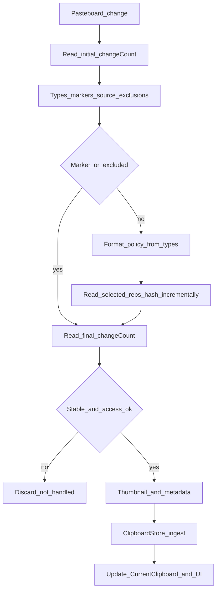
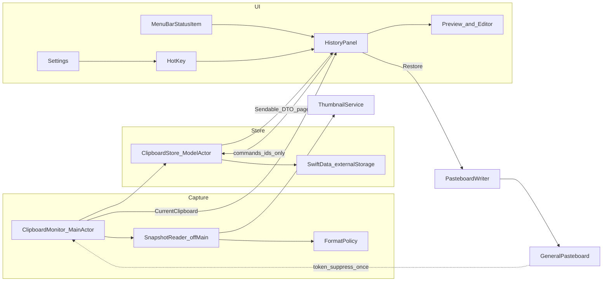

# Memopila — Clipboard Manager Plan

**Document type:** DESIGN  
**Status:** v1 plan, revised after review (macOS 27.x pasteboard access, memory budgets, Pasta parity, record editing). Ready for the Phase 1 spike. Statements marked **(spike)** are assumptions the Phase 1 spike must confirm; record the result next to them before relying on them.  
**SSOT:** §3–§6 = normative contracts; §7 = architecture + memory budgets; §8 = UI; §10 = phase done-when; §11 = test matrix by reference (do not restate contracts)  
**Product:** Memopila — native macOS clipboard manager that replaces [Pasta](https://getpasta.com/): the same UI model (§8) plus what Pasta lacks, starting with record editing (§3.6).

---

## 1. Goals and non-goals

### Goals (v1)

- **Pasta-parity UI** (§8): menu-bar app; hotkey window with sidebar (History, Favorites, Apps, Types, Collections), search and a card grid with thumbnails.
- Capture clipboard history as **deduplicated canonical snapshots** of allowlisted formats (text, rich text, URL, image, PDF, color, files) plus formats the user opts into with **format rules** (§3.2.2).
- **Show the current clipboard even when it is not saved**: a red *Current — not saved* card with the reason and quick fixes (§3.2.3).
- **Restore to Clipboard**: rewrite the pasteboard, close the window, return focus to the previous app. Variants: **Copy as plain text**; optional **Paste after restore** (Accessibility, off by default).
- **Edit records**: edit text content and set a custom title on any record (§3.6).
- Organize with **Favorites** and **Collections** (UI name for tags, many-to-many); search; filter by source app, type, collection.
- **Low memory footprint**: history lives on disk; RAM stays within explicit budgets (§7.3).
- Respect privacy: local-only data, exclude apps, skip transient/concealed/auto-generated markers, follow the macOS pasteboard access policy (**Capture paused**).
- Deduplicate by canonical content hash; retain by **age** and by **`maxCount` on non-favorites only** (favorites outside the count cap).

### Non-goals (v1)

- Auto-rules (content transforms, auto-tagging), snippets. Format rules (§3.2.2) are not auto-rules: they only decide which formats are stored.
- Rich-text editing, image editing, edit history / versions.
- OCR, eyedropper-from-image, lock, export/import, iCloud sync.
- System Quick Look panel (in-app preview instead, §8.5), text transforms beyond Copy as plain text, drag-out to other apps, undo-delete.
- Notarized / Mac App Store distribution; **App Sandbox off** for v1 source builds.
- Persisting file contents from disk (never — §3.3). Display-only QuickLook thumbnails of copied files are allowed.
- Claiming complete automatic protection against secrets (absence of markers ≠ safe content).

---

## 2. Policies

| Policy | Decision |
|--------|----------|
| **Data** | Local only under Application Support; no account, sync, or cloud |
| **Distribution (v1)** | Build and run from source (Xcode). Sign with a stable **Apple Development** identity (a free personal team is enough), not ad-hoc "Sign to Run Locally": the per-app pasteboard access choice in System Settings is tied to the app's code identity, and an identity that changes on every build is expected to reset it **(spike)**. Downloadable binary is a later deliverable |
| **Sandbox** | **Not sandboxed** in v1. Store file **URLs/paths** for restore; no security-scoped bookmarks |
| **Stack** | SwiftUI + AppKit, Swift 6 language mode. **Minimum macOS 15.0** (SwiftData `#Index`/`#Unique`; pasteboard access API from 15.4). Build with the current Xcode (27.x) and macOS 27 SDK |
| **OS test matrix** | Latest 15.x, latest 26.x, 27.0.x, 27.2+. 27.2 is listed separately: its release notes remove the `EnablePasteboardPrivacyDeveloperPreview` default (186955507), so the pasteboard access alert is expected to be enforced from 27.2 **(spike)** |
| **Payload persistence** | One SwiftData `PayloadRepresentation` row per stored representation with `@Attribute(.externalStorage) bytes` (§3.5). No single package blob, no custom BlobStore |
| **Memory** | History lives on disk. No in-memory mirror of history. RAM budgets (§7.3) are phase acceptance criteria |
| **App presentation** | Menu-bar-first (`NSApplication.ActivationPolicy.accessory` / `LSUIElement`); Dock via activation-policy toggle — Phase 1 spike on each OS of the matrix |
| **Window** | Non-activating `NSPanel` **(spike)**; fallback: activating window + remembered previous app (§8.1) |
| **Hotkey** | Default **⌥⌘V** (same as Pasta), rebindable in Settings. Carbon `RegisterEventHotKey` (no global key monitor / Accessibility). While registered it overrides Finder's ⌥⌘V *Move Item Here* — accepted. Only one app can hold a combination: if registration fails (`eventHotKeyExistsErr`, e.g. Pasta is still running), keep the previous binding and show a Settings error that names the likely cause. Rebind order: (1) if new equals current, no-op; (2) register **new** while **old remains active**; (3) on success unregister old; (4) on failure keep old active and show the error. If an API path requires unregistering old first, **re-register old** on new-register failure |

---

## 3. P0 contracts

### 3.1 Pasteboard access and privacy

#### Access behavior (`NSPasteboard.AccessBehavior`, macOS 15.4+)

Facts from Apple's documentation:

- **`.default`:** "If an app has never triggered a pasteboard access alert, its General pasteboard will report `.default` behavior. Such an app is not shown in the corresponding System Settings pane. Once programmatic pasteboard access triggers the first pasteboard access alert, the state automatically changes to `.ask`."
- **`.ask`:** the system asks before granting programmatic access; access that is both user-originated and paste-related is always allowed.
- **`.alwaysAllow`:** all access allowed without notifying the user.
- **`.alwaysDeny`:** programmatic access denied without notifying the user.
- Only the **General** pasteboard is gated: "All other pasteboards default to always allow access" (matters for tests, §11).
- `accessBehavior` is read-only; the user changes it per app in System Settings. It is declared `@objc dynamic`, so KVO may work **(spike)**.
- Writes (Restore) are not gated.

**Spike questions** — answer on every OS of the matrix (§2) and record the results here:

1. Is the alert enforced by default? Expected: off on 15.4–27.1 (developer preview only), on from 27.2.
2. Which calls raise it: `changeCount`, `types`, `data(forType:)` / `string(forType:)`? Expected: content reads only.
3. With enforcement off, does `accessBehavior` stay `.default` after a successful content read?
4. Does a gated read block until the user answers? What does a denied read return?
5. Does KVO on `accessBehavior` fire? Exact System Settings pane name and whether a deep link exists.

**Capture policy:**

| State | Capture |
|-------|---------|
| `.alwaysAllow` | Continuous capture (250 ms poll) |
| `.default` **and** silent default verified for the current OS build (below) | Continuous capture |
| `.default`, not verified | **No background content reads.** Onboarding shows **Enable capture**; pressing it runs the bootstrap read |
| `.ask` | **Capture paused.** Banner + guidance: System Settings → Privacy & Security → *pane (spike)* → Memopila → Always Allow. No reads, no prompt loops |
| `.alwaysDeny` | **Capture paused**, same guidance |
| macOS 15.0–15.3 | No API: continuous capture |

**Bootstrap read** (only from the explicit **Enable capture** action while the state is `.default`; the paused banner's **Check again** only re-reads `accessBehavior` and never reads content):

1. Read **one small content representation** of the current pasteboard (e.g. `string(forType:)` of a text type, else `data(forType:)` of the first declared type) and discard it — not persisted, not hashed. Empty pasteboard → ask the user to copy any text first. A `types`-only peek is not enough if the spike shows it does not raise the alert.
2. Re-read `accessBehavior`:
   - `.alwaysAllow` → start capture.
   - still `.default` → no alert was raised: enforcement is off on this OS. Persist `silentDefaultVerifiedOSBuild = current OS build` and start capture.
   - `.ask` / `.alwaysDeny` → Capture paused with guidance. On enforcing systems this is the normal outcome (the first alert moves the state to `.ask`); its main effect is that Memopila is now listed in System Settings.
3. At most one alert per user action; **never** an alert from background polling. After an OS update the verification no longer matches, so the next launch asks for Enable capture again instead of reading in the background.

**Runtime re-check:**

1. Re-read `accessBehavior` at the start of every tick, before any `changeCount` or content access. Not allowed → skip the tick (Capture paused).
2. **Post-read gate:** when a reader returns, re-read `accessBehavior` before ingest. Not allowed → discard the whole result, do not mark the change handled, pause. The same `changeCount` stays eligible once access returns.
3. On app activation, on return from System Settings, and on KVO change (if it works) → re-check; resume only when allowed. Resume must not promise success.
4. Safety net: if a background read ever moves `.default` → `.ask`, capture pauses immediately (at most one unexpected alert).

**Acceptance:** no alert without a user action on enforcing systems; `.ask` / `.alwaysDeny` start no reader and no periodic poll; mid-read policy drop → discard before ingest, change remains eligible; capture resumes only when allowed; an OS update with state `.default` requires Enable capture again.

#### Marker types (checked before reading other representations)

Conventions from [nspasteboard.org](https://nspasteboard.org). v1 **skips the entire pasteboard change** (no payload, no preview, no record, no Current card) if any Transient, Confidential, or Auto-generated marker is present on any item.

| Class | Identifiers (complete v1 table — each needs a test) | Rule |
|-------|------------------------------------------------------|------|
| Transient | `org.nspasteboard.TransientType`, `de.petermaurer.TransientPasteboardType`, `com.typeit4me.clipping`, `Pasteboard generator type` | Do not save |
| Confidential | `org.nspasteboard.ConcealedType`, `com.agilebits.onepassword` | Do not save |
| Auto-generated | `org.nspasteboard.AutoGeneratedType` | Do not save |
| Source metadata | `org.nspasteboard.source` | Not a skip marker — attribution only (§5); not payload; not in contentHash |

- Lack of a marker does **not** guarantee content is not a secret. Do not claim full automatic secret protection.
- Markers and exclusions (§5) always win over format rules (§3.2.2).

**Tests required:** one automated case **per identifier** above; marker only on the second item → no payload read for any item; marker + stable `changeCount` → whole change skipped and marked handled.

### 3.2 Unit of storage = deduplicated canonical snapshot

- `ClipboardRecord` represents **one deduplicated canonical snapshot identity**. `copyCount` counts **observed captures** of that identity, not every user Copy (polling may coalesce copies; dedup merges identical content).
- Persist the **stored representations** of every item in **original order**: allowlisted ones (§3.2.1) plus types kept by format rules (§3.2.2), minus file coalesce / file+image rules (§3.3), redundant image formats (§3.2.2) and types skipped by rules.
- `displayType` (`text` / `richText` / `url` / `image` / `pdf` / `color` / `file` / `mixed`) is for classification and UI only — never discard other stored representations because of it.
- Multi-file Copy → one record.
- `SnapshotReader` **immediately copies** data into owned values. Do **not** retain `NSPasteboardItem` instances. Restore builds **new** pasteboard items from stored data.

#### Size budget (`maxSinglePayloadBytes`)

- Default **32 MiB**, Settings range **4–256 MiB**, per-app override via format rules (§3.2.2); **hard max 256 MiB**. It limits the stored size of one snapshot: Σ representation bytes + Σ UTF-8 file path bytes.
- The decision of **which** types to read is made from `types` only (§3.2.2), before any payload read.
- Read one representation at a time inside `autoreleasepool`; feed bytes to the incremental SHA-256 (§4) and the owned snapshot; nothing else keeps a copy.
- Before each read: if `acceptedBytes + lowerBoundForNextType` exceeds the limit → stop reading. After each read: if `acceptedBytes` exceeds the limit → stop. No further representations are read for that attempt.
- Oversize → no record; the change is marked handled (if stable); Current card *Not saved — larger than N MiB* with **Save anyway** (§3.2.3).
- **RAM honesty:** AppKit materializes a full representation as `Data` (no streaming read API), so peak memory during capture ≈ accepted bytes + the representation being read + SwiftData write buffers. There is no package-encoding copy. Budget in §7.3.

**Required test:** several representations each under the limit, cumulative over it → not persisted, later representations not read, Current card shows the reason.

#### Pasteboard stability during read (markers inside the guard)

All observation for one change — types, markers, source, exclusions, format decisions, payload copy — happens **inside** one `changeCount`-guarded attempt:

1. Read **initial** `changeCount`.
2. **Once:** read types on **every** item; any forbidding marker (§3.1) on any item forbids the whole change. Decide before any payload read.
3. Read source metadata; resolve **admission source** and **display source** (§5).
4. Apply exclude-apps (**fail-closed**, §5) using the **admission source only**.
5. Forbidden or excluded → read no payload; still complete the guard.
6. Else apply the format policy (§3.2.2) to the declared types → list of representations to read; read them under the size budget.
7. Read **final** `changeCount`. If final ≠ initial → **discard** everything from this attempt; do **not** mark handled (the new count is read on a later tick).
8. Run the **post-read gate** (§3.1). Fail → discard, not handled.
9. Apply the outcome table below.

#### Outcomes

| Outcome | Mark `changeCount` handled? | Current card (§3.2.3) |
|---------|------------------------------|-----------------------|
| Marker skip / excluded source | Yes | None (content never shown) |
| Empty pasteboard | Yes | None |
| Only unsupported / rule-skipped types | Yes | Red *No supported formats* (lists types; **Keep formats…**) |
| Oversize | Yes | Red *Larger than N MiB* (**Save anyway**, **Raise limit for app…**) |
| Declared representation read fails (nil, error, ObjC exception) | Yes (no retry loop) | Red *Read failed* (**Save anyway**) |
| Unstable `changeCount` / post-read gate fails | No | Unchanged |
| Store `committed` / `merged` | Yes | Normal card (with *+N skipped formats* badge if user-relevant types were skipped) |
| Store `rejected` (deterministic, e.g. quota) | Yes | Red *Not saved: reason* |
| Store `failed` twice (§3.2 coordination rule 3) | Yes | Red *Save failed: reason* (**Save anyway**) |
| Store `dropped(stale)` (Clear/Delete/Edit raced, rule 5) | Yes | None |

**Owned snapshot timestamp:** when the guard completes, freeze `observedAt` on the snapshot. Retries and **Save anyway** of the same snapshot use that `observedAt`; dedup merges follow §4.

#### Capture coordination (v1)

**Isolation:**

- `ClipboardMonitor` is `@MainActor`: timer, access checks, `lastHandledChangeCount`, single-flight flag `isCapturing`, `destructiveInProgress`, operation sequence `opSeq`, Restore suppression token (§3.4), `CurrentClipboard` state (§3.2.3).
- `SnapshotReader` runs off the main actor (detached task) and returns a `Sendable` owned snapshot. Off-main `NSPasteboard` reads **(spike)**; fallback: read on the main actor, one representation per run-loop turn, so a slow lazy provider in the source app cannot freeze the UI for the whole snapshot.
- `ClipboardStore` is a `@ModelActor` and the only mutation owner (§3.5).

**Rules:**

1. **Single flight.** A tick starts a reader only if: capture is allowed (§3.1), `!isCapturing`, `!destructiveInProgress`, `changeCount != lastHandledChangeCount`, and the suppression-token check (§3.4) does not consume the count. These checks, `isCapturing = true` and `readerSeq = opSeq` happen **synchronously on the main actor** — no `await` in between.
2. **Completion.** Reader returns → main actor: post-read gate → `await store.ingest(snapshot, readerSeq)` → apply the outcome table → `isCapturing = false`.
3. **Save failure.** The store rolls back and returns `failed(error)`. The monitor retries the same snapshot **once** after ~1 s. A second failure → drop the snapshot (no payload bytes are kept in RAM), mark handled, red Current card with **Save anyway** (re-reads the pasteboard only if `changeCount` is unchanged). Capture continues with later changes. After **3 consecutive** failed snapshots → *Capture paused: storage error* banner with **Resume**.
4. **No pending queue, no crash durability.** If the app dies mid-capture, that observation is lost. `lastHandledChangeCount` is process-local and not persisted: after launch the current pasteboard is captured as one normal observation (if unchanged content was saved before, dedup may bump `copyCount` — accepted). Do not invent a "skip whatever is on the pasteboard at launch" rule.
5. **Clear / Delete / Edit vs an in-flight capture.**
   - The user starts the operation on the main actor: `opSeq += 1`; `destructiveInProgress = true` (no new reader, **Save anyway** disabled); the store call carries `opSeq`. A second Clear/Delete while one runs → **busy** (UI disabled, no queue).
   - The store keeps `lastClearSeq` and a small in-memory tombstone list `{contentHash, opSeq}` (last 64 entries) for Delete and Edit.
   - `ingest(snapshot, readerSeq)` returns `dropped(stale)` when `readerSeq < lastClearSeq`, or when `snapshot.contentHash` has a tombstone with `opSeq > readerSeq`. The check runs inside the same serialized mutation as the commit (no `await` between check and save).
   - The monitor marks `dropped(stale)` as handled. This is safe: a reader can only be in flight if it started before the operation; content copied during the operation either makes that read unstable (re-read later with a newer `readerSeq`) or appears as a newer `changeCount`.
   - `destructiveInProgress = false` when the store returns (success or failure). On failure: UI error, history unchanged.
   - Result: cleared, deleted or pre-edit content is never resurrected by an in-flight capture; unrelated content captured concurrently with a Delete is kept; content copied after the operation started is captured.
6. **Polling:** one timer, **250 ms** (tolerance ~50 ms; not user-configurable), only while capture is allowed. Polling observes discrete samples: several copies between two polls collapse into one observation. Timer cadence for an accessory app with the window closed (App Nap, Low Power Mode) **(spike)**: if ticks are delayed beyond 1 s, hold a `ProcessInfo` activity while capture is enabled.

**Clear History scopes** (explicit Store argument): **`.nonFavorites`** (UI default) deletes all non-favorite records; **`.all`** deletes all records. Representations, thumbnails and `RecordTag` rows of deleted records go in the **same** transaction.

**Required tests:**

- Ten unchanged ticks → no reads; two ticks during one read → one reader.
- Reader of A in flight, Clear → A dropped and handled; B copied during Clear captured afterwards.
- Reader of A in flight, Delete record A → A not resurrected; reader of unrelated C in flight, Delete X → C saved.
- Reader of pre-edit content in flight, Edit → pre-edit record not recreated.
- Policy → `.ask` mid-read → discarded, not handled; eligible after `.alwaysAllow`.
- Save fails once → retried and committed; fails twice → red card, capture continues; 3 consecutive → paused banner.
- **Save anyway** re-reads only if `changeCount` is unchanged.
- Launch → current pasteboard captured once.
- Clear `.nonFavorites` vs `.all`; second Clear/Delete → busy; store failure → UI error, history intact.

### 3.2.1 Supported representations allowlist

| UTI / type | Action |
|------------|--------|
| `public.utf8-plain-text` / `public.plain-text` | Preserve original bytes + UTI; derive UTF-8 preview/search |
| `public.utf16-plain-text` | Preserve original bytes + UTI; derive UTF-8 preview/search; restore original bytes |
| `public.rtf`, `com.apple.flat-rtfd` | Preserve original bytes + UTI |
| `public.html` | Preserve original bytes + UTI |
| `com.apple.webarchive` (also the legacy name `Apple Web Archive pasteboard type`) | Preserve original bytes + UTI |
| `public.url`, `public.url-name` | Preserve original bytes + UTI |
| `public.file-url`, `NSFilenamesPboardType` | **File-reference exception** (§3.3) |
| `public.png`, `public.heic`, `public.jpeg`, `com.compuserve.gif`, `public.tiff` | Preserve original bytes + UTI, subject to the redundant-image rule (§3.2.2) |
| `com.adobe.pdf` | Preserve original bytes + UTI (not a redundant raster) |
| `com.apple.cocoa.pasteboard.color` | Preserve original bytes + UTI |
| `org.nspasteboard.source` | Metadata only (§5) |
| Transient / Confidential / Auto-generated markers (§3.1) | Detect only; skip entire change |
| **Any other UTI** | Skip, unless a format rule keeps it (§3.2.2) |
| **File promises** / deferred file providers | Skip in v1 |

**Universal Clipboard:** content copied on another device arrives lazily over the network; reading it may block and counts against the size budget. It is captured like local content. Setting **Ignore content from other devices** (default off) skips changes that carry the remote-clipboard type (`com.apple.is-remote-clipboard` **(spike: verify identifier)**).

**Representation fidelity:** non-file representations keep original bytes and UTI. Derived UTF-8 (preview/search) is outside the restore path. File-reference representations follow §3.3.

**Mixed content / read failures:**

| Case | Action |
|------|--------|
| Type not stored (not allowlisted, skipped by rule, redundant image) | Not read |
| Declared stored representation present but **read fails** (nil, error, or ObjC exception) | **Discard the entire snapshot**; mark handled if stable; red Current card; **must not crash** |
| Item with zero stored representations | Omit the item (not counted in MCS1 `itemCount`, §4) |
| Whole pasteboard empty / markers-only / excluded | No record |

**AppKit read errors:** some `NSPasteboard` paths can raise `NSPasteboardCommunicationException` (Objective-C exception). If the chosen read API can raise it, wrap reads in a **narrow Objective-C boundary** that converts the exception into a read failure. No global exception catcher.

**Test:** allowlisted read failure → no partial record, handled when stable, process keeps running.

### 3.2.2 Format policy and user format rules

The policy decides, **from the declared `types` only**, which representations are read and stored. Markers and exclusions are evaluated first and always win.

**Default policy:**

1. Allowlist (§3.2.1).
2. **Redundant image formats.** If an item declares more than one raster image type, read only the first available in this order: **GIF > PNG > HEIC > JPEG > TIFF**; the others are never read. GIF goes first because it may be animated. PDF is vector and not a redundant raster: keep PDF and the chosen raster. Rationale: a full-screen screenshot on a 5K / 6K display is ~59 / ~81 MB as uncompressed TIFF and a few MB as PNG.
3. A record whose TIFF was skipped restores the stored raster only. If a target app turns out to need TIFF, Phase 4 adds a lazy TIFF data provider that converts on demand (§12 otherwise).

**User format rules** (Settings → Formats):

- Rule = `{ app: any | bundle ID, type: exact UTI | prefix (e.g. com.adobe.), action: keep | skip, maxSize: MiB? }`.
- Precedence: app + type > app only > type only > default policy. Within a level, the first rule in list order wins.
- **`keep` on a non-allowlisted type** → stored as opaque bytes, restored byte-for-byte under the same type, hashed like any bytes representation (§4).
- **`keep` on an image type** disables the redundant-image rule for that type (example: *Adobe Photoshop: keep `public.tiff`*).
- **`maxSize`** raises or lowers the size budget for matching snapshots (the largest matching value wins), never above the hard max (256 MiB).
- App matching uses the **display source** (§5), including the frontmost-app fallback: format rules are a convenience, not a privacy boundary. Exclusions keep using the admission source.
- Changing rules affects new captures only. The same copy stored with different formats has a different `contentHash` (§4) — accepted.

**Quick creation:** the red Current card offers **Keep formats from <App>…** (pre-filled rules for the skipped types) and **Raise limit for <App>…**.

**Inspector:** Settings → Formats → **Inspect current clipboard** lists items, declared types and the decision for each (store / skip by rule / redundant / unsupported). Sizes are shown only for representations it actually reads; it reads only when the button is pressed, within the hard max, and keeps nothing.

**Tests:** precedence levels; prefix rule; Photoshop *keep TIFF*; PNG + TIFF by default → TIFF never read (assert no read call); non-allowlisted *keep* restores byte-exact; markers and exclusions beat rules.

### 3.2.3 Current clipboard state (red card)

- `ClipboardMonitor` keeps `CurrentClipboard` for the latest stable change **in memory only** (never persisted): `changeCount`, status, display source, declared type names, known size (lower bound), optional thumbnail.
- Status → UI:
  - `saved(recordID)` → normal card (first in History by recency); badge *+N skipped formats* (tooltip lists them) when types other than redundant images were skipped.
  - `notSaved(reason)` → **red card** first in History: reason (*Larger than 32 MiB*, *No supported formats*, *Read failed*, *Save failed: …*, *Not saved: quota*), source app, type list, known size.
  - `privacySkipped`, `excluded`, `paused` → no card (content is never shown; paused state uses the banner).
- The red card is replaced as soon as the clipboard changes.
- Its thumbnail comes only from data already read within the budget. It never triggers extra reads and is never persisted.
- **Actions:**
  - **Save anyway** — user-initiated one-shot capture of the current pasteboard, only if `changeCount` is unchanged. Same format policy with the size limit raised to the hard max; for *No supported formats* it keeps all declared types.
  - **Keep formats from <App>…** and **Raise limit for <App>…** — rule shortcuts (§3.2.2).
  - **Dismiss**.

**Tests:** each status maps to the right card; marker/excluded changes never show content; Save anyway rejected after a clipboard change; red card disappears on the next change.

### 3.3 Files: references only — live filesystem state

**Product rule (v1):** Memopila **never persists file contents** from disk. It stores **path references** for file representations. It **skips image UTIs on the same item** as file references (§3.3 coalesce). It **may** store image bytes from **other items** in the same change when those items have no file refs. Do **not** claim "never any bytes that might equal a file on disk." No path↔image matching heuristics.

**Display-only thumbnails:** file cards show a QuickLook thumbnail (`QLThumbnailGenerator`) at card size, generated on demand from the file on disk, kept only in the in-memory thumbnail cache (§7.3), never persisted and never hashed. It works for any file size (QuickLook generates out of process). Missing file → **Unavailable** (dimmed card, Reveal disabled). The card footer shows file count and total size (`stat` off the main actor).

**v1 file fidelity (chosen contract):** fidelity is to **paths, path order, and Finder-usable restore** — not necessarily to the original file UTI or item boundaries.

- On capture: read `public.file-url` and legacy `NSFilenamesPboardType` per the coalesce rules below; persist **one** ordered normalized path list per item. Do not store original filenames plist bytes.
- Hash **`CanonicalFileListV1`** (§4) — never plist bytes, never file contents.
- On Restore: write the list **once** as a canonical modern set of file `URL`s (e.g. `writeObjects`). Integration-test with Finder.
- Do not persist whether the list came from multi-path vs single-URL representations.
- No security-scoped bookmarks in v1.

#### File-representation coalesce and MCS1 framing (same item)

**Path list:**

1. Normalize each file representation to an ordered path list (§3.3.1).
2. Both present and **equal** → one list. **Different** → use **`public.file-url`** only. Never union/concatenate.
3. Restore emits that list **once**.

**Effective file UTI for MCS1 `typeIdBytes`:** `public.file-url` if present on the item, else `NSFilenamesPboardType`. Payload bytes for that slot are `CanonicalFileListV1` of the chosen list (§4).

**Representation order (per item, original pasteboard order):**

1. Walk representations in original order.
2. On the **first** file-reference type → emit **one** file slot with the effective UTI + coalesced list.
3. Skip the **second** file-reference type.
4. Skip image UTIs when any file-reference type is present on the item.
5. Emit every other stored non-file representation in place, preserving relative order.

Example: types `[public.utf8-plain-text, NSFilenamesPboardType, public.file-url, public.html]` with equal lists → reps: utf8-plain-text, **`public.file-url` + CanonicalFileListV1** (at the NSFilenames position), html.

**Unit tests (assert full canonical framing bytes):** equal lists; unequal lists (file-url wins); file types before/after text and HTML in different orders.

#### Mixed file + non-file representations on one item

Capture stores the coalesced file list plus the item's other stored non-file representations (image exception above).

**Restore rule:**

1. Emit file URLs for the coalesced list **once**.
2. Also restore every stored non-file representation of that item.
3. When file expansion changes item boundaries, attach the non-file representations to the **first** restored file-URL item from that original item.

| Pasteboard content | Stored as |
|--------------------|-----------|
| Finder copy of a `.png` | Normalized path reference(s) only (image UTI on same item skipped); card thumbnail via QuickLook |
| Screenshot / image pixels (no file refs) | One raster representation (§3.2.2) |
| One item with file-url + plain text | Paths + text; restore = file URL(s) + text on the first file item |
| Equal file-url + NSFilenames lists | One list; restore once |
| Unequal file-url + NSFilenames | file-url list only |

#### 3.3.1 Path normalization (single algorithm)

Applies to `public.file-url` and `NSFilenamesPboardType` before storage, hash, and UI. **Must not** use APIs that resolve symlinks or collapse `..` (e.g. avoid `standardizingPath`).

| Input kind | Rule |
|------------|------|
| `file:` URL | Parse with Foundation `URL`. Extract the decoded path **exactly once** (e.g. `path(percentEncoded: false)`). **Never** percent-decode the result again |
| Legacy filename path string | A filesystem path, not a URL. **Do not** percent-decode |

1. **Do not** collapse `.` or `..`; keep the string exactly as extracted.
2. Encode as **UTF-8** for `CanonicalFileListV1` and display.
3. **Do not** resolve symlinks; **do not** read or compare file contents.
4. Preserve path order.

**Required tests:** percent-encoded space in a URL; literal `%20` in a filename (not double-decoded); `.` and `..` kept; symlink path unchanged; spaces and Unicode; same path via each file representation → identical `CanonicalFileListV1` bytes.

### 3.4 Restore to Clipboard (not paste)

User-facing name: **Restore** (menu: *Copy to Clipboard*).

**Focus and keys:**

- Remember the previous frontmost app before the window shows (with the non-activating panel it simply stays frontmost).
- **Enter** restores the selected card whether focus is in the **grid or the search field**. While typing, selection follows the first result; arrow keys move the selection without leaving search.
- **⇧Enter** — Copy as plain text (below).
- **Esc** — clears a non-empty search; otherwise closes the window without changing the clipboard and returns focus.
- **Successful** Restore: write pasteboard → close window (unless pinned, §8.1) → previous app stays/returns frontmost.
- **Write failure:** keep the window open, show an error, do not treat as restored.

**Variants:**

- **Restore:** all stored representations.
- **Copy as plain text:** one item with `public.utf8-plain-text` derived from the record's text (UTF-8 decode helper, §7.4); available when the record has text.
- **Paste after restore** (Settings, off by default): once the panel has given up key status (it closes; when pinned it resigns key and stays visible), post ⌘V to the previous app via `CGEvent`. Requires Accessibility; without it the setting shows guidance and Restore still works.

**After a confirmed Restore:** the store moves the record to the top: `lastCopiedAt = max(lastCopiedAt, restoreTime)`; `copyCount` unchanged.

#### PasteboardWriter contract

`writeObjects(_:)` **adds** objects; Restore must **clear then write**. `clearContents()` returns the `changeCount` at which Memopila takes ownership — the anchor for the suppression token. There is no atomic cross-app pasteboard transaction.

1. **Load and verify first** (in the store, off the main actor): integrity checks of §3.5. Any failure → error, **no** pasteboard mutation. Build all `NSPasteboardItem`s in memory. Set `org.nspasteboard.source` **exactly once** on the first item: saved valid bundle ID, else empty string (§5).
2. On the main actor, **synchronously, with no `await`** from start to end (ticks run on the same actor and cannot interleave): `clearContents()` → `ownedCount` → pre-write check (`changeCount == ownedCount`, else abort) → `writeObjects` (must return `true`) → post-write confirmation (`changeCount == ownedCount`) → publish the token only if confirmed.
3. **Never** use an unconfirmed `changeCount` as the token. Prefer not suppressing a possible self-write over losing another app's content.
4. Abort / write failure: error, window stays open; do **not** claim the previous clipboard was preserved.
5. Release the loaded representation bytes right after the write.

**Suppression token** (main actor):

1. At most **one** confirmed token (`ownedCount`).
2. On a tick, before starting a reader: if `changeCount` equals the token → mark handled, consume the token, no reader, no ingest. A confirmed Restore is suppressed **once**.
3. If `changeCount` differs → discard the token and process the count normally.
4. No token → normal polling (an own Restore may be re-observed; dedup handles it).

**Required tests:**

- Restore B replaces A (clipboard is B, not A+B).
- Multi-item Restore: `string(forType: org.nspasteboard.source)` returns exactly the bundle ID once; source not in payload or hash.
- External change after `clearContents()` before the pre-write check → abort without `writeObjects`.
- External change after the pre-write check → no token; the test must not claim foreign content was untouched.
- A wrong token never suppresses an external change.
- Confirmed Restore suppressed once; later external change captured.
- Restore moves the record to the top without changing `copyCount`.
- Copy as plain text writes only plain text + source marker.

### 3.5 Ingest pipeline and payload persistence



#### Storage model

- `ClipboardRecord` — metadata only (§7.2); list and search fetch these rows only.
- `PayloadRepresentation` — one row per stored representation: `itemIndex`, `repIndex`, `uti`, `kind` (`bytes` | `filePaths`), `bytes: Data?` with `@Attribute(.externalStorage)`, `paths: [String]?`, `byteCount`. Relationship from the record with **cascade** delete.
- `RecordThumbnail` — one optional row per record (`data`, longest side ≤ 512 px, alpha preserved; HEIC if the spike confirms alpha support, else PNG). Separate entity so list fetches never load it; cascade delete.
- `ClipboardRecord.payloadSizeBytes = Σ byteCount` (bytes count, or Σ UTF-8 path bytes); `storageFormatVersion = 1`.
- Never put `bytes` or thumbnail data in `#Predicate` filters.

**Why rows instead of one package blob:** no encode copy at ingest (peak ≈ 1× snapshot), previews load only the representation they need, and list queries cannot touch payload bytes.

**Integrity before Restore (mandatory):**

1. Reject `hashSchemeVersion != 1` and `storageFormatVersion != 1`.
2. Rows sorted by `(itemIndex, repIndex)` are contiguous from 0; each row has the field its `kind` requires; `bytes.count == byteCount`; `Σ byteCount == payloadSizeBytes`.
3. File paths validate with the capture normalization rules (§3.3.1; no file reads).
4. Recompute MCS1 (§4) from the rows; SHA-256 hex must equal `contentHash`.
5. Any failure → **unreadable**: error, no `clearContents()`.

**Commit:** one SwiftData save inserts the record + representations + thumbnail and deletes the retention/storage victims (§6) with their representations, thumbnails and `RecordTag` rows. On error → `rollback()`, history intact, result `failed(error)`. Deterministic refusal → `rejected(reason)`. Store results: `committed` | `merged` (dedup hit) | `rejected` | `failed` | `dropped(stale)`.

**Mutation ownership:** hashing is pure and runs in `SnapshotReader`. Dedup lookup, limit checks, victim planning and commit run as **one** serialized `ClipboardStore` operation with no `await` between checks and save. All mutations of records, collections, rules and settings go through `ClipboardStore`; the UI passes IDs and commands only.

**Phase 1 storage spike (mandatory, macOS 15 / 26 / 27):**

1. Paged card DTO fetches (`fetchLimit` / `fetchOffset` + `propertiesToFetch`) and search predicates do not materialize representation bytes or thumbnails.
2. Representations of 32 MiB and 256 MiB (hard max) round-trip: ingest, Restore, delete, reopen after force-quit. Measure peak footprint against §7.3.
3. Deleting a record removes its external data files.
4. A failure before commit (`rollback()` / no save) leaves nothing visible after reopening the store; covers "insert only" and "insert + victim deletes".
5. Whether the long-lived `@ModelActor` context keeps inserted `bytes` resident after save. If it does, ingest uses a short-lived `ModelContext` per operation.

If a mandatory gate fails → amend this PLAN with a fallback (layout, commit order, orphan accounting, recovery) **before** implementing any custom blob store.

### 3.6 Editing records

**Custom title** — any record: `customTitle: String?`. Shown on the card above the content preview; searchable; not part of `contentHash`. Shortcut ⌘R or context menu **Rename…**; empty title clears it.

**Edit text** — records with `displayType` `text`, `richText` or `url` (not images, PDFs, colors, files, mixed):

- Editor: plain-text editor inside the window (⌘E / **Edit…**), same monospaced font as cards, standard undo while open.
- Records with rich formats (RTF, RTFD, HTML, web archive) show a warning: *Formatting will be removed*. Rich-text editing is deferred.
- **Save** replaces the record's representations **in place** with one item holding `public.utf8-plain-text`. Recompute `contentHash`, `payloadSizeBytes`, `cardPreview`, `searchText`; `displayType` becomes `url` if the whole text is a single URL, else `text`. Keep favorite, collections, `copyCount`, timestamps, `customTitle`; set `editedAt`. No version history.
- **Save & Copy** (⌘↩ in the editor): save, then Restore.
- Empty text → save disabled. Text larger than `maxSinglePayloadBytes` → save rejected with a message.
- **Dedup collision:** if the new hash equals another record → merge into that record (favorite = OR; collections = union; `copyCount` = sum; `firstCopiedAt` = min; `lastCopiedAt` = max; `customTitle` = the existing one, else the edited one), delete the edited record, select the survivor, show *Merged with an existing record*. One transaction.
- **Concurrency:** Edit is a `ClipboardStore` mutation; it adds the old hash to the tombstones (§3.2 coordination rule 5). Record deleted meanwhile → *Record no longer exists*.

**Tests:** plain edit; rich → plain with warning; URL detection; collision merge; title shown and searchable; Save & Copy; in-flight capture of pre-edit content not recreated.

---

## 4. Dedup semantics

A **dedup hit** means the canonical snapshot hash is identical. Update record metadata only; **never rewrite** existing representations (editing is a separate explicit operation, §3.6).

**Versioning:** `storageFormatVersion` and the canonical-hash scheme are independent. Changing hash framing bumps the scheme (magic below **and** `ClipboardRecord.hashSchemeVersion`).

### CanonicalSnapshotEncodingV1

All multi-byte integers are **UInt64 big-endian**. The hash covers **stored payload** representations only.

**Excluded:** `org.nspasteboard.source`, all marker types, `customTitle`, thumbnails. Changing source alone must **not** create a new record.

```
CanonicalSnapshotEncodingV1:
  magic/version:  ASCII "MCS1" (4 bytes)   // Memopila Canonical Snapshot v1
  itemCount:      UInt64   // retained items only

  for each retained item, in original pasteboard order among retained:
    representationCount: UInt64   // stored reps after coalesce and format policy

    for each stored representation in that item's canonical order (§3.3):
      typeIdByteLength: UInt64
      typeIdBytes:      UTF-8 UTI/type string

      payloadByteLength: UInt64
      payloadBytes:      canonical payload for that type
```

**`itemCount`:** items that contribute at least one stored representation. Items with zero stored representations are not encoded.

`contentHash = SHA-256(CanonicalSnapshotEncodingV1)`, lowercase hex. Computed **incrementally** while reading (no concatenated buffer).

| Class | `payloadBytes` |
|-------|----------------|
| Text / rich text / URL / image / PDF / color / rule-kept types | **Original** representation bytes |
| File-list types | `CanonicalFileListV1` — not plist bytes, not file contents |

```
CanonicalFileListV1:
  pathCount: UInt64

  for each path in original order (after §3.3.1 normalization):
    pathByteLength: UInt64
    canonicalPathBytes: UTF-8
```

**Structural invariant:** one item with two representations ≠ two items with one representation each.

Persist `contentHash: String` and `hashSchemeVersion: Int` (= 1). Dedup compares only records with the same scheme. v1 rejects `hashSchemeVersion != 1` on Restore and any verify path; future schemes need an explicit migration.

**Metadata merge on a dedup hit** (from the snapshot's `observedAt` and source, never retry wall-clock):

- `firstCopiedAt = min(existing, observedAt)`; `lastCopiedAt = max(existing, observedAt)`.
- `copyCount += 1` once per distinct observation (the single-flight monitor never submits the same snapshot twice after success).
- `lastSourceAppBundleID` / `lastSourceAppName` update only when `observedAt >= existing.lastCopiedAt`.
- Preserve favorite, collections, `customTitle`.
- New record: `firstCopiedAt = lastCopiedAt = observedAt`.

**SoC:** canonical encoding + SHA-256 are a pure, deterministic type with no SwiftData or UI.

---

## 5. Source attribution and exclude-apps

- Fields: `firstCopiedAt`, `lastCopiedAt`, `copyCount`, `lastSourceAppBundleID`, `lastSourceAppName`.

Distinguish **admission source** (gates payload; exclusions) from **display source** (UI, Apps sidebar, format rules).

#### Reading `org.nspasteboard.source`

Do **not** use pasteboard-level `string(forType:)` for admission — it concatenates values across items.

1. Collect values from **each** item whose `types` include `org.nspasteboard.source`.
2. **No** item declares the type → source **absent**.
3. Declared but nil / non-string → **present but invalid**: admission = Unknown; non-empty exclusions → skip.
4. Every present value is the **same valid** bundle ID → that ID.
5. Any empty, invalid, nil-on-declared, or conflicting values → Unknown; non-empty exclusions → skip.
6. Never admit on a concatenated string.

**Valid bundle ID (single validator — Settings, admission, DTOs, format rules):** UTF-8 length 1…255; no whitespace or control characters; split on `.` into ≥ 2 non-empty components; each component letters/digits/hyphen only, not starting or ending with `-`. Empty string is a present marker meaning unknown — not a valid ID.

| Marker | Admission source | Display source |
|--------|------------------|----------------|
| Valid bundle ID | That ID | Same |
| Present but empty / invalid / unreadable | **Unknown** | **Unknown** — never frontmost |
| Absent | See exclusions | Frontmost app at capture time (best effort) |

**Exclude-apps (fail-closed):**

| Exclusion list | Rule |
|----------------|------|
| **Empty** | Capture allowed (markers / access permitting) |
| **Non-empty** | Admit only when a **valid** bundle ID is present **and** not on the list. Absent / empty / invalid / unreadable → **skip**. Frontmost never bypasses |

**Trust boundary (Settings + README):** exclusions filter self-reported metadata; they are not an authenticated security boundary. With exclusions enabled, apps without a valid `org.nspasteboard.source` are skipped. A writer can claim another app's bundle ID.

- On Restore, write `org.nspasteboard.source` **exactly once** (§3.4).
- Source is metadata, not payload; not in `contentHash`.

**Required tests:** `""` + non-empty exclusions → no payload; absent + non-empty exclusions → no payload even if frontmost is allowed; valid source not excluded → capture; empty exclusions + empty/invalid marker → Unknown, not frontmost; empty exclusions + absent marker → frontmost display source; validator rejects leading/trailing `.`, empty component, whitespace, `...`; declared + nil → invalid; same valid ID on several items → that ID; conflicting IDs → Unknown.

---

## 6. Retention, storage limits, and deletion

### Defaults (v1)

| Setting | Default |
|---------|---------|
| `maxCount` | **500** non-favorite records; range **1…10 000** (0 not allowed) |
| `maxAge` | **30 days** from `lastCopiedAt` |
| `maxStorageBytes` | **512 MiB** Σ `payloadSizeBytes` over all records (logical payload quota, not total disk usage; not a v1 setting) |
| `maxSinglePayloadBytes` | **32 MiB**, Settings 4–256 MiB, per-app rule overrides, hard max 256 MiB (§3.2) |

### Rules

- **Favorites:** excluded from `maxCount`, age eviction and storage victim planning. Never auto-evicted. Collections do not pin.
- Non-favorites are the only automatic eviction candidates.
- **Cascade on every delete path** (manual Delete, retention, Clear, ingest victims, edit merge): representations, thumbnail and `RecordTag` rows go in the **same** transaction. External data goes with the record.
- Deleting a **Collection** deletes its `RecordTag` rows; records stay.
- `RecordTag` uniqueness `(recordId, tagId)` via `#Unique` (upsert on duplicate is harmless here).

### Age schedule

Delete non-favorites older than `maxAge`: at startup; after successful history mutations (ingest, Clear, settings that shrink caps, unfavorite); every 24 h while running. After a successful **unfavorite**, run age cleanup in the same pipeline.

### Count cap on ingest, settings change, and favorite toggle

- **New unique non-favorite:** plan oldest non-favorite victims so that after insert `freeCount ≤ maxCount`; victims share the insert transaction.
- **Settings lowers `maxCount`:** apply immediately in one mutation.
- **Favorite on:** no eviction. **Favorite off:** evict oldest **other** non-favorites until `freeCount ≤ maxCount` (the invariant guarantees a victim exists), then age cleanup.

### Storage preflight and safe commit (new ingest)

One `ClipboardStore` mutation, no `await` between checks and commit. Never delete existing history before the new record commits.

1. **Dedup lookup** — match ⇒ metadata merge only (`merged`).
2. `newPayloadBytes` = Σ snapshot bytes; reject if above the effective size limit.
3. `actualStoredBytes` = Σ `payloadSizeBytes` (metadata only).
4. Count victims for `freeCount ≤ maxCount`; `countVictimBytes`.
5. `requiredAdditionalBytes = max(0, actualStoredBytes + newPayloadBytes - maxStorageBytes - countVictimBytes)`.
6. Storage victims = oldest non-favorites not already chosen, until reclaimed ≥ required.
7. `allVictims` = union.
8. Still over the limit without favorites → `rejected(quota)`, no deletes.
9. Else one transaction: insert record + representations + thumbnail, delete `allVictims` with cascades. Error → rollback → `failed`. Success → `committed`.

### Confidentiality of stored data

- History lives under Application Support **without app-level encryption** in v1. Local-only ≠ encrypted.
- UI and privacy copy must not imply encryption or that unmarked secrets are filtered.
- Logs never contain clipboard content: `os.Logger` with `privacy: .private` for anything derived from payloads; no payload bytes, previews or paths in logs.

---

## 7. Architecture

This PLAN is the system design. No separate `SYSTEM_DESIGN.md`, ADR set or C4 pack unless a future decision needs one.



### 7.1 Components

No mandatory Repository / UseCase / Coordinator layers. Add test seams only where needed (pasteboard access policy, store failures).

| Component | Responsibility |
|-----------|----------------|
| `ClipboardMonitor` (`@MainActor`) | Access policy (§3.1), timer, single flight, `opSeq`, Restore token, `CurrentClipboard`, Clear/Delete/Edit busy state (§3.2) |
| `SnapshotReader` (off main) | Guarded read, markers once, per-item source, exclusions, format policy, size budget, file coalesce, incremental MCS1 hash |
| `FormatPolicy` (pure) | Default policy + user rules → which types to read and the effective size limit (§3.2.2) |
| `ThumbnailService` | Ingest: ImageIO downsampled thumbnail + pixel size (no full decode). Display: QuickLook thumbnails for files (§3.3). Shared memory cache (§7.3) |
| `ClipboardStore` (`@ModelActor`) | Sole mutation owner; ingest results; tombstones / `lastClearSeq`; retention; edit/merge; DTO read methods |
| Read models | Immutable `Sendable` DTOs; card DTOs carry no payload bytes and no thumbnail data |
| `PasteboardWriter` | Verify → build items → synchronous clear/write/confirm on the main actor; Copy as plain text; Paste after restore (§3.4) |
| `WindowPresenter` | Non-activating panel, screen choice, pin, frame per display (§8.1) |
| `HotKeyMonitor` | Carbon register/unregister; rebind keeps old until new succeeds (§2) |
| `LoginItemManager` | `SMAppService.mainApp` |
| `ActivationPolicyController` | Dock vs accessory |
| SwiftUI | Renders DTOs; issues commands to `ClipboardStore`; never reads or writes persistent models directly |

UI refreshes from store-published change notifications + explicit paged reloads; the private `ModelContext` is never shared with views.

### 7.2 Data model

- `ClipboardRecord` — `id: UUID`, `displayType`, `firstCopiedAt`, `lastCopiedAt`, `copyCount`, `lastSourceAppBundleID`, `lastSourceAppName`, `isFavorite`, `contentHash`, `hashSchemeVersion` (= 1), `storageFormatVersion` (= 1), `payloadSizeBytes`, `cardPreview` (≤ 300 scalars), `searchText` (≤ 10 000 scalars), `customTitle?`, `editedAt?`, `pixelWidth?` / `pixelHeight?`, `colorHex?`, `fileCount?`, `fileNames?` (for search), `skippedTypes?` (badge), relationships `representations` (cascade) and `thumbnail` (cascade). `#Index` on `contentHash`, `lastCopiedAt`, `isFavorite`, `lastSourceAppBundleID`, `displayType`. Dedup uniqueness is enforced by `ClipboardStore`, not `#Unique` (SwiftData resolves `#Unique` conflicts by upserting, which would bypass the merge rules).
- `PayloadRepresentation`, `RecordThumbnail` — §3.5.
- `Tag` (UI: Collection) — `id`, `name`, `sortOrder`. `RecordTag` (`recordId`, `tagId`) with `#Unique`.
- `FormatRule` — `id`, `appBundleID?`, `typePattern`, `isPrefix`, `action`, `maxSizeMiB?`, `order`.
- `AppSettings` — hotkey, exclusions, retention, size limit, `showDockIcon`, `loginAtStart`, `pasteAfterRestore`, `ignoreRemoteClipboard`, `silentDefaultVerifiedOSBuild`, window frame per display. Polling interval is fixed (250 ms).

### 7.3 Memory budgets

History lives on disk; RAM holds only what is on screen plus bounded caches. Budgets are measured as **physical footprint** (Activity Monitor *Memory*, `footprint`, Instruments) on Apple silicon:

| Scenario | Budget |
|----------|--------|
| Idle, window closed, 500 records | ≤ 50 MB |
| Window open, scrolling through 10 000 records | ≤ 150 MB |
| Capture of a snapshot of size S | ≤ idle + 2 × S, transient |
| 10 s after the window closes / after a capture | within idle + 10 MB |

**Practices (normative):**

- No in-memory mirror of history: the grid loads DTO pages (`fetchLimit` / `fetchOffset`, `propertiesToFetch`) for visible cards plus a small prefetch.
- Card text ≤ 300 scalars; search runs as a store predicate with a limit; `searchText` never goes into DTOs.
- Thumbnails are produced once at ingest with ImageIO downsampling (`CGImageSourceCreateThumbnailAtIndex`, longest side ≤ 512 px). Full-size images are never decoded for cards; preview downsamples to the view size.
- One `NSCache` for card thumbnails and QuickLook file thumbnails, `totalCostLimit` 24 MB.
- Window closed for 10 s → drop DTO pages and caches (the panel shell stays for instant reopen). Memory pressure (`DispatchSource.makeMemoryPressureSource`) → drop immediately.
- `autoreleasepool` around each pasteboard representation read and around Restore item building; no retained `NSPasteboardItem`.
- The monitor holds no payload bytes after a snapshot completes (no pending queue, §3.2).
- Restore and preview load representations of one record and release them right after use.

**Verification:** Phase 1 records baselines; Phases 3–6 assert the budgets in a scripted scenario (UI test + `task_vm_info.phys_footprint`) and with Instruments (Allocations, VM Tracker) before the phase is done.

### 7.4 Preview and search extraction

Full payload stays in `PayloadRepresentation` regardless of these caps.

| Use | Cap |
|-----|-----|
| Card preview (`cardPreview`, stored) | **300** Unicode scalars |
| Search extract (`searchText`, stored, never in DTOs) | **10 000** Unicode scalars |
| Detail preview (loaded on demand from the text representation) | **20 000** Unicode scalars |

**Text decode helper (single path):** UTF-8 for UTF-8/plain; `public.utf16-plain-text` honors a BOM, else UTF-16LE (unit-tested). RTF/RTFD/HTML → plain text via `NSAttributedString` off the main actor, only when no plain-text representation exists. Undecodable → no text index for that representation; never fail capture. Caps apply to Unicode scalars of the decoded string.

---

## 8. UI

Reference: Pasta's window (dark theme, ~720 × 490 pt): sidebar on the left, search bar on top, a 3-column grid of cards.

### 8.1 Window

- Non-activating `NSPanel` that can become key, so the previous app stays frontmost and keyboard input still reaches search and grid **(spike: text input, Esc, focus, full-screen spaces, multi-display; fallback: activating window + remembered previous app)**.
- Floating level; `collectionBehavior` `.canJoinAllSpaces` + `.fullScreenAuxiliary` (shows over full-screen apps).
- Opens on the screen with the mouse pointer; size and position remembered per display (default 720 × 490 pt, min 520 × 360). Search is focused and empty on every open; selection on the first card.
- Closes on: Restore, Esc (empty search), focus loss, hotkey again — except while **pinned**.
- **Pin** (⚓ button): keeps the window open on Restore and focus loss.
- Follows system appearance; standard materials (Liquid Glass on 26+ comes from the SDK).

### 8.2 Layout

- **Sidebar** (toggle button, ⌃⌘S): **History**, **Favorites**; **Apps** — source apps with icons, most recent first; **Types** — only types present (Text, Rich text, URL, Image, PDF, Color, File); **Collections** with **+ New Collection**. A selection filters the grid; search applies inside it.
- **Top bar:** search field, sidebar toggle, pin, settings.
- **Grid:** adaptive columns (3 at default width), cards ≈ 4:3, selected card with a 3 pt accent border.
- **Card content:**
  - Text — `customTitle` (if set) as a heading, then the first lines, monospaced.
  - URL — monospaced, link color.
  - Image / PDF — thumbnail centered, aspect-fit, on a checkerboard background (transparency).
  - Color — swatch + hex.
  - File — QuickLook thumbnail or icon + file name; *Unavailable* dimmed when missing.
- **Card footer:** source app icon (type icon when unknown) + metric (*N characters*, *W × H px*, *N files · 12.3 MB*, *#RRGGBB*) + relative time (*Now*, *2m*, *3h*, *4d*); heart if favorite; pencil if edited; *+N skipped formats* badge (§3.2.3).
- **Red Current card** first in History (§3.2.3).
- **Banners** above the grid: Enable capture (onboarding), Capture paused, storage errors.
- Empty states for History, filters and search.

### 8.3 Keyboard

| Key | Action |
|-----|--------|
| Typing | Goes to search |
| ↑ ↓ ← → | Move selection (also while search is focused) |
| ↩ | Restore selected |
| ⇧↩ | Copy as plain text |
| ⌘1 … ⌘9 | Restore the Nth visible card |
| Space (grid focused) / ⌘Y (anywhere) | Toggle preview |
| ⌘E | Edit text (§3.6) |
| ⌘R | Rename (custom title) |
| ⌘D | Toggle favorite |
| ⌘⌫ | Delete selected (favorites ask for confirmation) |
| ⌘F | Focus search |
| ⌃⌘S | Toggle sidebar |
| Esc | Clear search → close |
| ⌘, | Settings |

### 8.4 Context menu

Copy to Clipboard; Copy as Plain Text; Edit…; Rename…; Favorite / Unfavorite; Add to Collection ▸; Reveal in Finder (files); Delete.

### 8.5 Preview

In-window overlay (not the system Quick Look panel): text up to 20 000 scalars; image/PDF downsampled to the view size; file — QuickLook thumbnail, path, size, Reveal; color swatch. Metadata: source app, first / last copied, copy count, stored formats, skipped formats.

### 8.6 Search

- Case- and diacritic-insensitive substring match (`localizedStandardContains`) over `searchText`, `customTitle`, source app name and file names. Several words → all must match.
- Results ordered by `lastCopiedAt` (newest first); sidebar filter AND search.
- Budget: ≤ 50 ms per keystroke for 10 000 records on Apple silicon (Phase 3 measurement). If SwiftData misses it, move search text to an SQLite FTS5 side index and record the decision here.

### 8.7 Settings

- **General:** hotkey, launch at login, Dock icon, Paste after restore (Accessibility status + guidance).
- **Capture:** pasteboard access status and guidance (§3.1), exclusions with the trust-boundary note (§5), Ignore content from other devices.
- **Formats:** size limit, format rules, Inspect current clipboard (§3.2.2).
- **Storage:** `maxCount`, `maxAge`, Clear History — **Clear non-favorites** (default, `.nonFavorites`) and **Clear everything including favorites** (`.all`, extra confirmation).
- **About / privacy:** local-only, not encrypted, markers ≠ full secret protection; other clipboard managers may compete for the hotkey and pasteboard access.

---

## 9. Permissions and privacy UX

| Concern | v1 behavior |
|---------|-------------|
| Pasteboard access (15.4+) | §3.1: Enable capture onboarding; continuous only while allowed; `.ask` / `.alwaysDeny` = Capture paused with System Settings guidance; never an alert from background polling |
| macOS 15.0–15.3 | No access API; continuous capture |
| Exclude apps | Fail-closed on admission source (§5) |
| Markers | Skip entire change; test each identifier (§3.1) |
| Self-writes | Suppress only a confirmed `ownedCount` once (§3.4) |
| Accessibility | Only for **Paste after restore** (off by default) |
| Files | Paths only; display-only QuickLook thumbnails; Unavailable when missing (§3.3) |
| At-rest encryption | None in v1 |
| Logs | No clipboard content (§6) |
| Sandbox | Off in v1 |

---

## 10. Implementation phases and acceptance criteria

**SSOT:** normative rules live in §3–§8. This section states phase done-when only.

### Phase 1 — Spikes + shell

**Done when:**

- Storage spike (§3.5 items 1–5) recorded, including memory baselines (§7.3).
- Access spike (§3.1 questions 1–5) recorded on 15.x, 26.x, 27.0.x and 27.2+.
- Window spike: non-activating panel — text input, Esc, focus stays in the previous app, full-screen spaces, multiple displays.
- Carbon hotkey works on 27.x; the conflict error appears when Pasta holds ⌥⌘V.
- Off-main `NSPasteboard` reads; timer cadence with the window closed (App Nap, Low Power Mode); ImageIO HEIC thumbnails with alpha.
- Signing: the pasteboard access choice survives a rebuild with the Apple Development identity.
- App shell: menu bar, panel, hotkey, Esc/Enter rules, Enable capture onboarding, Capture paused banner.

### Phase 2 — First vertical slice

**Done when:** plain text end to end — capture → MCS1 → store → grid → Restore — with markers (§3.1), exclusions (§5), access gates (§3.1), capture coordination (§3.2), Restore token (§3.4), Current card statuses (§3.2.3), launch observation (§3.2).

### Phase 3 — History UI, search, retention

**Done when:** Pasta layout (§8.2) with Apps/Types filters, keyboard map (§8.3), paged DTOs, thumbnails pipeline (§7.1), search within budget (§8.6), dedup merges (§4), retention + storage preflight (§6), memory budgets for idle and window open (§7.3).

### Phase 4 — Formats and files

**Done when:** all allowlisted representations (§3.2.1), redundant-image rule and format rules + inspector (§3.2.2), Save anyway, files with coalesce / normalization / QuickLook thumbnails / Unavailable (§3.3), integrity before Restore (§3.5), Clear scopes (§3.2), capture memory budget (§7.3). Decide on the lazy TIFF provider.

### Phase 5 — Editing and organization

**Done when:** custom titles and text editing with merge on collision (§3.6), Favorites, Collections (`RecordTag`), unfavorite + `maxCount`, Settings `maxCount` shrink (§6), preview overlay (§8.5), Copy as plain text (§3.4).

### Phase 6 — Polish

**Done when:** login item, window frame per display, Paste after restore (§3.4), privacy copy does not over-claim (§9), VoiceOver labels on cards and controls, English and Russian localization, all memory budgets re-verified.

---

## 11. Testing strategy

| Level | Scope (by contract ref) | Approach |
|-------|-------------------------|----------|
| Unit | §3.1 markers; §3.2 size budget; §3.2.2 format policy; §3.3 paths/coalesce; §4 MCS1/file list; §5 source/exclude; §6 retention/preflight; §3.6 edit/merge; §7.4 decode | TDD on the owning section |
| Integration | §3.2 coordination (Clear/Delete/Edit races, save failures); §3.4 Writer + token; §3.5 SwiftData rows, integrity, rollback | Contract test first; seams for store failures |
| System / manual | §3.1 access alerts on each OS of the matrix; §2 hotkey/Dock; §8.1 panel focus; login; Paste after restore | Automate stable cases; OS dialogs on concrete versions |
| Performance | §7.3 memory budgets; §8.6 search budget | Scripted scenarios + `phys_footprint`; Instruments before each phase is done |

**Rules:**

- One SSOT: link §3–§8 instead of restating invariants; put new race cases next to the owning contract.
- Pasteboard tests use named pasteboards (`NSPasteboard(name:)` / `withUniqueName()`); since only the General pasteboard is gated, access-policy behavior is tested through an injected `PasteboardAccessPolicy` seam, plus manual checks on real OS versions.
- Do **not:** chase 100 % coverage; build mock/DI stacks for ceremony; add a custom blob store before a failed spike and a PLAN amendment.

---

## 12. Deferred (next versions)

- Rich-text editing, image editing, edit history
- Auto-rules (transforms, auto-tagging), snippets
- Lazy TIFF data provider (unless Phase 4 shows it is needed)
- System Quick Look panel, text transforms, drag-out, undo-delete
- Security-scoped bookmarks / App Sandbox
- Custom blob store (only after a failed storage spike **and** a PLAN amendment)
- App-level encryption at rest; user-facing `maxStorageBytes`
- OCR, eyedropper-from-image, lock, export/import, iCloud
- Notarized binary / MAS
